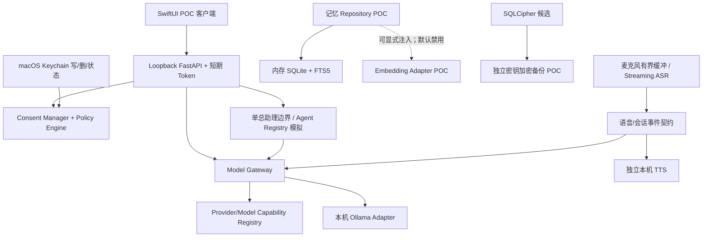

# 阶段 0 需求追踪与门禁矩阵

依据：`个人AI助理可执行开发规格书 v1.2.md` §13、§14、§15、§16、§20；`个人AI助理技术架构 V1.1.md` §16。该文档是阶段 0 的追踪记录，不修改产品决策或版本范围。

状态定义：`PASS` 仅表示列出的 POC 证据已实际取得；`PARTIAL` 表示有部分证据但验收项未齐；`BLOCKED` 表示有明确的外部前置条件阻止推进；`OPEN` 表示尚未测试或等待产品决策。模拟/契约测试不作为供应商端到端证据。用户已澄清“本机”指交付软件在本机开发、测试、运行，不排除后续在 Consent/Policy 授权后验证云 Provider。

**门禁变更（2026-11-08，C-007）**：本矩阵继续准确记录阶段 0 原始证据和缺口，但不再作为单用户 macOS 测试版整体开发的前置门槛。未完成项按对应功能启用或完整 V1/正式发布时补齐；状态仍保持 `PARTIAL/OPEN`，不得因延期改为通过。

## 1. 阶段 0 需求追踪矩阵

| 基线条目 | 阶段 0 要求 / 验收 | 状态 | 现有证据 | 缺口 / 下一步 |
|---|---|---|---|---|
| 阶段 0 工程基线 / CI | 仓库入口、依赖安装、Python/Swift 回归可重复运行 | PARTIAL | 2026-11-09 当前改动后 Python 全量 180 项、Swift 33 项通过；Swift 测试目标平台为 macOS 14.0；`uv lock --check`、`compileall` 通过。GitHub Actions 历史 `main` run `42489738004`（commit `51b9ab9`）及 `42475879541` 成功，日志分别记录当时 Python 162 项、Swift 31 项。SBOM 已按最新锁文件重生成，55/55 非根依赖匹配。当前 CI runner 为 macOS 26。 | 还没有当前改动的远端 CI 运行和实际 PR 事件；GitHub-hosted macOS 14 runner 已于 2026-11-02 退役，当前较新系统 CI 只能证明部署目标为 14.0 的构建/测试，不是 macOS 14 runtime 验证。Beta app 在真实 macOS 14 启动及安装流程仍需实际兼容设备/环境验证；参见 [GitHub runner 退役公告](https://github.blog/changelog/2026-10-01-github-actions-macos-14-runner-image-retirement/)。阶段验收状态未由实现者自行提升 |
| D-001/D-002、阶段 0 设备记录 | 记录并确认主力设备和最低系统要求 | PASS | 2026-11-09 刷新当前机况，且用户确认当前 MacBook Air `MacBookAir10,1` / Apple M1 / 16 GiB 为主力设备、最低 macOS 为 14.0；设备与工具快照见 `phase0-local-asr.md` 和 `DECISIONS.md` | 最低版本与 Beta 声明一致；完整最低系统 CI/安装包验证仍列在工程与发布条目，不作为本设备记录缺口 |
| D-003 数据保留 | 明确对话、安全日志、临时缓存和备份的保留策略 | PASS（决策） | 2026-11-09 用户确认不保存对话、安全日志 30 天、临时缓存退出/中断时清理；不备份对话；Beta 对话当前仅存进程内存 | Beta 尚未写持久安全日志；启用前需实现 30 天清理及 metadata-only 约束，不得记录正文、凭据或音频。模型资产/显式保留的模型缓存不属临时会话缓存 |
| D-004 音频缓存 | 确认有界音频上限及异常清理策略 | PASS（决策+Beta 用户路径） | 用户确认最多 30 秒（16 kHz 单声道 PCM16 为 960,000 字节）；Swift 采集层及 FastAPI 均有时长上限，取消/错误/应用退出路径调用 discard；新增实时 WebSocket 30 秒边界和断连 abort 回归；用户实机确认 final 入草稿、取消丢弃 partial、语音打断文字生成；录音中 Cmd-Q 后 app/backend 退出且重启无残留转写或录音 | AVAudioEngine 真实设备驱动故障仍无真实硬件注入证据；该缺口不否定已验证的用户取消/退出清理路径 |
| D-005 API 预算 | 明确周期、币种、提醒和硬限制 | PASS（决策） | 2026-11-09 用户确认自然月 100 元人民币，80 元提醒，100 元硬拦截并按月重置 | 当前 Beta 尚无跨 Provider 人民币费用归一或 enforcement；provider usage/cost 缺失、外币换算和并发一致性须在启用预算 UI/云 V1 前实现与验证，不得以 token 估值当成实扣费用 |
| D-006 备份 | 确认 V1 备份/恢复范围及恢复目标 | PASS（决策） | 2026-11-09 用户确认 V1 不提供备份/恢复；仅在未来加入持久数据时制定 RPO/RTO、份数和目的地 | 当前没有持久对话数据，也不实现备份/恢复 UI；SQLCipher/备份 POC 是故障证据，不代表 V1 有备份能力 |
| D-007 静态加密 | 确认 V1 是否引入持久化数据库及静态加密方案 | PASS（范围决策） | 2026-11-09 用户确认 V1 不保存会话、不备份且不设 app 数据库；持久化功能开始前再选加密方案 | ADR-019 仍 Deferred，直至引入持久化；现有 SQLCipher 兼容/恢复 POC 不能视为已选型或产品数据库加密 |
| D-008 外接盘数据目录 | 确认 V1 是否支持外接盘作为活动数据目录 | PASS（范围决策） | 2026-11-09 用户确认 V1 不支持外接盘作为活动数据目录；未来持久化功能再评估 | 该结论不涵盖模型权重/缓存存放位置，也不构成外接介质兼容性证据 |
| D-009 专业 Agent 分期 | 确认固定专业 Agent 交付版本 | PASS（决策） | 2026-11-09 用户确认 V2 提供少量固定专业 Agent，完整 Agent 集放 V3；V1 保持单总助理 | 当前 Agent Registry 仍为隔离的模拟 POC；本项只确定路线图，不批准在 V1 增加 Agent 团队或工具权限 |
| D-010 V1 Provider 范围 | 确认 V1 首批云 Provider 与路由区域 | PASS（决策） | 2026-11-09 用户确认默认千问应用 API，另支持 DeepSeek（中国）和 OpenRouter（Global） | 实际能力、取消行为、费用/区域 metadata、许可/条款及全量能力矩阵仍由 POC-02 单独追踪；未完成项不得从本范围决策推定通过 |
| D-012 文件导入 | 明确 V1 文件类型白名单及容量上限 | PASS（范围决策） | 2026-11-09 用户确认只读导入 TXT、Markdown、PDF，单文件最多 10 MB，须由用户主动选择 | 功能尚未实现；启用前须验证真实文件类型与大小校验、PDF 解析资源上限、无目录扫描/执行、路径边界和清理策略；决策不替代安全 POC |
| D-013 性能目标 | 明确本机启动、partial 和停止后 final 的 P95 目标 | PASS（决策） | 2026-11-09 用户确认主力 M1/16 GiB 上：启动 P95 ≤5 秒；ASR partial P95 ≤500 毫秒；停止录音至 final 草稿可用 P95 ≤2 秒 | 既有指标多为合成 WAV、CLI 或单帧推理；需新增 Beta 端到端采样并按该目标判断，不能从旧数据推定通过 |
| D-014 长期记忆/Embedding | 确认 V1 是否交付长期记忆，以及其 Embedding 方案 | PASS（范围决策） | 2026-11-09 用户确认 V1 不提供长期记忆/Embedding；产品模型/格式等持久化功能启动前再选 | POC 候选和 4 条合成 query 评估保留为研究证据，不构成产品 schema 或型号批准；未来启用前须有真实标注检索集和 migration/删除验证 |
| D-015 数据导出 | 确认 V1 数据导出范围及格式/加密选择时机 | PASS（范围决策） | 2026-11-09 用户确认 V1 不提供 app 数据导出；未来加入持久数据时再定格式和默认加密 | 当前无 app 数据库/持久对话，也不生成导出文件；未来导出启用前需完成加密、权限和可读性验证 |
| D-013 Beta GUI 性能样本 | 验证启动 P95≤5 秒、partial P95≤500 毫秒、停止→final P95≤2 秒 | PARTIAL | 用户提供 17 个启动值 0.5–0.7 秒（500–700 ms，nearest-rank P95=700 ms）；原面板遗漏秒到毫秒换算，已修复。截图确认同一运行新增 partial n=7/P95 32.5 ms 与 final 92.0 ms。partial 共 22 个窗口摘要（n=7/9/10，合计 216 更新，窗口 P95 32.2–41.5 ms）；停止→final 共 21 个 n=1 值，pooled nearest-rank P95=97.9 ms、最大 99.9 ms。三项当前样本均低于各自门槛 | 启动计时单位显示 bug 已修复；当前 17 个有效启动值的 P95=700 ms（≤5秒），按既定 20 次采样计划还需 3 个启动值后关闭本行。partial P95 摘要基于各窗口 n=7/9/10，按应用 nearest-rank 算法 P95 等于该窗口最大值，因此总体样本上界为 41.5 ms |
| ADR-021 V1 语音边界 | 确认本机实时 ASR、打断交互和排除项 | PASS（决策+Beta 用户路径） | 2026-11-09 用户确认点击触发本机实时 ASR；语音按钮可打断文字生成，final 入草稿；V1 不做 AEC、自动声学插话或云 Realtime。用户实机确认 final 入草稿、取消丢弃 partial、语音打断文字生成并开始采集、录音中 Cmd-Q 退出后重启无残留均成功 | 端到端 P95 与真实硬件驱动异常路径尚未验证；不把功能冒烟视为性能和全路径通过 |
| POC-01 / FR-VOICE-002/004 | 本地流式 partial/final、语句端点 | PARTIAL | 旧中文 Streaming 模型：8 条本机合成句均产生 final、59 partial、weighted CER 0.0；官方双语 Streaming Zipformer：合成中英 WAV 10/10 final、82 partial、weighted CER 0.0254；用户主动完成三次真实 CLI 麦克风采集并观察到流式 partial/final；用户确认 Beta partial 可见，并实机验证停止后 final 入草稿、取消清空 partial、语音按钮打断文字生成并开始采集、录音中 Cmd-Q 退出后重启无残留。最新 GUI 故障根因已在真实本机 ASR 离线复现：`LocalVoiceTranscriber.end_stream()`/`abort_stream()` 调用不存在的 `LocalStreamingASR.reset()`；cleanup 异常导致 finally 未释放 asyncio 会话锁。现通过底层 recognizer 重置、异常安全锁释放修复。Apple URLSessionWebSocketTask + 真实 Uvicorn WebSocket + 本机 ASR + PCM 文件连续 3 次均完成 partial/final/ended；Python 全量 180 项通过。此前 GUI 端曾见 socket 断开、第二次 busy，partial n=2、停止→final n=0；用户现已确认 GUI 修复完成。D-013 GUI 端到端 partial/final 延迟均低于门槛，详细样本见 D-013 性能行。识别质量按用户决定留待后续模型优化 | 本机双语 Zipformer 三个权重 SHA-256 已与固定公开模型 revision 完全匹配，仓库标注 Apache-2.0；训练数据权利链及随包 WAV 许可仍未核。Qwen ONNX 三个权重 SHA-256 已与 sherpa-onnx 固定镜像 revision 匹配；第三方转换代码/工件与测试 WAV 许可仍未核。真人语音质量留待模型选择，不以合成集结果代替 |
| POC-01 / FR-VOICE-005/008 | 本机 TTS 可打断；ASR/TTS 独立 | PARTIAL | AVSpeechSynthesizer CLI 实测立即打断；新增显式合成样本 ASR-final→AVSpeechSynthesizer 链路，5 条中文/英文/混说 manifest WAV 共 7/7 产生 final 并正常完成播放；拒绝路径无 TTS；详见 `phase0-local-asr.md` | 均为系统合成语音，不代表真人语料或长时稳定性；SwiftUI 集成属阶段 3，ASR/TTS 并发与产品性能阈值未验证 |
| POC-01 / FR-VOICE-006/007/010 | 本地默认；本地失败显式失败；不落盘、不静默云切换 | PARTIAL | ASR adapter 无云 fallback；麦克风仅内存队列；测试覆盖拒绝/溢出；新增 mock PortAudio 启动失败与 callback status 故障注入，验证缓冲清空和采集停止。D-011 现优先选千问 Token Plan/北京；文本 chat adapter 已有本地 mock，但云语音各接口仍未实现 | 实际设备驱动异常与系统级出站监测未完整执行；Token Plan 官方支持的实时语音 WebSocket、非实时云 ASR 和云 TTS 尚未接入；Consent/本机音频生命周期适配和实测待完成，接口记录见 `beta/qwen-token-plan-integration.md`；麦克风未打开时的一次 Ctrl-C 停止正常返回 |
| POC-01 性能 | ASR 与 Agent 同时运行的延迟、内存、CPU/GPU | PARTIAL | 两条本机合成 WAV 各有同步 barrier 的 ASR + 本机 Ollama LLM 观察：原 6.94 秒样本四轮、另一 28 帧样本三轮；后者重叠 0.243–0.254 秒、帧 P95 15.86–16.47 ms、Python + Ollama 进程 RSS 峰值 671,645,696–775,536,640 bytes。2026-11-09 对另一固定合成 WAV 做 20 次独立模型加载观察，每次 28 帧/10 partial/1 final；运行级帧 P95 范围 11.378–14.229 ms，运行级 P95 的 P95 为 13.721 ms。新增 GUI 测量模式后，用户提供 17 次有效启动值，已换算为 500–700 ms，P95=700 ms。 | 并发 ASR+Agent 的端到端 P95 分布仍未测；用户已确认快速二次录音故障已修复。Beta D-013 启动、partial 与停止→final 的独立测量均低于门槛；启动样本还差 3 次。partial 起点为 200 ms PCM 帧组装就绪、终点为 SwiftUI 状态更新；停止→final 从点击计至草稿更新；启动从 Beta App 初始化计至本机服务健康。离线帧耗时不能替代端到端测量 |
| POC-02 / FR-MODEL-001/002 | Adapter、统一流式契约、精确型号能力注册 | PARTIAL | 本机 Ollama generate/stream；qwen3.5:0.8b 一次真实本机 tool proposal；DeepSeek 与 OpenRouter 各一次真实 SSE 精确匹配；Qwen Token Plan `qwen3.8-flash` 交互式固定北京 chat adapter 经逐次 Consent 完成一次真实非流式文本探测，精确匹配，usage 73/50/123；MockTransport/默认拒绝回归通过，`sk-sp-` 前缀保护有效。千问AI平台官方支持该 OpenAI 兼容端点用于交互式 Agent 工具，同时排除自定义应用后端 | Qwen 真实证据仅一次文本请求；未测试 streaming/tools/JSON/错误/取消和重复稳定性。此次服务未返回下游 Provider、实际区域、费用。Token Plan 官方支持实时语音 WebSocket，尚未接入/实测；文本 adapter 已改用官方品牌域名，历史实测使用旧北京域名，新地址尚未另行真实探测。完整配置见 `beta/qwen-token-plan-integration.md`。OpenRouter/DeepSeek 既有结果见 `phase0-remote-provider.md`；Provider 侧停止生成证据和更广稳定性矩阵仍待补 |
| POC-02 阶段验收 | 2–3 家 Provider 端到端、开源 Gateway 对照、跨 Provider 切换 | PARTIAL | 本机 Ollama 有真实请求证据；用户分别逐次确认 DeepSeek 与 OpenRouter 独立合成请求及同一 ModelGateway 顺序路由，均精确匹配；两家 SSE 各有一次真实请求精确匹配；DeepSeek 与 OpenRouter tool proposal 各有一次真实成功且未执行；OpenRouter tool 响应路由到 Relace/HKG；单次独立文本请求另有 token/cost metadata；同一 Gateway 双 adapter 本地 MockTransport 路由回归通过；用户已确认 V1 保持自有 Gateway，第三方桌面对照见 `phase0-gateway-comparison.md` | OpenRouter tool proposal 第三次实测成功（前两次空结果）；OpenRouter JSON 一次实测通过并报告 Relace/HKG、USD 0.000018276；DeepSeek JSON 三次一空两成功且空正文原因/稳定性未明；两家各一次客户端取消实测成功，但 Provider 侧停止生成/计费未知；成功响应确认该次 API Key 可用；DeepSeek HTTP 422 与 OpenRouter HTTP 400 错误路径均实测且脱敏；DeepSeek 服务侧费用/区域 metadata 未提供（两次观测，一次 ACK 不匹配）；拒绝路径两家真实 HTTPX 均在 Adapter 前拒绝、PID 级 lsof 无活动 socket（正向对照可见），但不是完整包级证明；SSE/tool 证据仅单次成功 |
| POC-02 / FR-SEC-002/003/010 | 云请求严格 Consent + Policy，L3 默认拒绝 | PARTIAL | `ConsentAwarePolicy` 在 adapter 前拒绝无授权 generate/stream；精确匹配/撤销/过期/L3 路径测试；用户两次对 CLI 显示的 L1 合成请求逐次确认，DeepSeek 和 OpenRouter 均返回精确响应 | 真实 HTTPX 无 Consent harness 对 DeepSeek/OpenRouter 均在 Adapter 前拒绝且凭据读取=0；PID 级 lsof 观察无活动 socket，loopback 正向对照可见；全局 tcpdump 有流量但无法按 PID 归因；持久审计仍未实测；V1 尚未实现，详见 `phase0-consent-aware-gateway.md` |
| POC-03 / FR-AGENT-001/004 | Registry/Result 契约、权限不扩张、模拟与产品隔离 | PASS | 显式 simulation 标记、父权限交集、测试验证不运行产品 Agent | V1 总助理未实现；本项只限模拟接口验证 |
| POC-04 / FR-MEMORY-002/003/006/007/008 | 来源/claim/时间、纠错、FTS/派生索引删除和恢复 | PARTIAL | 内存 SQLite/FTS5，纠错 supersede、FTS/fixture embedding 删除、内存备份恢复测试；固定候选 provider 可显式注入 disposable `MemoryStore`；本机固定 Embedding 权重离线合成记忆检索 4/4 top-1 且返回来源，纠错/删除/恢复的派生向量测试通过，详见 `phase0-memory-embedding.md` | 无持久化产品 schema；Embedding 型号/性能目标未决，候选许可初核见 `phase0-model-license-review.md`；检索集仅 4 条合成查询；无模型重建 migration/多次崩溃/大数据评估 |
| POC-05 / FR-SEC-006/009/014 | Keychain 凭据、Touch ID/设备密码 gate、本机认证/Loopback | PARTIAL | Swift Keychain 写/删/状态接口；LocalAuthentication `.deviceOwnerAuthentication` 策略常量测试；token/Host/Origin/loopback 测试；集成 harness 两次重启 FastAPI 后由 Swift CLI 用新端口/新 token 重新握手；固定 Python 服务入口真实子进程测试；Swift `Foundation.Process` supervisor 实际启动固定模块、验证握手并经 LocalAPIClient 健康检查，再经 stdin stop/EOF 关闭，重复启动受保护且停止后可重启；无握手/非法 JSON 测试验证超时与子进程清理；异常退出后 caller 显式 restart 测试通过；owner deinit 后端不可访问测试通过；SwiftUI ViewModel 的启动/健康/停止 fake-controller 路径通过；本机 demo `.app` 实际点击启停、退出后无残留服务；本次再完成两轮停止/启动/健康检查，最后仅有一个受管理的后端进程；新增显式本机认证测试按钮；真实 demo 窗口两次认证成功、一次准确显示“用户取消了系统认证”，测试代码不访问钥匙串 | 异常退出自动恢复/有限退避、锁屏/休眠行为、正式分发配置未测；Secret scan 仅限 POC 范围 |
| POC-05 / FR-SEC-001/002/003 | L0–L3、授权和撤销策略 | PARTIAL | 内存 Consent/Policy 测试覆盖 provider/model/region/purpose/data level/action/source 精确匹配、过期、L3 deny、撤销状态保留；Gateway 从调用入口派生 generate/stream/tool-proposal 操作，测试确认不同操作授权不互通；窄回归 47 项通过，2026-11-09 Python 全量 176 项通过，详见 `phase0-consent-aware-gateway.md` | 审计持久化、Consent UI、并发撤销对在途请求的取消语义、真实 Provider 出站门禁证据仍未闭环；V1 尚未实现 |
| POC-05 / FR-SEC-007/008 | 静态加密兼容性、备份恢复及 ADR 证据 | PARTIAL | SQLCipher ARM64/Python 3.12、FTS5、错误密钥拒绝、加密备份/恢复（含 WAL 数据库）；复制/校验/原子替换失败时保留旧备份，校验后原子替换；复制部分页面后子进程 SIGKILL，在 DELETE/WAL 两种 mode 下旧目标仍可恢复、源库完整；新增在 `os.replace` 调用前/成功返回后 SIGKILL，旧/新目标分别可完整恢复，源库均完整；WAL reader/writer/checkpoint 注入；目标路径错误不损坏源 DB；临时 Alembic upgrade/downgrade、合成性能观察和 HFS+/APFS 有界映像 ENOSPC，详见相关 POC 报告 | 持续并发负载、WAL 生命周期、密钥管理、正式应用包分发、真实负载性能、外接介质/断电/介质故障未齐；系统调用内部中断与 fsync 持久性未测；ADR-019 按用户要求延期；崩溃 staging 清理策略待定 |
| 阶段 0 工程/恢复 | 崩溃、重启、磁盘不足和备份恢复故障注入 | PARTIAL | `os._exit` 与 DELETE/WAL 两种模式下子进程 SIGKILL 后未提交事务恢复；WAL TRUNCATE checkpoint 等待读锁期间 SIGKILL 恢复；活动 WAL reader 下 `busy=1` 可见且释放后 checkpoint 重试成功；页数上限、HFS+/APFS 有界映像 ENOSPC 回滚；复制中断保留旧备份；新增 `os.replace` 调用前 SIGKILL 保留旧目标、成功返回后 SIGKILL 保留新目标，两边源库/备份完整；备份复制：确定性注入 ENOSPC 与 APFS 临时映像真实 ENOSPC 均通过，旧目标/源库完整且 staging 清理 | 临时映像不代表系统卷/外接介质；系统调用内部中断、断电/fsync 持久性、真实介质故障和崩溃 staging 清理策略待定 |
| POC-04 本地 Embedding | 候选权重、真实向量与检索质量 | PARTIAL | 固定 revision 权重 SHA-256 完整校验；本机 FastEmbed 真实推理，4 个合成 query top-1 命中 4/4；HF/Transformers offline 环境二次加载通过；离线三次重复均 4/4 top-1，observed max RSS 883,130,368–883,490,816 bytes；Python 锁定依赖 CycloneDX SBOM 于 2026-11-09 更新，55/55 非根依赖匹配；当前 SwiftPM 无第三方 package；已清点 `.venv` 实际原生 wheel，见 `phase0-model-license-review.md` | 仅 4 条合成 query，不代表真实语义质量；真实检索集、SQLCipher memory 集成和模型选择未完成；Pillow wheel 含 GPL/LGPL 组件，SQLCipher/PortAudio/内嵌 ONNX Runtime 有独立通知要求；正式发行物、通知文件与产品性能目标未确认 |
| 全阶段安全边界 | 不自动扫描；无任意 Shell/文件访问；无外部写/后台队列/专业 Agent 团队 | PASS（范围审计） | 当前 POC 结构无产品文件扫描、任意 Shell、外部写或后台任务；Agent 仅模拟 | 后续实现须持续做静态与集成门禁，当前不构成产品级验收 |

## 2. 模块依赖图

依赖约束：UI 只经 Loopback API；Gateway adapter 不授予自身出站权；出站授权归 Consent/Policy；工具只能由 Tool Gateway 进入（当前没有任意执行器）；记忆不得赋予权限；ASR、TTS、LLM 分别配置。当前图描述 POC seams，不代表完整产品模块已交付。

## 3. 待确认 / 未决项

以下事项已按用户 2026-11-08 指示延期；延期不视为阶段 0 中明确要求的 POC/验收通过：

- 规格书 D-001–D-015 已由用户逐项确认或限定后续决策触发时机；D-003–D-008、D-014/D-015 为 V1 范围决策，D-011 为阶段 0 云语音候选方向。ADR-021 的 V1 窄语音边界已确认；决策通过不等于实现和 POC 证据通过，按各矩阵行分别追踪。
- 多语言 ASR：用户提供的 Qwen3-ASR 候选完成随包 WAV 离线测试；另有官方 sherpa-onnx 双语 streaming 模型在现有适配器上通过中英合成 WAV 分帧测试。后者证明文件回放路径产生 partial/final，不代表真人麦克风、独立语料或 SwiftUI 端到端通过；双语 Zipformer 与 Qwen ONNX 权重身份现分别与公开固定 revision 匹配，但训练数据权利链、Qwen 转换代码/工件及随包音频许可仍待核。
- 多 Provider 实测与开源 Gateway 对照：D-010 已确认 V1 默认千问应用 API，并支持 DeepSeek（中国）与 OpenRouter（Global）。DeepSeek/OpenRouter 各有一次用户逐次确认的合成文本请求成功；千问应用 API 的 Beta 用户报告可正常聊天。真实 Provider 请求仍须对应的精确 Consent + Policy，能力证据见 `phase0-remote-provider.md`，各供应商完整 E2E/费用和取消证据仍不足。
- 同一 ModelGateway 双 adapter 路由已有本地 MockTransport 与一次真实顺序调用证据；DeepSeek 和 OpenRouter SSE 各一次真实成功；两家 tool proposal 各一次成功且未执行（OpenRouter 前两次为空，第三次 Relace/HKG 成功）；OpenRouter JSON 成功，DeepSeek JSON 三次一空两成功；两家错误路径分别返回 HTTP 422/400。OpenRouter metadata 两次均 Relace/HKG；DeepSeek 两次均无服务端 Provider/区域/费用。deny-check tripwire 与真实 HTTPX 默认拒绝 harness 均通过；PID 级 lsof 无活动 socket，但全局 tcpdump 流量无法归因。脚本及实测结果见 `phase0-remote-provider.md`；LiteLLM、Bifrost、Portkey 第一方桌面资料对照已记录，但不代表运行集成。
- 真实 Touch ID 提示、应用正式进程生命周期、SwiftUI 麦克风链路及 AEC/插话。
- SQLCipher 产品 ADR 与密钥轮换/恢复体验、并发 WAL 备份、系统卷/外接介质 ENOSPC、断电/备份介质故障、发布打包和产品性能；APFS 临时映像数据库写入与备份目标 ENOSPC 已实测，不代表系统卷或外接介质。
- 本地 Embedding 候选许可复核、真实中英文检索集、向量质量和资源目标；当前仅有 4 条合成 query 的一次检索记录。模型/依赖公开许可线索见 `phase0-model-license-review.md` 和 `phase0-python-sbom.md`，完整发行物与通知闭包仍未完成。
- ASR/TTS/LLM 并发资源结果；P50/P95 门槛由产品负责人确认。

## 4. 阶段 / 工作包拆分与门禁

### 阶段 0（当前阶段，未验收）

1. 0A 仓库审计与基线记录：完成，不改动原功能/章节/schema/API。
2. 0B 本地语音链路：旧模型有中文 Streaming ASR；官方双语 Streaming Zipformer 对合成中英音频产生 partial/final；Qwen3-ASR ONNX 另有随包离线评估。用户已有三次真实设备麦克风 CLI partial/final 观察；Beta 用户已实机验证 partial、停止后 final 入草稿、取消清理、文字生成中点击打断及录音中 Cmd-Q 退出后无残留。最新快速重复录音曾报 WebSocket 服务 bad response；已查明 ASR stream reset 方法不存在并修复异常锁泄漏，用户现已确认 GUI 故障修复。模型质量留待后续选择。V1 已接受本机点击触发的实时 ASR/点击打断文字生成，不做 AEC/自动声学插话/云 Realtime。ASR-final→TTS 合成链路在 5 条中文/英文/混说 WAV 上共 7/7 完成并有报告；独立真人语料、长时/多负载资源证据、真实驱动异常仍缺。D-011 现优先采用千问 Token Plan/北京；应用内云语音仍需合规凭据、Consent 和对应接口实测。
3. 0C 本地 Gateway/能力注册/Agent 模拟：可测试骨架完成；DeepSeek 与 OpenRouter 有用户逐次确认的合成文本实测，同一 ModelGateway 顺序跨 Provider 路由一次通过，两家 SSE、工具提案、JSON 和 4xx 错误路径均有真实探测；另已加入 Qwen Token Plan 固定北京文本 adapter 和 `sk-sp-` 类型保护，并有一次用户逐次确认、精确匹配的真实文本请求（usage 73/50/123）；服务未返回 Provider/区域/费用。服务端取消语义、完整稳定性矩阵及 Qwen 逐项能力仍待补证。
4. 0D 记忆 POC：SQLite/FTS/来源/纠错/删除/恢复已测；本地 Embedding 候选以 opt-in provider 接入内存仓库并完成 4 条合成查询；产品模型、持久化 schema 与真实检索质量仍 OPEN。
5. 0E Swift/Loopback/Keychain/Consent：部分完成；策略支持 Touch ID 或设备密码，fake evaluator 路径已测；POC SwiftUI demo 启停/退出清理及两轮 GUI 启停已实机验证；真实系统认证成功两次、用户取消一次，测试代码不访问钥匙串；异常自动恢复/退避、锁屏行为及正式分发配置仍 OPEN。
6. 0F SQLCipher：兼容性与临时 migration POC 部分完成；产品 ADR 及故障面 OPEN。
7. 0G Embedding：真实模型已下载并离线加载，固定 revision 权重完整性、FastEmbed 本机真实向量和 offline 二次加载已验证；4 条合成 query top-1 为 4/4；真实检索质量、重复性能和模型选择未验收。当前 SwiftPM 无第三方 package，demo 使用独立 `.venv`。许可审查已确认本机双语 Zipformer 与 Qwen ONNX 权重分别 SHA-256 匹配公开固定 revision；模型页/源模型许可有声明，但训练数据、Qwen 转换工件与随包音频的许可仍未确认；全量发行物与通知闭包未完成。
8. 0H 故障注入/性能：事务崩溃、页数限制、WAL reader contention/checkpoint 重试、HFS+/APFS 临时映像数据库写入 ENOSPC 和 APFS 临时映像真实备份 staging ENOSPC 已测；系统卷/外接介质 ENOSPC、checkpoint 写页中断、断电/介质故障和产品语音并发性能未验证。
9. 0I 阶段追踪与验收：本矩阵建立；待所有必须验收项有证据且待决项被确认或延期，才能评审阶段 0。

阶段 0 未签收前禁止开始阶段 1 完整产品实现。D-001–D-015 与 ADR-019/020/021/022 的延期记录不等于对应阶段验收证据齐全；0I 仍须逐条复核必需验收项。

### 后续基线阶段（尚未开始）

| 阶段 | 范围 | 进入条件 |
|---|---|---|
| 1 | V1 工程底座、安全底座、Alembic 产品 schema | 阶段 0 已验收；关键 ADR/产品决策确认 |
| 2 | 对话、总助理、Model Gateway、Usage/预算 | 阶段 1 工程与安全门禁通过 |
| 3 | SwiftUI 实时语音闭环 | 阶段 0 语音方案/协议和隐私门槛通过；阶段 3 才实现 SwiftUI 采集、WebSocket、AEC、锁屏与休眠行为 |
| 4 | 记忆产品化、用户选中文件导入 | schema/加密/保留/Embedding 决策可执行 |
| 5 | Tool Gateway 加固、加密备份、健康与恢复 | 授权与恢复设计确认 |
| 6 | V1 E2E、真实设备、发布候选 | AC-001–AC-020 有实际证据，所有阻断项关闭 |

2026-11-09 注：按用户要求，单用户 Beta 的 B2 已提前加入本机实时 ASR/WebSocket、临时 partial/final 草稿边界及点击打断文字生成；用户已确认录音 partial 可见，并实机验证停止 final 入草稿、取消清空 partial、语音按钮打断文字生成并开始采集、录音中 Cmd-Q 退出后 app/backend 清理。20 次离线合成帧耗时观察已记录；用户提供 17 次 App 启动值，单位换算后 P95 为 700 ms；用户提供的 GUI partial/final 端到端性能样本均低于门槛；启动计时单位错误已修复，17 个值为 500–700 ms，仍需按采样计划补 3 次，详见 D-013 行。用户已确认修复构建的快速重复录音故障；D-013 GUI 端到端样本已低于性能门槛，启动计时尚差 3 个计划样本。真实设备驱动故障路径未作硬件注入。AEC/自动声学插话/云 Realtime 不在 V1 ADR-021 范围。阶段 3 完整语音体验仍未验收。

V1.1 及 V2–V5 仅按规格书规划；当前不实施后台任务、专业 Agent 团队、外部连接器/写操作、跨设备或多用户能力。

## 5. 风险清单

| 风险 | 影响 | 当前缓解 | 剩余事项 |
|---|---|---|---|
| ASR 候选与流式能力 | 中文与官方中英双语 Streaming 模型均已接入本机候选；Qwen3-ASR 0.6B INT8 ONNX 为单独离线候选 | 保持本地推理；不静默云 fallback；区分文件分帧和 OfflineRecognizer 证据 | 双语 Zipformer 10 条合成音频 weighted CER 0.0254；Qwen3 五条随包 WAV CER/RTF 见报告；独立语料、真人麦克风和 Qwen ONNX 转换包许可待测 |
| 短合成样本无法代表真实语音 | 延迟/准确率/噪声鲁棒性被高估 | 明确记录同一 WAV 三次的观察范围，不设承诺 | 独立语料、真人麦克风重复与产品阈值待定 |
| 真实 Provider 能力矩阵不完整 | 无法证明跨 Provider 切换、流式/工具/JSON/错误/费用/区域能力 | DeepSeek 与 OpenRouter 经逐次 Consent 的 L1 合成非流式请求成功；同一 ModelGateway 顺序真实路由一次成功；本地 mock 路由回归；deny-check tripwire 断言 Keychain/HTTP transport 触发次数均为 0；真实 HTTPX client 默认拒绝 harness 对两家均在 Adapter 前拒绝且凭据读取=0；PID 级 lsof 无活动 socket，loopback 正向对照可见；unknown-by-default；ConsentAwarePolicy 默认拒绝 | 真实 Provider/Gateway 实测尚缺：DeepSeek 服务侧费用/区域 metadata 缺失；DeepSeek JSON 三次一空两成功，空正文根因未知；两家 Provider 侧停止生成语义与更多稳定性样本（DeepSeek/OpenRouter 客户端首片段取消各一次成功）；全局 tcpdump 捕获到的 546 个包无法按 PID 归因；lsof 为活动 socket 快照而非包级完整证明；跨 Provider 实测不是自动 fallback |
| Consent 仅内存、策略字段不全 | 重启/持久审计后授权可能无法证明 | POC 无云出站、默认拒绝 | 产品阶段实现完整 schema/migration/audit |
| SQLCipher POC 不是发布形态验证 | DB/备份/打包或恢复失败；异常终止可能遗留加密 staging 文件 | ARM64 本机 migration；备份复制中 SIGKILL 后旧目标仍可恢复且源库完整；三轮合成性能对照；HFS+/APFS 有界映像数据库 ENOSPC 后源库与备份均恢复；APFS 备份目标真实 ENOSPC 后旧目标与源库完整、staging 清理；候选资料对照已记录、未作选型 | ADR、SEE/文件容器实测、打包、灾难恢复、staging 生命周期和真实负载性能；未测系统卷/外接介质 ENOSPC、断电/介质故障 |
| Embedding 合成集过小且 observed RSS 较高 | 语义质量或资源占用不达产品目标 | 固定 revision 权重校验；离线加载；4 条合成 query 的三次进程观察见报告；锁定依赖 SBOM 已生成 | 真实标注检索集、许可证闭包、扩展性能分布与产品阈值 |
| 真实认证与正式运行策略未验收 | 敏感入口和进程恢复风险 | `.deviceOwnerAuthentication` fake evaluator 测试；demo 显式按钮触发真实系统认证成功两次、用户取消一次，界面均显示未访问钥匙串；fake 回归区分系统中断与普通失败；SwiftUI POC demo 启停/退出清理实测；supervisor 超时/退出集成回归 | 正式签名分发、自动恢复/退避、锁屏/休眠策略 |
| POC 与产品容易混淆 | 误将模拟视为完成承诺 | 报告标 POC、能力需要证据 | 每项产品功能进入正式实现仍需独立契约与验收 |

## 6. 阶段状态

**阶段 0：未验收。阶段 1：未开始。** 当前测试通过只证明各自 POC 覆盖路径；不能代替阶段 0 全部验收条款、产品决策或 V1 Definition of Done。
