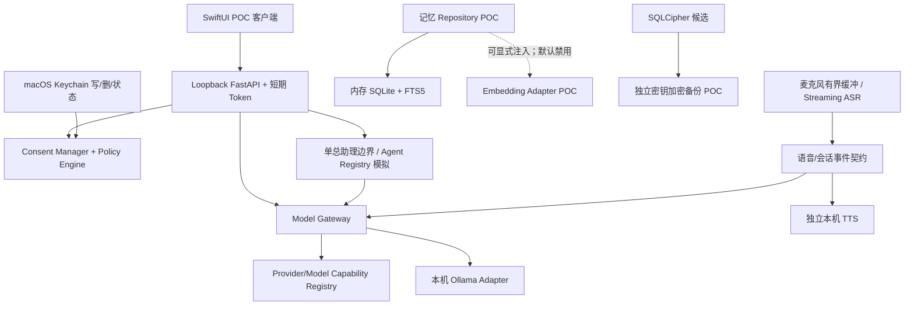

# 阶段 0 需求追踪与门禁矩阵

依据：`个人AI助理可执行开发规格书 v1.2.md` §13、§14、§15、§16、§20；`个人AI助理技术架构 V1.1.md` §16。该文档是阶段 0 的追踪记录，不修改产品决策或版本范围。

状态定义：`PASS` 仅表示列出的 POC 证据已实际取得；`PARTIAL` 表示有部分证据但验收项未齐；`BLOCKED` 表示有明确的外部前置条件阻止推进；`OPEN` 表示尚未测试或等待产品决策。模拟/契约测试不作为供应商端到端证据。用户已澄清“本机”指交付软件在本机开发、测试、运行，不排除后续在 Consent/Policy 授权后验证云 Provider。

## 1. 阶段 0 需求追踪矩阵

| 基线条目 | 阶段 0 要求 / 验收 | 状态 | 现有证据 | 缺口 / 下一步 |
|---|---|---|---|---|
| 阶段 0 工程基线 / CI | 仓库入口、依赖安装、Python/Swift 回归可重复运行 | PARTIAL | 新增根 `README.md`、`AGENTS.md`、GitHub Actions macOS arm64 workflow；本机等价命令最新记录为 Python 139 项、Swift 27 项通过，`uv lock --check`、`compileall` 和 YAML 语法通过 | 仓库未配置 Git remote，GitHub Actions 首次执行未验证；PR/push 真实 CI 状态仍待有 remote 后取得 |
| D-001、阶段 0 设备记录 | 记录型号、内存、macOS、磁盘、音频设备 | PARTIAL | 2026-11-07 快照：MacBook Air `MacBookAir10,1`、M1/16 GiB、macOS 26.5.1 (25F80)、Xcode 26.6、Swift 6.3.3、uv Python 3.12.13、数据卷剩余约 18 GiB、内建音频输入/输出 48 kHz，见 ASR 报告；2026-11-08 用户将未决事项延期 | 记录了设备快照，但用户未确认其为产品主力设备；最低 macOS 与设备门槛按用户要求延期 |
| POC-01 / FR-VOICE-002/004 | 本地流式 partial/final、语句端点 | PARTIAL | 旧中文 Streaming 模型：8 条本机合成句均产生 final、59 partial、weighted CER 0.0；官方双语 Streaming Zipformer：合成中英 WAV 10/10 final、82 partial、weighted CER 0.0254；用户主动完成两次真实 CLI 麦克风采集，均观察到流式 partial/final，第二次在 30 秒内产生 final。用户将当前真人语音目标定为功能冒烟，识别质量留待后续模型选择；详情见 `phase0-local-asr.md` | 已证明 CLI 能采集并产生 partial/final；重复一致性、停止/异常清理、SwiftUI 集成、性能仍缺证据。转写错词按用户要求暂缓质量验收；Qwen ONNX 转换包及随包音频许可待核 |
| POC-01 / FR-VOICE-005/008 | 本机 TTS 可打断；ASR/TTS 独立 | PARTIAL | AVSpeechSynthesizer CLI 实测打断；ASR、TTS POC 分开 | SwiftUI 集成与 ASR/TTS 并发未验证 |
| POC-01 / FR-VOICE-006/007/010 | 本地默认；本地失败显式失败；不落盘、不静默云切换 | PARTIAL | ASR adapter 无云 fallback；麦克风仅内存队列；测试覆盖拒绝/溢出 | 麦克风真实异常与系统级出站监测未完整执行 |
| POC-01 性能 | ASR 与 Agent 同时运行的延迟、内存、CPU/GPU | PARTIAL | 同一条本机合成 WAV 的独立 ASR 进程重复 3 次，帧 P50 16.01–16.51 ms、P95 17.22–31.78 ms、RTF 0.0527–0.0665；另有一次同步 barrier 的 ASR + 本机 Ollama LLM 生成，重叠 0.785 秒、帧 P95 52.17 ms、Python + Ollama 进程 RSS 采样峰值 702,267,392 bytes、CPU 时间差约 10.95 秒；不是完整 Agent | 同一短合成 WAV 重复不代表独立样本；并发只有单次；不是麦克风端到端；采样间隔 1 秒；GPU 未测；目标阈值未决 |
| POC-02 / FR-MODEL-001/002 | Adapter、统一流式契约、精确型号能力注册 | PARTIAL | 本机 Ollama generate/stream；qwen3.5:0.8b 一次真实本机 tool proposal；DeepSeek 与 OpenRouter 各一次真实 SSE 精确匹配；DeepSeek `deepseek-flash` 在显式关闭 thinking 后返回正确合成 tool proposal；OpenRouter 工具端点参数过滤已加入；unknown-by-default registry；MockTransport 测试 schema、tool_choice 和解析 | OpenRouter tool proposal 经参数过滤后待复测；两家 JSON/错误、费用重复、远端取消及其他型号能力仍无完整证据；DeepSeek tool 仅一次，不代表稳定性 |
| POC-02 阶段验收 | 2–3 家 Provider 端到端、开源 Gateway 对照、跨 Provider 切换 | PARTIAL | 本机 Ollama 有真实请求证据；用户分别逐次确认 DeepSeek 与 OpenRouter 独立合成请求及同一 ModelGateway 顺序路由，均精确匹配；两家 SSE 各有一次真实请求精确匹配；DeepSeek tool proposal 一次真实成功且未执行；OpenRouter 实测返回 Relace/HKG，单次独立请求另有 token/cost metadata；同一 Gateway 双 adapter 本地 MockTransport 路由回归通过；Gateway 对照见 `phase0-gateway-comparison.md` | OpenRouter tool proposal 尚未实测成功；两家 JSON/错误、系统级拒绝零出站、费用/区域重复核验仍未完成；SSE/tool 证据仅单次成功；ADR-020 已延期 |
| POC-02 / FR-SEC-002/003/010 | 云请求严格 Consent + Policy，L3 默认拒绝 | PARTIAL | `ConsentAwarePolicy` 在 adapter 前拒绝无授权 generate/stream；精确匹配/撤销/过期/L3 路径测试；用户两次对 CLI 显示的 L1 合成请求逐次确认，DeepSeek 和 OpenRouter 均返回精确响应 | 当前仅验证两条明确授权的真实路径；拒绝/撤销后的真实网络零出站与持久审计仍未实测；V1 尚未实现，详见 `phase0-consent-aware-gateway.md` |
| POC-03 / FR-AGENT-001/004 | Registry/Result 契约、权限不扩张、模拟与产品隔离 | PASS | 显式 simulation 标记、父权限交集、测试验证不运行产品 Agent | V1 总助理未实现；本项只限模拟接口验证 |
| POC-04 / FR-MEMORY-002/003/006/007/008 | 来源/claim/时间、纠错、FTS/派生索引删除和恢复 | PARTIAL | 内存 SQLite/FTS5，纠错 supersede、FTS/fixture embedding 删除、内存备份恢复测试；固定候选 provider 可显式注入 disposable `MemoryStore`；本机离线合成记忆检索 3/3 top-1 且返回来源，纠错/删除/恢复的派生向量测试通过，详见 `phase0-memory-embedding.md` | 无持久化产品 schema；Embedding 型号/性能目标未决，候选许可初核见 `phase0-model-license-review.md`；检索集仅 3 条合成查询；无模型重建 migration/多次崩溃/大数据评估 |
| POC-05 / FR-SEC-006/009/014 | Keychain 凭据、Touch ID/设备密码 gate、本机认证/Loopback | PARTIAL | Swift Keychain 写/删/状态接口；LocalAuthentication `.deviceOwnerAuthentication` 策略常量测试；token/Host/Origin/loopback 测试；集成 harness 两次重启 FastAPI 后由 Swift CLI 用新端口/新 token 重新握手；固定 Python 服务入口真实子进程测试；Swift `Foundation.Process` supervisor 实际启动固定模块、验证握手并经 LocalAPIClient 健康检查，再经 stdin stop/EOF 关闭，重复启动受保护且停止后可重启；无握手/非法 JSON 测试验证超时与子进程清理；异常退出后 caller 显式 restart 测试通过；owner deinit 后端不可访问测试通过；SwiftUI ViewModel 的启动/健康/停止 fake-controller 路径通过；本机 demo `.app` 实际点击启停、退出后无残留服务 | 真实系统认证提示、异常退出自动恢复/有限退避、锁屏策略、多轮/休眠 GUI 交互、正式分发配置未测；Secret scan 仅限 POC 范围 |
| POC-05 / FR-SEC-001/002/003 | L0–L3、授权和撤销策略 | PARTIAL | 内存 Consent/Policy 测试覆盖 exact match、过期、L3 deny、撤销 | action/source scope 和持久审计未齐；无真实云出站验证 |
| POC-05 / FR-SEC-007/008 | 静态加密兼容性、备份恢复及 ADR 证据 | PARTIAL | SQLCipher ARM64/Python 3.12、FTS5、错误密钥拒绝、加密备份/恢复（含 WAL 数据库）；复制/校验/原子替换失败时保留旧备份，校验后原子替换；复制部分页面后子进程 SIGKILL，在 DELETE/WAL 两种 mode 下旧目标仍可恢复、源库完整；新增在 `os.replace` 调用前/成功返回后 SIGKILL，旧/新目标分别可完整恢复，源库均完整；WAL reader/writer/checkpoint 注入；目标路径错误不损坏源 DB；临时 Alembic upgrade/downgrade、合成性能观察和 HFS+/APFS 有界映像 ENOSPC，详见相关 POC 报告 | 持续并发负载、WAL 生命周期、密钥管理、正式应用包分发、真实负载性能、外接介质/断电/介质故障未齐；系统调用内部中断与 fsync 持久性未测；ADR-019 按用户要求延期；崩溃 staging 清理策略待定 |
| 阶段 0 工程/恢复 | 崩溃、重启、磁盘不足和备份恢复故障注入 | PARTIAL | `os._exit` 与 DELETE/WAL 两种模式下子进程 SIGKILL 后未提交事务恢复；WAL TRUNCATE checkpoint 等待读锁期间 SIGKILL 恢复；活动 WAL reader 下 `busy=1` 可见且释放后 checkpoint 重试成功；页数上限、HFS+/APFS 有界映像 ENOSPC 回滚；复制中断保留旧备份；新增 `os.replace` 调用前 SIGKILL 保留旧目标、成功返回后 SIGKILL 保留新目标，两边源库/备份完整 | 边界测试不模拟系统调用内部中断或断电/fsync 持久性；临时映像不代表活动卷/外接介质；正式 App 重启、真实介质故障及崩溃 staging 清理策略待定 |
| POC-04 本地 Embedding | 候选权重、真实向量与检索质量 | PARTIAL | 固定 revision 权重 SHA-256 完整校验；本机 FastEmbed 真实推理，4 个合成 query top-1 命中 4/4；HF/Transformers offline 环境二次加载通过；离线三次重复均 4/4 top-1，observed max RSS 883,130,368–883,490,816 bytes；Python 锁定依赖 CycloneDX SBOM 覆盖 uv.lock 54/54 个包，见 `phase0-python-sbom.md` | 仅 4 条合成 query，不代表真实语义质量；真实检索集、SQLCipher memory 集成和模型选择未完成；SBOM 未携许可证字段，完整许可证闭包及产品性能目标未确认 |
| 全阶段安全边界 | 不自动扫描；无任意 Shell/文件访问；无外部写/后台队列/专业 Agent 团队 | PASS（范围审计） | 当前 POC 结构无产品文件扫描、任意 Shell、外部写或后台任务；Agent 仅模拟 | 后续实现须持续做静态与集成门禁，当前不构成产品级验收 |

## 2. 模块依赖图

依赖约束：UI 只经 Loopback API；Gateway adapter 不授予自身出站权；出站授权归 Consent/Policy；工具只能由 Tool Gateway 进入（当前没有任意执行器）；记忆不得赋予权限；ASR、TTS、LLM 分别配置。当前图描述 POC seams，不代表完整产品模块已交付。

## 3. 待确认 / 未决项

以下事项已按用户 2026-11-08 指示延期；延期不视为阶段 0 中明确要求的 POC/验收通过：

- 规格书 D-001–D-015：主力设备；最低 macOS；对话/日志/缓存/备份保留期限；音频缓存期限；月预算/币种/软硬阈值；备份 RPO/RTO/份数/目的地；应用静态加密方案；活动数据目录是否支持外接盘；固定专业 Agent 属 V2 还是 V3；V1 首批 2–3 Provider；云 ASR/TTS 供应商及区域；导入白名单/容量限制；性能目标；Embedding 型号/格式；导出格式/默认加密。
- 多语言 ASR：用户提供的 Qwen3-ASR 候选完成随包 WAV 离线测试；另有官方 sherpa-onnx 双语 streaming 模型在现有适配器上通过中英合成 WAV 分帧测试。后者证明文件回放路径产生 partial/final，不代表真人麦克风、独立语料或 SwiftUI 端到端通过；Qwen ONNX 转换包许可仍待核。
- 多 Provider 实测与开源 Gateway 对照：D-010 延期；用户确认 DeepSeek（中国）与 OpenRouter（Global）为 POC 候选。两家各有一次用户逐次确认的合成文本请求成功；固定 Keychain 读取路径已接入 Provider Adapter，后续每个出站请求仍须由 Consent Manager + Policy Engine 明确放行。
- 同一 ModelGateway 双 adapter 路由已有本地 MockTransport 与一次真实顺序调用证据；DeepSeek 和 OpenRouter SSE 各有一次真实成功，DeepSeek tool proposal 真实成功一次。逐 Provider 能力探测 CLI 已就绪，OpenRouter 工具、JSON/错误能力和多次费用/区域核验仍缺。拒绝 tripwire 证明进程内 HTTP transport 零调用，不是系统级抓包。脚本及实测结果见 `phase0-remote-provider.md`；LiteLLM、Bifrost、Portkey 第一方桌面资料对照已记录，但不代表运行集成。
- 真实 Touch ID 提示、应用正式进程生命周期、SwiftUI 麦克风链路及 AEC/插话。
- SQLCipher 产品 ADR 与密钥轮换/恢复体验、并发 WAL 备份、APFS/外接介质 ENOSPC、断电/备份介质故障、发布打包和产品性能。
- 本地 Embedding 候选许可复核、真实中英文检索集、向量质量和资源目标；当前仅有 4 条合成 query 的一次检索记录。
- ASR/TTS/LLM 并发资源结果；P50/P95 门槛由产品负责人确认。

## 4. 阶段 / 工作包拆分与门禁

### 阶段 0（当前阶段，未验收）

1. 0A 仓库审计与基线记录：完成，不改动原功能/章节/schema/API。
2. 0B 本地语音链路：旧模型有中文 Streaming ASR；官方双语 Streaming Zipformer 对合成中英音频产生 partial/final；Qwen3-ASR ONNX 另有随包离线评估。用户已两次在真实设备上运行麦克风 CLI 并观察到 partial/final，按用户指示当前以功能冒烟为准，模型质量留待后续选择；SwiftUI 集成、异常/停止清理和性能仍未验收。
3. 0C 本地 Gateway/能力注册/Agent 模拟：可测试骨架完成；DeepSeek 与 OpenRouter 有用户逐次确认的合成文本实测，同一 ModelGateway 顺序跨 Provider 路由一次通过，两家 SSE 各一次通过；完整工具/JSON/错误能力矩阵仍待补证。
4. 0D 记忆 POC：SQLite/FTS/来源/纠错/删除/恢复已测；本地 Embedding 候选以 opt-in provider 接入内存仓库并完成 3 条合成查询；产品模型、持久化 schema 与真实检索质量仍 OPEN。
5. 0E Swift/Loopback/Keychain/Consent：部分完成；策略支持 Touch ID 或设备密码，fake evaluator 路径已测；POC SwiftUI demo 启停/退出清理已实机验证；真实认证提示、异常自动恢复/退避、锁屏行为及正式分发配置仍 OPEN。
6. 0F SQLCipher：兼容性与临时 migration POC 部分完成；产品 ADR 及故障面 OPEN。
7. 0G Embedding：真实模型已下载并离线加载，固定 revision 权重完整性、FastEmbed 本机真实向量和 offline 二次加载已验证；4 条合成 query top-1 为 4/4；真实检索质量、重复性能和模型选择未验收。
8. 0H 故障注入/性能：事务崩溃、页数限制、WAL reader contention/checkpoint 重试、48 MiB HFS+ 临时映像 ENOSPC 已测；APFS/外接介质 ENOSPC、checkpoint 执行中断、介质故障和语音并发性能未验证。
9. 0I 阶段追踪与验收：本矩阵建立；待所有必须验收项有证据且待决项被确认或延期，才能评审阶段 0。

阶段 0 未签收前禁止开始阶段 1 完整产品实现。D-001–D-015 与 ADR-019/020/021/022 的延期记录不等于对应阶段验收证据齐全；0I 仍须逐条复核必需验收项。

### 后续基线阶段（尚未开始）

| 阶段 | 范围 | 进入条件 |
|---|---|---|
| 1 | V1 工程底座、安全底座、Alembic 产品 schema | 阶段 0 已验收；关键 ADR/产品决策确认 |
| 2 | 对话、总助理、Model Gateway、Usage/预算 | 阶段 1 工程与安全门禁通过 |
| 3 | SwiftUI 实时语音闭环 | 阶段 0 语音方案/协议和隐私门槛通过 |
| 4 | 记忆产品化、用户选中文件导入 | schema/加密/保留/Embedding 决策可执行 |
| 5 | Tool Gateway 加固、加密备份、健康与恢复 | 授权与恢复设计确认 |
| 6 | V1 E2E、真实设备、发布候选 | AC-001–AC-020 有实际证据，所有阻断项关闭 |

V1.1 及 V2–V5 仅按规格书规划；当前不实施后台任务、专业 Agent 团队、外部连接器/写操作、跨设备或多用户能力。

## 5. 风险清单

| 风险 | 影响 | 当前缓解 | 剩余事项 |
|---|---|---|---|
| ASR 候选与流式能力 | 中文与官方中英双语 Streaming 模型均已接入本机候选；Qwen3-ASR 0.6B INT8 ONNX 为单独离线候选 | 保持本地推理；不静默云 fallback；区分文件分帧和 OfflineRecognizer 证据 | 双语 Zipformer 10 条合成音频 weighted CER 0.0254；Qwen3 五条随包 WAV CER/RTF 见报告；独立语料、真人麦克风和 Qwen ONNX 转换包许可待测 |
| 短合成样本无法代表真实语音 | 延迟/准确率/噪声鲁棒性被高估 | 明确记录同一 WAV 三次的观察范围，不设承诺 | 独立语料、真人麦克风重复与产品阈值待定 |
| 真实 Provider 能力矩阵不完整 | 无法证明跨 Provider 切换、流式/工具/JSON/错误/费用/区域能力 | DeepSeek 与 OpenRouter 经逐次 Consent 的 L1 合成非流式请求成功；同一 ModelGateway 顺序真实路由一次成功；本地 mock 路由回归；deny-check tripwire 断言 Keychain/HTTP transport 触发次数均为 0；unknown-by-default；ConsentAwarePolicy 默认拒绝 | 真实 Provider/Gateway 实测尚缺：流式/工具/JSON/错误、重复费用/区域与稳定性；deny-check 不是系统级抓包；跨 Provider 实测不是自动 fallback |
| Consent 仅内存、策略字段不全 | 重启/持久审计后授权可能无法证明 | POC 无云出站、默认拒绝 | 产品阶段实现完整 schema/migration/audit |
| SQLCipher POC 不是发布形态验证 | DB/备份/打包或恢复失败；异常终止可能遗留加密 staging 文件 | ARM64 本机 migration；备份复制中 SIGKILL 后旧目标仍可恢复且源库完整；三轮合成性能对照；有界 HFS+ 映像 `SQLITE_FULL` 后源库与备份均恢复；候选资料对照已记录、未作选型 | ADR、SEE/文件容器实测、打包、灾难恢复、staging 生命周期和真实负载性能；未测 APFS/外接介质 ENOSPC、断电/介质故障 |
| Embedding 合成集过小且 observed RSS 较高 | 语义质量或资源占用不达产品目标 | 固定 revision 权重校验；离线加载；4 条合成 query 的三次进程观察见报告；锁定依赖 SBOM 已生成 | 真实标注检索集、许可证闭包、扩展性能分布与产品阈值 |
| 真实认证与正式运行策略未验收 | 敏感入口和进程恢复风险 | `.deviceOwnerAuthentication` fake evaluator 测试；SwiftUI POC demo 启停/退出清理实测；supervisor 超时/退出集成回归 | 系统认证提示、正式签名分发、自动恢复/退避、锁屏/休眠策略 |
| POC 与产品容易混淆 | 误将模拟视为完成承诺 | 报告标 POC、能力需要证据 | 每项产品功能进入正式实现仍需独立契约与验收 |

## 6. 阶段状态

**阶段 0：未验收。阶段 1：未开始。** 当前测试通过只证明各自 POC 覆盖路径；不能代替阶段 0 全部验收条款、产品决策或 V1 Definition of Done。
