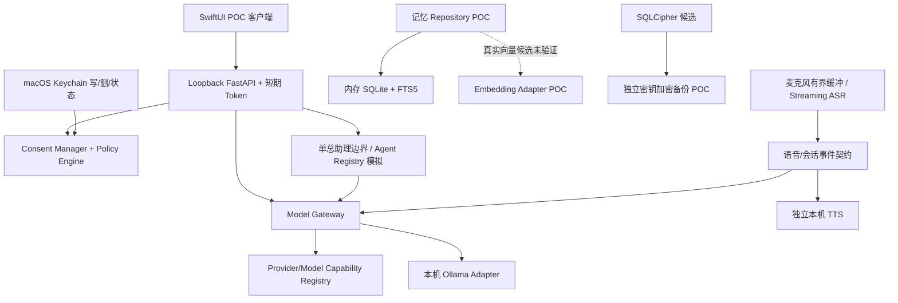

# 阶段 0 需求追踪与门禁矩阵

依据：`个人AI助理可执行开发规格书 v1.2.md` §13、§14、§15、§16、§20；`个人AI助理技术架构 V1.1.md` §16。该文档是阶段 0 的追踪记录，不修改产品决策或版本范围。

状态定义：`PASS` 仅表示列出的 POC 证据已实际取得；`PARTIAL` 表示有部分本机证据但验收项未齐；`BLOCKED` 表示当前“开发、测试、使用均在本机”的约束使所需真实外部证据不能取得；`OPEN` 表示尚未测试或等待产品决策。模拟/契约测试不作为供应商端到端证据。

## 1. 阶段 0 需求追踪矩阵

| 基线条目 | 阶段 0 要求 / 验收 | 状态 | 现有证据 | 缺口 / 下一步 |
|---|---|---|---|---|
| D-001、阶段 0 设备记录 | 记录型号、内存、macOS、磁盘、音频设备 | PARTIAL | M1/16 GiB、macOS 26.5.1、采集时空间约 18–19 GiB、系统音频设备，见 ASR 报告 | 设备空间与设备列表是时点记录；主力设备仍待产品负责人确认 |
| POC-01 / FR-VOICE-002/004 | 本地流式 partial/final、语句端点 | PARTIAL | 合成 WAV 多个 partial、final；用户实机反馈麦克风可录音 | 固定真实语音集、重复轮次、麦克风 partial/final 停止/异常清理记录不完整；英语识别未解决并按用户指示暂缓 |
| POC-01 / FR-VOICE-005/008 | 本机 TTS 可打断；ASR/TTS 独立 | PARTIAL | AVSpeechSynthesizer CLI 实测打断；ASR、TTS POC 分开 | SwiftUI 集成与 ASR/TTS 并发未验证 |
| POC-01 / FR-VOICE-006/007/010 | 本地默认；本地失败显式失败；不落盘、不静默云切换 | PARTIAL | ASR adapter 无云 fallback；麦克风仅内存队列；测试覆盖拒绝/溢出 | 麦克风真实异常与系统级出站监测未完整执行 |
| POC-01 性能 | ASR 与 Agent 同时运行的延迟、内存、CPU/GPU | PARTIAL | 短合成 WAV 单次分帧耗时、RTF、CPU 时间、进程峰值 RSS 已记录 | 不是麦克风端到端或并发负载；没有重复样本分布；目标阈值未决 |
| POC-02 / FR-MODEL-001/002 | Adapter、统一流式契约、精确型号能力注册 | PARTIAL | 本机 Ollama generate/stream；unknown-by-default capability registry；契约测试 | 工具调用、JSON Schema、费用、错误、取消、区域及每个型号能力仍无完整证据 |
| POC-02 阶段验收 | 2–3 家 Provider 端到端、开源 Gateway 对照、跨 Provider 切换 | BLOCKED | 当前仅本机 Ollama 有真实请求证据；其他均未标为支持 | 本机限定下不发起云请求，不能满足真实多供应商端到端验收；开源 Gateway 的边界/集成比较未完成，不能用假 Provider 代替 |
| POC-02 / FR-SEC-002/003/010 | 云请求严格 Consent + Policy，L3 默认拒绝 | PARTIAL | 精确匹配授权/撤销/过期/L3 拒绝的本机测试；无授权即拒绝 | 未通过真实 Provider 网络路径验证；V1 尚未实现 |
| POC-03 / FR-AGENT-001/004 | Registry/Result 契约、权限不扩张、模拟与产品隔离 | PASS | 显式 simulation 标记、父权限交集、测试验证不运行产品 Agent | V1 总助理未实现；本项只限模拟接口验证 |
| POC-04 / FR-MEMORY-002/003/006/007/008 | 来源/claim/时间、纠错、FTS/派生索引删除和恢复 | PARTIAL | 内存 SQLite/FTS5，纠错 supersede、FTS/fixture embedding 删除、内存备份恢复测试 | 无持久化产品 schema；真实 Embedding 未验证；无迁移/多次崩溃/大数据评估 |
| POC-05 / FR-SEC-006/009/014 | Keychain 凭据、Touch ID gate、本机认证/Loopback | PARTIAL | Swift Keychain 写/删/状态接口、授权抽象；token/Host/Origin/loopback 测试；集成 harness 两次重启 FastAPI 后由 Swift CLI 用新端口/新 token 重新握手 | 真实 Touch ID UI 提示、正式 App 子进程所有权/启动关闭/故障恢复未测；Secret scan 仅限 POC 范围 |
| POC-05 / FR-SEC-001/002/003 | L0–L3、授权和撤销策略 | PARTIAL | 内存 Consent/Policy 测试覆盖 exact match、过期、L3 deny、撤销 | action/source scope 和持久审计未齐；无真实云出站验证 |
| POC-05 / FR-SEC-007/008 | 静态加密兼容性、备份恢复及 ADR 证据 | PARTIAL | SQLCipher ARM64/Python 3.12、FTS5、错误密钥拒绝、加密备份/恢复、临时 Alembic upgrade/downgrade | WAL、密钥生命周期、实际应用包分发、真 ENOSPC/断电/介质故障和性能未齐；产品加密方案 ADR 未冻结 |
| 阶段 0 工程/恢复 | 崩溃、重启、磁盘不足和备份恢复故障注入 | PARTIAL | 未提交事务进程立即退出、页数上限导致事务回滚、Integrity Check | page limit 不等于真实 ENOSPC；SIGKILL/断电、WAL、App 重启、介质故障未测 |
| POC-04 本地 Embedding | 候选权重、真实向量与检索质量 | OPEN | 接口/缓存隔离/合成数据契约测试 | 模型权重下载未完成，未跑真实向量、召回/排序或资源评估；候选未选定 |
| 全阶段安全边界 | 不自动扫描；无任意 Shell/文件访问；无外部写/后台队列/专业 Agent 团队 | PASS（范围审计） | 当前 POC 结构无产品文件扫描、任意 Shell、外部写或后台任务；Agent 仅模拟 | 后续实现须持续做静态与集成门禁，当前不构成产品级验收 |

## 2. 模块依赖图

依赖约束：UI 只经 Loopback API；Gateway adapter 不授予自身出站权；出站授权归 Consent/Policy；工具只能由 Tool Gateway 进入（当前没有任意执行器）；记忆不得赋予权限；ASR、TTS、LLM 分别配置。当前图描述 POC seams，不代表完整产品模块已交付。

## 3. 待确认 / 未决项

以下均保留为问题，不以本 POC 代替产品决定：

- 规格书 D-001–D-015：主力设备；最低 macOS；对话/日志/缓存/备份保留期限；音频缓存期限；月预算/币种/软硬阈值；备份 RPO/RTO/份数/目的地；应用静态加密方案；活动数据目录是否支持外接盘；固定专业 Agent 属 V2 还是 V3；V1 首批 2–3 Provider；云 ASR/TTS 供应商及区域；导入白名单/容量限制；性能目标；Embedding 型号/格式；导出格式/默认加密。
- 英语识别：当前中文模型不支持用户实测英语；用户已明确“轻松则修，否则跳过”，故暂缓，不自动更换大模型或走云端。
- 多 Provider 实测与开源 Gateway 对照：用户限定开发、测试、使用均在本机；真实云端测试不在当前执行范围。若此约束继续有效，POC-02 对应真实验收项必须由产品负责人决定是否延期/豁免，未决定前阶段 0 不可宣告完成。
- 真实 Touch ID 提示、应用正式进程生命周期、SwiftUI 麦克风链路及 AEC/插话。
- SQLCipher 产品 ADR 与密钥轮换/恢复体验、WAL、真实 ENOSPC、断电/杀进程/备份介质故障、发布打包和性能。
- 本地 Embedding 权重传输与许可核验、真实中英文检索集、向量质量和资源占用。
- ASR/TTS/LLM 并发资源结果；P50/P95 门槛由产品负责人确认。

## 4. 阶段 / 工作包拆分与门禁

### 阶段 0（当前阶段，未验收）

1. 0A 仓库审计与基线记录：完成，不改动原功能/章节/schema/API。
2. 0B 本地语音链路：中文 Streaming ASR、partial/final、用户主动录音、TTS 打断；英语和真实 E2E 尚未完成。
3. 0C 本地 Gateway/能力注册/Agent 模拟：完成可测试骨架；真实多 Provider blocked。
4. 0D 记忆 POC：SQLite/FTS/来源/纠错/删除/恢复；真实向量 OPEN。
5. 0E Swift/Loopback/Keychain/Consent：部分完成；Touch ID UI/完整 App lifecycle OPEN。
6. 0F SQLCipher：兼容性与临时 migration POC 部分完成；产品 ADR 及故障面 OPEN。
7. 0G Embedding：候选接口测试完成，真实权重/质量未验证。
8. 0H 故障注入/性能：事务崩溃和页数限制 POC 完成；真实介质故障和语音并发性能未验证。
9. 0I 阶段追踪与验收：本矩阵建立；待所有必须验收项有证据且待决项被确认或延期，才能评审阶段 0。

阶段 0 未签收前禁止开始阶段 1 完整产品实现。

### 后续基线阶段（尚未开始）

| 阶段 | 范围 | 进入条件 |
|---|---|---|
| 1 | V1 工程底座、安全底座、Alembic 产品 schema | 阶段 0 已验收；关键 ADR/产品决策确认 |
| 2 | 对话、总助理、Model Gateway、Usage/预算 | 阶段 1 工程与安全门禁通过 |
| 3 | SwiftUI 实时语音闭环 | 阶段 0 语音方案/协议和隐私门槛通过 |
| 4 | 记忆产品化、用户选中文件导入 | schema/加密/保留/Embedding 决策可执行 |
| 5 | Tool Gateway 加固、加密备份、健康与恢复 | 授权与恢复设计确认 |
| 6 | V1 E2E、真实设备、发布候选 | AC-001–AC-020 有实际证据，所有阻断项关闭 |

V1.1 及 V2–V5 仅按规格书规划；当前不实施后台任务、专业 Agent 团队、外部连接器/写操作、跨设备或多用户能力。

## 5. 风险清单

| 风险 | 影响 | 当前缓解 | 剩余事项 |
|---|---|---|---|
| 中文专用模型语言覆盖不足 | 中英混合语音不满足需求 | 显式显示当前候选边界；不静默云 fallback | 英语候选按用户指示暂缓；阶段验收需记为限制 |
| 短合成样本无法代表真实语音 | 延迟/准确率/噪声鲁棒性被高估 | 报告只记单次观察，不设承诺 | 固定集、实机重复与产品阈值待定 |
| 真实云 Provider 证据缺失 | 无法证明多 Provider/费用/取消/区域 | 能力默认 UNKNOWN；本机策略 deny non-local | 本机约束下需延期/豁免决策 |
| Consent 仅内存、策略字段不全 | 重启/持久审计后授权可能无法证明 | POC 无云出站、默认拒绝 | 产品阶段实现完整 schema/migration/audit |
| SQLCipher POC 不是发布形态验证 | DB/备份/打包或恢复失败 | ARM64 本机临时 migration 与错误 key 测试 | ADR、WAL、打包、灾难恢复和性能 |
| Embedding 权重不可达或不完整 | 语义检索可能不可用，索引资源未知 | 权重缓存隔离；下载失败未伪装成功 | 受控下载重试、许可证与质量评估 |
| 真实 Touch ID/SwiftUI 生命周期未跑 | 敏感入口和进程恢复风险 | 单元/协议测试与 loopback CLI 集成 | 原生 UI/系统认证/退出重启实测 |
| POC 与产品容易混淆 | 误将模拟视为完成承诺 | 报告标 POC、能力需要证据 | 每项产品功能进入正式实现仍需独立契约与验收 |

## 6. 阶段状态

**阶段 0：未验收。阶段 1：未开始。** 当前测试通过只证明各自 POC 覆盖路径；不能代替阶段 0 全部验收条款、产品决策或 V1 Definition of Done。
