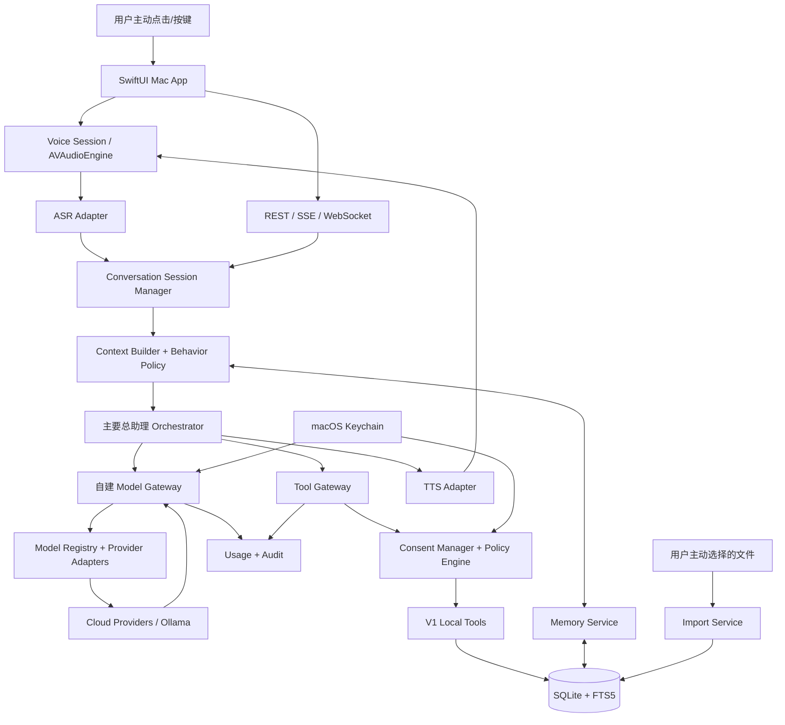
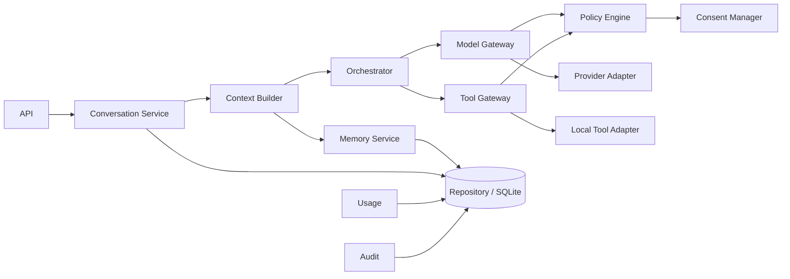

# 个人 AI 助理 --- 可执行开发规格书

> **文档版本：1.2（开发执行版）** **依据基线：个人AI助理技术架构 V1.1（审核修订版，2026-11-07）** **目标：可直接交给 Codex、Claude Code或其他 AI 编程工具执行** 
> 本次交付范围：V1；V1.1、V2--V5
> 仅保留规划和明确的版本边界

------------------------------------------------------------------------

## 0. 给 AI 编程工具的强制执行指令

### 0.1 不可违反的约束

1. 本文以原架构 V1.1
   为基线。不得删除、弱化或绕过已确认功能、技术决策、隐私边界、安全要求和版本边界。
2. V1 是**一个主要用户、一台 Mac、本地优先**。Mac M1/16GB
   只是初期参考设备；阶段0必须记录真实型号、内存、macOS、可用磁盘空间和音频设备。
3. V1 只交付一个主要总助理。可建立 Orchestrator、Agent
   Registry、模型绑定基础结构，但不得把模拟 Agent
   或预留结构包装成已交付的专业 Agent 团队、多 Agent 并行或后台委派。
4. V1 不连接邮件、聊天、通讯录、日历、待办等外部账户；不自动扫描整个
   Mac；只处理用户主动提供或明确选择的本地资料。
5. V1 不实现完整任务状态机、周期任务、用户委托后台任务、Mac
   休眠/关机期间执行、跨设备迁移或外部系统写操作。`conversation_turns`
   仅用于当前对话轮次恢复。
6. 语音必须由用户主动点击/按键开始。持续环境监听、声纹唤醒、全天候唤醒不属于
   V1 前提。必须保留文字模式、停止、打断和会话恢复。
7. 实时 ASR
   必须支持流式音频和中间结果；不得只实现整段录音结束后批量转写。默认优先验证本地
   sherpa-onnx Streaming ASR；云端实时 ASR
   只有用户主动选择并授权后才可用。
8. ASR、TTS、LLM 独立配置。至少交付一条稳定实时识别/合成链路。端到端
   Speech-to-Speech 仅为可选 POC，不替代解耦标准链路。
9. 自建 Model Gateway、Provider Adapter、Model Registry、Consent
   Manager、Policy Engine、Tool Gateway、Audit、Usage
   必须保持边界清晰。第三方 Gateway 只能在 ADR 决策后成为运行依赖。
10. 模型输出、工具参数、导入文件内容和外部资料全部视为不可信输入。工具执行必须经
    Schema、权限、数据等级、授权、风险和审计检查。
11. 凭据只保存在 macOS Keychain；不得写入
    SQLite、日志、普通配置、命令行参数、前端源码或模型上下文。凭据 API
    只允许写入/删除/状态查询，不允许明文读取。
12. 数据分级 L0--L3 必须落实。L2
    默认留在本机；发送云端前核验供应商、模型、区域、用途、数据范围和有效授权。L3
    凭据不得发送给普通模型 API。
13. 原始麦克风音频默认不持久化。ASR partial
    不得写长期记忆或触发高风险动作。会话关闭/异常后清理音频缓冲。
14. 本地 API 默认仅监听 `127.0.0.1`，使用短期本机凭据或受控 IPC；关闭
    CORS，校验 Host/Origin。Loopback 不是唯一安全边界。
15. 必须落实静态加密。SQLCipher 只是候选，需验证
    FTS5、SQLAlchemy、Alembic、备份恢复、ARM64 打包和性能后冻结
    ADR。FileVault
    不能替代应用级静态加密。备份必须应用层加密，密钥与备份分离。
16. 不得擅自决定原文未确定事项：主力 Mac、最低
    macOS、数据保留天数、月预算/币种、RPO/RTO、性能阈值、网络盘活动数据库支持、V2
    固定专业 Agent 归属等。
17. 不得凭品牌或 OpenAI 兼容格式推断具体模型支持工具、严格 JSON
    Schema、多模态、取消或数据区域。每个型号逐项验证。
18. 开发前先审计现有仓库和文档；建立功能/文件清单与
    ADR。禁止重建项目时覆盖或删除已有功能、数据或架构。
19. 数据库变更必须通过 Alembic
    migration；禁止运行时丢弃或重建用户数据库。失败测试不得删除以"修复"构建。
20. 发生需求冲突时优先级：产品构想书【已确认】要求 \> 原架构 V1.1 明确
    V1 边界/ADR \> 本文 IMPLEMENTATION_DETAIL。冲突先记录到
    `docs/decisions/OPEN_QUESTIONS.md`，不得自行扩大范围。

### 0.2 每个编码任务的执行流程

1. 阅读 README、docs、相关模块、测试、迁移文件。
2. 说明受影响模块、API、表、数据等级和版本范围。
3. 列出新增/修改文件，确认不删除现有功能。
4. 先补测试与契约，再实现。
5. 执行单元、集成、契约、静态检查和构建。
6. 检查异常、取消、重试、幂等、越权和数据清理。
7. 更新 OpenAPI、ADR、README、变更日志和验收记录。
8. 汇报完成项、未完成项、实际测试命令/结果和风险；不得声称未执行测试已通过。

### 0.3 状态标签

- `CONFIRMED`：原架构/产品基线已确认。
- `IMPLEMENTATION_DETAIL`：为可执行性补充的实现细节，不改变产品范围。
- `POC_REQUIRED`：必须在真实设备/供应商环境验证。
- `DECISION_REQUIRED`：产品负责人确认前不得固化。
- `FUTURE_Vx`：只在对应版本实现，V1 不得启用。

------------------------------------------------------------------------

# 1. 项目总体介绍

## 1.1 项目目标

建设一个长期理解用户、自然交流、保存长期记忆、分析问题，并在授权范围内调用模型与本地工具的个人
AI 助理。以 Mac
原生应用为入口，语音优先但保留文字交互，本地优先但允许在明确授权下调用云端模型。

核心能力：中文及中英混合实时语音；上下文与会话恢复；带来源、时间、事实/推测区分和版本的长期记忆；多供应商模型配置；主要总助理；用户选择文件导入；本机认证、Keychain、Consent/Policy、审计、加密备份恢复；用量、费用和健康监控。

## 1.2 V1 范围

  ------------------------------------------------------------------------------------------------

  模块                                V1 交付

  ----------------------------------- ------------------------------------------------------------

  客户端                              SwiftUI macOS 原生应用、首次配置、语音/文字、设置、健康状态

  语音                                主动开始；流式 ASR partial/final；可打断；本地默认；授权云
                                      ASR；至少一套稳定 TTS

  对话                                连续对话、上下文构建、轮次持久化、异常恢复

  模型                                自建 Model Gateway；首批 2--3 家 POC
                                      供应商；经验证的自定义兼容 Endpoint

  Agent                               一个主要总助理；基础
                                      Orchestrator/Registry；仅总助理可配置模型

  记忆                                Core/Episodic/Raw/Archive；结构化记忆、FTS5、可选本地
                                      Embedding

  文件                                用户主动选择的本地文件；白名单、预览、哈希去重、进度、取消

  安全                                本机认证、Keychain、Consent/Policy、Tool
                                      Gateway、L0--L3、加密和审计

  成本                                Token/音频时长/费用/延迟；实际与估算区分；软提醒/硬停止

  备份                                用户主动触发的应用层加密备份与恢复

任务                                仅当前会话/轮次恢复；无后台任务、调度器、周期任务
------------------------------------------------------------------------------------------------

## 1.3 V1 明确不交付

自动扫描整个 Mac；外部账户连接；外部平台写入；邮件/消息发送；支付；任意
Shell/Python；完整任务状态机；周期任务；Mac 休眠期间执行；完整专业 Agent
团队；动态 Agent；多 Agent 并行；iPhone
远程入口；跨设备同步/任务迁移；多用户云账号。

## 1.4 版本路线

  ------------------------------------------------------------------------------------------------------------

  版本                                范围

  ----------------------------------- ------------------------------------------------------------------------

  阶段0                               实时语音、Model Gateway、模拟 Agent、记忆、安全/加密/打包 POC

  V1                                  Mac
                                      原生核心助理：语音、对话、总助理、基础记忆、本地资料、安全、用量、备份

  V1.1                                记忆中心体验、导出/恢复优化、语音可靠性/预设、快捷指令、简单本地提醒

  V2                                  完整任务状态机、日历/待办只读连接器、受控通知；固定专业角色归属待确认

  V3                                  完整固定专业 Agent、多 Agent 受控协作、外部写操作逐次确认、Skills

  V4                                  iPhone 入口、跨设备同步/接续、动态 Agent 团队

V5                                  多用户、自部署/云服务、PostgreSQL/pgvector、对象存储、运维产品化
------------------------------------------------------------------------------------------------------------

------------------------------------------------------------------------

# 2. 产品需求说明

## 2.1 功能需求

### FR-VOICE 语音

- `FR-VOICE-001` 用户主动点击/按键开始会话。
- `FR-VOICE-002` 音频帧持续送 ASR，返回 partial 和 final。
- `FR-VOICE-003` partial 可被 revision
  替换，不持久化为正式消息/记忆，不触发高风险动作。
- `FR-VOICE-004` VAD/端点检测确定语句结束。
- `FR-VOICE-005` 用户可停止、暂停、继续、打断；打断停止 TTS
  并取消可取消请求。
- `FR-VOICE-006` 默认本地 Streaming ASR；云端 ASR
  需主动选择、显示服务商/区域/费用并授权。
- `FR-VOICE-007` 本地 ASR 失败不得静默上传音频。
- `FR-VOICE-008` TTS 独立配置；本地 AVSpeechSynthesizer，云端 TTS
  需授权。
- `FR-VOICE-009` 保存声音配置；引擎不支持的表达参数不得显示为可用。
- `FR-VOICE-010` 原始音频默认不落盘，会话结束/异常后清理。

### FR-CONV 对话

- `FR-CONV-001` 新建、列表、详情、消息提交、取消当前轮次、删除会话。
- `FR-CONV-002` 持久化用户消息、最终转写、助手消息和轮次状态。
- `FR-CONV-003`
  轮次状态：`RECEIVED/CONTEXT_BUILDING/GENERATING/TOOL_PENDING/SPEAKING/COMPLETED/FAILED/INTERRUPTED/CANCELLED`。
- `FR-CONV-004` 重启后恢复上下文；未完成轮次标记中断，不伪造完成。
- `FR-CONV-005` 长对话可生成带来源摘要；摘要不自动成为长期记忆。
- `FR-CONV-006` 支持文字模式。

### FR-MODEL 模型

- `FR-MODEL-001` Adapter 统一
  `generate/stream/call_with_tools/validate_connection/validate_models/estimate_cost/normalize_error`。
- `FR-MODEL-002` Model Registry 记录流式、工具、并行工具、JSON
  Schema、视觉、音频输入/输出、Embedding、Rerank、实时音频、Batch、Cancellation、Region、数据政策、价格、验证时间、状态。
- `FR-MODEL-003` 首批 2--3 家供应商端到端验证，不承诺全供应商同能力。
- `FR-MODEL-004`
  候选：OpenAI、DeepSeek、Qwen、Kimi/Moonshot、GLM/Zhipu、Gemini、Grok/xAI、Claude/Anthropic、Ollama。
- `FR-MODEL-005` 支持经验证的自定义 OpenAI-compatible Endpoint。
- `FR-MODEL-006` 切换 Provider/Model/Region 前重查
  Consent、数据等级和预算。
- `FR-MODEL-007` 费用区分 actual/estimated，保留原币种。
- `FR-MODEL-008` 硬预算达到后暂停收费请求，不自动充值/升级模型。
- `FR-MODEL-009` API Key 只写 Keychain，界面只显示 configured 状态。

### FR-AGENT 总助理

- `FR-AGENT-001` V1 只有主要总助理。
- `FR-AGENT-002` Agent 路由与 Model 路由解耦。
- `FR-AGENT-003` Registry
  保存角色、模型绑定、工具白名单、数据策略、预算、Prompt 版本。
- `FR-AGENT-004` V1 不启用专业 Agent 委派/并行；POC 可模拟。
- `FR-AGENT-005` Behavior Policy
  按工作/生活/情绪/学习/闲聊/紧急场景调整表达，不增加权限。
- `FR-AGENT-006`
  上下文区分系统指令、产品规则、会话、记忆来源、用户指令和不可信资料。

### FR-MEMORY 记忆

- `FR-MEMORY-001` Core、Episodic、Raw Data、Archive 四层。
- `FR-MEMORY-002` 至少支持
  fact、preference、goal、event、decision、commitment、inference。
- `FR-MEMORY-003`
  记录来源、观察时间、有效时间、事实/推测、敏感级别、证据等级、状态和版本。
- `FR-MEMORY-004` 模糊/冲突/高影响内容进入候选并请求确认。
- `FR-MEMORY-005`
  健康、财务、亲密关系、凭据及第三方敏感信息默认不自动进入长期画像。
- `FR-MEMORY-006` 用户纠正后立即停用旧当前事实，保留必要历史版本。
- `FR-MEMORY-007` SQL、FTS5、可选本地
  Embedding、时间过滤、来源权重混合检索。
- `FR-MEMORY-008`
  删除覆盖条目、版本、来源关联、摘要、FTS、Embedding、缓存、导入副本和备份清理状态。
- `FR-MEMORY-009` 用户查看、纠错、归档、删除、导出。
- `FR-MEMORY-010` 权限只由 Consent Manager/Policy Engine 决定。

### FR-IMPORT 文件导入

- `FR-IMPORT-001` 只处理用户明确选择文件/目录。
- `FR-IMPORT-002`
  导入前展示范围、类型、数量/大小、是否复制、云端处理风险。
- `FR-IMPORT-003`
  类型白名单；限制大小、解析时间、压缩包展开深度和内存。
- `FR-IMPORT-004` SHA-256、去重、缺失检查、进度、取消。
- `FR-IMPORT-005`
  原件默认不移动/改写；托管副本纳入加密和删除生命周期。
- `FR-IMPORT-006` 文件内容始终是不可信资料。

### FR-SEC 安全

- `FR-SEC-001` L0--L3 数据分级。
- `FR-SEC-002` Consent 绑定
  purpose/provider/model/region/data_scope/action_scope/source_scope/有效期/状态。
- `FR-SEC-003` 撤销后阻止新请求，并尽可能取消当前请求。
- `FR-SEC-004` Tool Gateway 执行
  Schema/权限/数据等级/风险/确认/幂等/审计检查。
- `FR-SEC-005` 禁止任意 Shell/Python 执行。
- `FR-SEC-006` 敏感入口 Touch ID/设备密码。
- `FR-SEC-007` 静态加密方案经 POC/ADR 冻结。
- `FR-SEC-008` 备份应用层加密，密钥与备份分离。
- `FR-SEC-009` 日志不记录原始音频、完整
  Prompt、私人文件正文、密钥/令牌。
- `FR-SEC-010` 锁屏/用户切换保护界面、停止采集、避免通知/语音泄露。

### FR-OPS 运维

- 后端健康检查、启动超时、优雅关闭、有限重启。
- 健康页显示 App/Backend
  版本、语音引擎、Provider、最近错误、备份、磁盘、DB/Vault 占用。
- 磁盘不足暂停非必要导入/索引，不自动删除用户数据。
- 日志轮转/容量上限；DEBUG 显式开启；诊断包脱敏预览。
- 安装/更新前检查空间、备份、迁移；失败保留旧数据。
- 卸载应用与删除用户数据分开选择。

## 2.2 非功能需求

可靠性：失败状态明确，不伪造成功；取消传播、有限重试、幂等。\
可维护性：模块化单体，Repository/Service 隔离数据库。\
可扩展性：Provider Adapter、Model Registry、Agent
Registry、工具注册接口。\
隐私：本地优先、云端最小化、授权可查看/撤销。\
可恢复性：会话、记忆、迁移、加密备份恢复。\
性能：POC 建立 P50/P95 后由产品负责人确认，不编造毫秒承诺。\
可观测性：trace_id、usage、语音事件、健康状态、最小化审计。\
兼容性：Apple Silicon；最低 macOS 待阶段0确认。

------------------------------------------------------------------------

# 3. 系统总体架构

## 3.1 逻辑架构



## 3.2 V1 部署形态

一个 SwiftUI Mac App；一个本地 FastAPI 模块化单体（默认
`127.0.0.1`）；本地 ASR 原生库/受控子进程；SQLite+FTS5；可选本地
Embedding；Keychain；经授权的云端 LLM/ASR/TTS。V1 不部署
Redis、Celery、独立向量数据库、Kubernetes 或公有云业务服务器。

## 3.3 依赖方向

```text
macOS UI
 -> API Client / Audio
 -> FastAPI API Layer
 -> Application Services
    -> Domain Models / Ports
    -> Policy / Consent
    -> Repositories
    -> Provider Adapters
    -> Local Tool Adapters
 -> Infrastructure (SQLite, Keychain bridge, filesystem, audio process)
```

Domain 不得依赖 FastAPI/SQLAlchemy/供应商 SDK；Orchestrator 不得直连
DB/Keychain/文件/SDK；Provider Adapter 不得自行决定出站授权；Tool
Adapter 不得绕过 Tool Gateway；SwiftUI 不持有长期 Provider Key。

## 3.4 标准数据流

主动开始会话 → 音频采集 → ASR partial/final → final 形成用户消息和轮次 →
Context Builder → Orchestrator → Model Gateway → Policy/Consent 检查 →
Provider → 工具请求经 Tool Gateway 校验执行 → 汇总消息 → TTS → 播放 →
Usage/Audit。失败均返回明确状态；V1 只恢复会话，不恢复后台任务。

## 3.5 异常边界

ASR partial
不进入正式消息/记忆；授权缺失拒绝出站；模型超时保留轮次并标记失败/中断；工具
Schema 不合规不执行；TTS 打断清空待播队列；不支持取消的 Provider
标记可能仍在服务端运行/计费；migration
失败保留旧库；磁盘不足暂停导入/索引。

------------------------------------------------------------------------

# 4. 技术选型

## 4.1 前端

  组件       选型                           用途

  ---------- ------------------------------ --------------------------------

  UI         Swift + SwiftUI                macOS 原生体验
  音频       AVFoundation / AVAudioEngine   采集、播放、缓冲、打断
  本地 TTS   AVSpeechSynthesizer            V1 默认候选
  认证       LocalAuthentication            Touch ID/设备密码
  凭据       Security / Keychain            API Key、本机凭据
  通知       UserNotifications              V1 状态提示；V1.1 简单本地提醒
  网络       URLSession                     REST/SSE/WebSocket
  测试       XCTest / Swift Testing         UI、状态、系统能力

V1 决策为 SwiftUI；Tauri/React、Electron、Flutter
仅在跨平台优先级变化时重新评估。

## 4.2 后端

Python 3.11+（依赖兼容后冻结）、FastAPI、Pydantic 2、SQLAlchemy
2、Alembic、HTTPX、stdlib logging +
structlog、uv、pytest。模块化单体。FastAPI 不在事件循环中执行
ASR/Embedding 重计算；使用原生库、受控线程或子进程。V1 不引入
Redis/Celery。

## 4.3 数据

SQLite + FTS5、WAL、外键、Repository 抽象、Alembic。Embedding
独立接口，优先本地多语言模型。V1 不部署
Qdrant/Milvus/Elasticsearch。PostgreSQL+pgvector 留给跨设备/多用户阶段。

## 4.4 实时语音

- 本地 Streaming ASR 首选 POC：sherpa-onnx；候选中文 Streaming
  模型/Qwen3-ASR 0.6B INT8 示例，须验证许可、准确率、延迟和内存。
- 云端候选 Qwen Realtime
  ASR：`qwen3-asr-flash-realtime`、`qwen-audio-3.1-asr-flash-streaming`
  等，型号/区域上线前核验。
- 本地 TTS：AVSpeechSynthesizer；云端 TTS 按需适配。
- whisper.cpp 可作文件转写补充，不得未经验证当作严格实时唯一方案。
- Speech-to-Speech 仅可选实验，不替代 ASR→LLM→TTS。

音频协议至少定义
`sample_rate_hz`、`channels`、`encoding`、`bit_depth`、`frame_duration_ms`、帧序号、采集时间戳、session/utterance
ID、结束原因、错误码。不同 Provider 格式由 Adapter
转换。帧队列有上限和背压；落后时告知用户或安全终止，不得静默丢帧。POC 测
AEC、噪声抑制、VAD、插话和回声误判；全双工不可靠时保留按键/点击打断。

## 4.5 Model Gateway

自建 Gateway；统一 Provider Adapter；Model Registry 登记能力；首批 2--3
家端到端验证。LiteLLM/Bifrost 为 POC 对照，Portkey
为参考。是否引入第三方 Gateway 必须 ADR 决定。Fallback
不得扩大数据授权、区域或费用权限。

## 4.6 Agent

V1 轻量自建 Orchestrator + Pydantic Schema；Pydantic AI
可选评估；LangGraph V2/V3 POC；OpenAI Agents SDK
可作为独立适配器评估。Agent 路由与模型路由解耦。V1 不实现专业 Agent
工作流；V2 固定专业角色归属待产品确认；动态 Agent 团队 V4。

------------------------------------------------------------------------

# 5. 前后端目录结构

```text
PersonalAI/
├── app-macos/
│   ├── PersonalAIApp/
│   │   ├── App/
│   │   ├── Views/
│   │   ├── ViewModels/
│   │   ├── Models/
│   │   ├── Audio/{Capture,Playback,Session,Devices}/
│   │   ├── API/{Client,DTO,Streaming,Auth}/
│   │   ├── Security/
│   │   ├── Persistence/
│   │   ├── Notifications/
│   │   └── Resources/
│   └── PersonalAITests/
├── backend/
│   ├── app/
│   │   ├── main.py
│   │   ├── api/{routes,schemas,dependencies,middleware}/
│   │   ├── core/{config,auth,consents,policy_engine,permissions,events,security}/
│   │   ├── conversation/{domain,services,repositories}/
│   │   ├── voice/{asr,tts,vad,session_manager,protocol,retention}/
│   │   ├── ai/{model_gateway,providers,model_registry,orchestrator,agent_registry,agent_runtime,context_builder,behavior_policy}/
│   │   ├── memory/{extractor,classifier,validator,retriever,store,relations,lifecycle}/
│   │   ├── tools/{registry,gateway,local}/
│   │   ├── database/{models,repositories,migrations,session.py}
│   │   ├── imports/
│   │   ├── backups/
│   │   ├── retention/
│   │   ├── usage/
│   │   ├── audit/
│   │   ├── diagnostics/
│   │   └── monitoring/
│   ├── tests/{unit,integration,contract,security,fixtures}/
│   ├── alembic.ini
│   ├── pyproject.toml
│   └── uv.lock
├── models/{asr,tts,embedding}/
├── runtime-data/
├── backups/
├── docs/{architecture,api,adr,poc,runbooks,acceptance}/
├── scripts/
├── .github/workflows/
├── .gitignore
└── README.md
```

目录按阶段创建，不必第一天创建空目录。模型权重、用户数据、凭据、备份和日志不得提交
Git。正式数据放 macOS Application Support 私有目录；活动 SQLite 不放
NAS/网盘/多设备同步目录，除非专门 POC 通过并形成产品决策。

------------------------------------------------------------------------

# 6. 数据库完整设计（V1）

## 6.1 规则

SQLite + FTS5；WAL；外键开启；SQLAlchemy Repository；Alembic
migration。时间统一 ISO 8601 UTC TEXT；ID 统一 UUID 字符串；JSON 字段存
JSON 文本并由 Pydantic 校验；金额用整数 micros +
currency；Token/时长整数。以下详细字段属于
`IMPLEMENTATION_DETAIL`，用于补足原架构只列表名的情况，不改变产品范围。

## 6.2 表清单

  表                                          版本     用途

  ------------------------------------------- -------- ------------------------------

  conversations                               V1       会话
  conversation_turns                          V1       对话轮次恢复，不是任务
  messages                                    V1       用户/助手/工具消息及最终转写
  memory_items                                V1       当前记忆
  memory_versions                             V1       历史版本
  memory_sources                              V1       来源证据
  memory_embeddings                           V1/POC   Embedding
  memory_relations                            V1基础   人物/事件/项目关系
  user_profile                                V1       画像键值
  provider_configs                            V1       Provider 配置，不含密钥
  model_registry                              V1       型号能力/价格/区域快照
  agent_definitions                           V1基础   总助理/未来角色定义
  model_usage                                 V1       用量与费用
  consents                                    V1       授权与撤销
  retention_policies                          V1       数据保留策略
  deletion_jobs                               V1       删除工作流
  audit_logs                                  V1       最小化审计
  imports                                     V1       用户选中文件导入
  app_settings                                V1建议   非敏感设置
  tasks/connectors/tool_runs/skills/devices   V2+      V1 不启用

## 6.3 SQLite DDL

```sql
PRAGMA foreign_keys = ON;

CREATE TABLE conversations (
 id TEXT PRIMARY KEY, title TEXT NOT NULL DEFAULT '新对话',
 status TEXT NOT NULL DEFAULT 'ACTIVE' CHECK(status IN ('ACTIVE','ARCHIVED','DELETING','DELETED')),
 mode TEXT NOT NULL DEFAULT 'TEXT' CHECK(mode IN ('TEXT','VOICE')),
 summary TEXT, summary_version INTEGER NOT NULL DEFAULT 0,
 last_message_at TEXT, metadata_json TEXT NOT NULL DEFAULT '{}',
 created_at TEXT NOT NULL, updated_at TEXT NOT NULL, deleted_at TEXT
);
CREATE INDEX idx_conversations_status_updated ON conversations(status,updated_at DESC);

CREATE TABLE conversation_turns (
 id TEXT PRIMARY KEY, conversation_id TEXT NOT NULL REFERENCES conversations(id) ON DELETE CASCADE,
 sequence_no INTEGER NOT NULL,
 status TEXT NOT NULL CHECK(status IN ('RECEIVED','CONTEXT_BUILDING','GENERATING','TOOL_PENDING','SPEAKING','COMPLETED','FAILED','INTERRUPTED','CANCELLED')),
 input_message_id TEXT, assistant_message_id TEXT, trace_id TEXT NOT NULL,
 idempotency_key TEXT NOT NULL UNIQUE, model_provider_id TEXT, model_id TEXT,
 prompt_version TEXT, context_version TEXT, error_code TEXT, error_message_safe TEXT,
 started_at TEXT, completed_at TEXT, created_at TEXT NOT NULL, updated_at TEXT NOT NULL,
 UNIQUE(conversation_id,sequence_no)
);
CREATE INDEX idx_turns_conversation_created ON conversation_turns(conversation_id,created_at DESC);
CREATE INDEX idx_turns_status ON conversation_turns(status);

CREATE TABLE messages (
 id TEXT PRIMARY KEY, conversation_id TEXT NOT NULL REFERENCES conversations(id) ON DELETE CASCADE,
 turn_id TEXT REFERENCES conversation_turns(id) ON DELETE SET NULL,
 role TEXT NOT NULL CHECK(role IN ('SYSTEM','USER','ASSISTANT','TOOL')),
 content TEXT NOT NULL, content_format TEXT NOT NULL DEFAULT 'TEXT'
 CHECK(content_format IN ('TEXT','MARKDOWN','JSON','TRANSCRIPT')),
 source_type TEXT, source_id TEXT, is_final INTEGER NOT NULL DEFAULT 1 CHECK(is_final IN (0,1)),
 sensitivity TEXT NOT NULL DEFAULT 'L1' CHECK(sensitivity IN ('L0','L1','L2','L3')),
 token_count INTEGER, metadata_json TEXT NOT NULL DEFAULT '{}',
 created_at TEXT NOT NULL, deleted_at TEXT
);
CREATE INDEX idx_messages_conversation_created ON messages(conversation_id,created_at);
CREATE INDEX idx_messages_turn ON messages(turn_id);
CREATE VIRTUAL TABLE messages_fts USING fts5(message_id UNINDEXED,content,tokenize='unicode61');

CREATE TABLE memory_items (
 id TEXT PRIMARY KEY, category TEXT NOT NULL CHECK(category IN ('fact','preference','goal','event','decision','commitment','inference','relationship','project')),
 subject TEXT NOT NULL, content TEXT NOT NULL,
 claim_type TEXT NOT NULL CHECK(claim_type IN ('user_confirmed_fact','source_supported_fact','model_inference','user_preference','event_record','unknown')),
 confidence REAL CHECK(confidence IS NULL OR (confidence>=0 AND confidence<=1)),
 evidence_level TEXT NOT NULL DEFAULT 'UNVERIFIED'
 CHECK(evidence_level IN ('USER_CONFIRMED','SOURCE_VERIFIED','MULTI_SOURCE','SINGLE_SOURCE','UNVERIFIED')),
 sensitivity TEXT NOT NULL DEFAULT 'L1' CHECK(sensitivity IN ('L0','L1','L2','L3')),
 status TEXT NOT NULL DEFAULT 'CANDIDATE'
 CHECK(status IN ('CANDIDATE','ACTIVE','SUPERSEDED','ARCHIVED','REJECTED','DELETING','DELETED')),
 valid_from TEXT,valid_to TEXT,observed_at TEXT NOT NULL,reviewed_at TEXT,
 supersedes_memory_id TEXT REFERENCES memory_items(id) ON DELETE SET NULL,
 extractor_version TEXT,deletion_state TEXT NOT NULL DEFAULT 'NONE'
 CHECK(deletion_state IN ('NONE','REQUESTED','IN_PROGRESS','PENDING_BACKUP','COMPLETED')),
 metadata_json TEXT NOT NULL DEFAULT '{}',created_at TEXT NOT NULL,updated_at TEXT NOT NULL,deleted_at TEXT
);
CREATE INDEX idx_memory_status_category ON memory_items(status,category);
CREATE INDEX idx_memory_subject ON memory_items(subject);
CREATE INDEX idx_memory_validity ON memory_items(valid_from,valid_to);

CREATE TABLE memory_versions (
 id TEXT PRIMARY KEY,memory_id TEXT NOT NULL REFERENCES memory_items(id) ON DELETE CASCADE,
 version_no INTEGER NOT NULL,snapshot_json TEXT NOT NULL,change_reason TEXT NOT NULL,
 changed_by TEXT NOT NULL CHECK(changed_by IN ('USER','SYSTEM','ASSISTANT')),
 created_at TEXT NOT NULL,UNIQUE(memory_id,version_no)
);
CREATE TABLE memory_sources (
 id TEXT PRIMARY KEY,memory_id TEXT NOT NULL REFERENCES memory_items(id) ON DELETE CASCADE,
 source_type TEXT NOT NULL CHECK(source_type IN ('MESSAGE','IMPORT','USER_CONFIRMATION','MANUAL_ENTRY','TOOL_RESULT')),
 source_id TEXT NOT NULL,source_locator TEXT,source_excerpt_hash TEXT,source_time TEXT,
 reliability TEXT NOT NULL DEFAULT 'UNKNOWN' CHECK(reliability IN ('HIGH','MEDIUM','LOW','UNKNOWN')),
 created_at TEXT NOT NULL,UNIQUE(memory_id,source_type,source_id,source_locator)
);
CREATE INDEX idx_memory_sources_source ON memory_sources(source_type,source_id);

CREATE TABLE memory_embeddings (
 id TEXT PRIMARY KEY,memory_id TEXT NOT NULL REFERENCES memory_items(id) ON DELETE CASCADE,
 embedding_model TEXT NOT NULL,embedding_version TEXT NOT NULL,dimensions INTEGER NOT NULL,
 vector_blob BLOB NOT NULL,content_hash TEXT NOT NULL,created_at TEXT NOT NULL,
 UNIQUE(memory_id,embedding_model,embedding_version)
);
CREATE TABLE memory_relations (
 id TEXT PRIMARY KEY,from_memory_id TEXT NOT NULL REFERENCES memory_items(id) ON DELETE CASCADE,
 to_memory_id TEXT NOT NULL REFERENCES memory_items(id) ON DELETE CASCADE,
 relation_type TEXT NOT NULL,confidence REAL,source_id TEXT,created_at TEXT NOT NULL,
 CHECK(from_memory_id<>to_memory_id),UNIQUE(from_memory_id,to_memory_id,relation_type)
);
CREATE TABLE user_profile (
 id TEXT PRIMARY KEY,profile_key TEXT NOT NULL UNIQUE,value_json TEXT NOT NULL,
 sensitivity TEXT NOT NULL DEFAULT 'L1' CHECK(sensitivity IN ('L0','L1','L2','L3')),
 source_memory_id TEXT REFERENCES memory_items(id) ON DELETE SET NULL,
 status TEXT NOT NULL DEFAULT 'ACTIVE' CHECK(status IN ('ACTIVE','ARCHIVED','DELETED')),
 created_at TEXT NOT NULL,updated_at TEXT NOT NULL
);

CREATE TABLE provider_configs (
 id TEXT PRIMARY KEY,provider_key TEXT NOT NULL UNIQUE,display_name TEXT NOT NULL,
 adapter_key TEXT NOT NULL,base_url TEXT,region TEXT,
 endpoint_kind TEXT NOT NULL DEFAULT 'OFFICIAL' CHECK(endpoint_kind IN ('OFFICIAL','CUSTOM_COMPATIBLE','LOCAL')),
 credential_ref TEXT,enabled INTEGER NOT NULL DEFAULT 0 CHECK(enabled IN (0,1)),
 validation_status TEXT NOT NULL DEFAULT 'NOT_VALIDATED'
 CHECK(validation_status IN ('NOT_VALIDATED','VALID','INVALID','LIMITED','DISABLED')),
 last_validated_at TEXT,policy_ref TEXT,config_json TEXT NOT NULL DEFAULT '{}',
 created_at TEXT NOT NULL,updated_at TEXT NOT NULL
);
CREATE TABLE model_registry (
 id TEXT PRIMARY KEY,provider_id TEXT NOT NULL REFERENCES provider_configs(id) ON DELETE CASCADE,
 model_id TEXT NOT NULL,display_name TEXT NOT NULL,model_family TEXT NOT NULL,context_limit INTEGER,
 supports_streaming INTEGER NOT NULL DEFAULT 0,supports_tools INTEGER NOT NULL DEFAULT 0,
 supports_parallel_tools INTEGER NOT NULL DEFAULT 0,supports_json_schema INTEGER NOT NULL DEFAULT 0,
 supports_vision INTEGER NOT NULL DEFAULT 0,supports_audio_input INTEGER NOT NULL DEFAULT 0,
 supports_audio_output INTEGER NOT NULL DEFAULT 0,supports_embeddings INTEGER NOT NULL DEFAULT 0,
 supports_rerank INTEGER NOT NULL DEFAULT 0,supports_realtime_audio INTEGER NOT NULL DEFAULT 0,
 supports_batch INTEGER NOT NULL DEFAULT 0,supports_cancellation INTEGER NOT NULL DEFAULT 0,
 region TEXT,data_policy_ref TEXT,input_price_micros INTEGER,output_price_micros INTEGER,
 price_currency TEXT,price_unit TEXT,price_snapshot_at TEXT,capability_verified_at TEXT,
 status TEXT NOT NULL DEFAULT 'PENDING' CHECK(status IN ('RECOMMENDED','LIMITED','DISABLED','PENDING')),
 capabilities_json TEXT NOT NULL DEFAULT '{}',created_at TEXT NOT NULL,updated_at TEXT NOT NULL,
 UNIQUE(provider_id,model_id,region)
);
CREATE INDEX idx_models_provider_status ON model_registry(provider_id,status);

CREATE TABLE agent_definitions (
 id TEXT PRIMARY KEY,agent_key TEXT NOT NULL UNIQUE,name TEXT NOT NULL,description TEXT NOT NULL,
 capabilities_json TEXT NOT NULL DEFAULT '[]',task_types_json TEXT NOT NULL DEFAULT '[]',
 primary_provider_id TEXT REFERENCES provider_configs(id) ON DELETE SET NULL,
 primary_model_registry_id TEXT REFERENCES model_registry(id) ON DELETE SET NULL,
 fallback_bindings_json TEXT NOT NULL DEFAULT '[]',
 model_selection_mode TEXT NOT NULL DEFAULT 'FIXED' CHECK(model_selection_mode IN ('FIXED','USER_SELECTED','AUTO')),
 tool_allowlist_json TEXT NOT NULL DEFAULT '[]',data_access_policy_json TEXT NOT NULL DEFAULT '{}',
 budget_policy_json TEXT NOT NULL DEFAULT '{}',max_steps INTEGER NOT NULL DEFAULT 8,
 timeout_seconds INTEGER NOT NULL DEFAULT 120,max_delegation_depth INTEGER NOT NULL DEFAULT 0,
 prompt_version TEXT NOT NULL DEFAULT '1',evaluation_profile TEXT,enabled INTEGER NOT NULL DEFAULT 0,
 version INTEGER NOT NULL DEFAULT 1,status TEXT NOT NULL DEFAULT 'ACTIVE'
 CHECK(status IN ('ACTIVE','PAUSED','ARCHIVED')),created_at TEXT NOT NULL,updated_at TEXT NOT NULL
);
-- V1 仅允许 agent_key='main_assistant' 的一个定义 enabled=1。

CREATE TABLE model_usage (
 id TEXT PRIMARY KEY,trace_id TEXT NOT NULL,
 conversation_id TEXT REFERENCES conversations(id) ON DELETE SET NULL,
 turn_id TEXT REFERENCES conversation_turns(id) ON DELETE SET NULL,
 agent_id TEXT REFERENCES agent_definitions(id) ON DELETE SET NULL,
 provider_id TEXT REFERENCES provider_configs(id) ON DELETE SET NULL,
 model_registry_id TEXT REFERENCES model_registry(id) ON DELETE SET NULL,
 model_id TEXT NOT NULL,purpose TEXT NOT NULL,data_sensitivity TEXT NOT NULL,
 input_tokens INTEGER,output_tokens INTEGER,reasoning_tokens INTEGER,cached_input_tokens INTEGER,
 audio_input_ms INTEGER,audio_output_ms INTEGER,retry_count INTEGER NOT NULL DEFAULT 0,
 latency_ms INTEGER,first_token_latency_ms INTEGER,cost_micros INTEGER,cost_currency TEXT,
 cost_kind TEXT NOT NULL DEFAULT 'ESTIMATED' CHECK(cost_kind IN ('ACTUAL','ESTIMATED','UNKNOWN')),
 status TEXT NOT NULL,consent_id TEXT,usage_json TEXT NOT NULL DEFAULT '{}',created_at TEXT NOT NULL
);
CREATE INDEX idx_usage_created ON model_usage(created_at DESC);
CREATE INDEX idx_usage_provider_model ON model_usage(provider_id,model_id);

CREATE TABLE consents (
 id TEXT PRIMARY KEY,purpose TEXT NOT NULL,provider_id TEXT REFERENCES provider_configs(id) ON DELETE CASCADE,
 model_id TEXT,region TEXT,data_scope_json TEXT NOT NULL,action_scope_json TEXT NOT NULL,
 source_scope_json TEXT NOT NULL,consent_type TEXT NOT NULL CHECK(consent_type IN ('ONE_TIME','PERSISTENT')),
 consent_version INTEGER NOT NULL,status TEXT NOT NULL DEFAULT 'ACTIVE'
 CHECK(status IN ('ACTIVE','EXPIRED','REVOKED','CONSUMED')),
 granted_at TEXT NOT NULL,expires_at TEXT,revoked_at TEXT,consumed_at TEXT,
 created_at TEXT NOT NULL,updated_at TEXT NOT NULL
);
CREATE INDEX idx_consents_lookup ON consents(status,provider_id,model_id,purpose);

CREATE TABLE retention_policies (
 id TEXT PRIMARY KEY,data_kind TEXT NOT NULL UNIQUE,
 default_action TEXT NOT NULL CHECK(default_action IN ('KEEP','DELETE_AFTER','SESSION_ONLY','USER_CONTROLLED')),
 retention_seconds INTEGER,include_in_backup INTEGER NOT NULL DEFAULT 0,
 policy_version INTEGER NOT NULL DEFAULT 1,enabled INTEGER NOT NULL DEFAULT 1,
 config_json TEXT NOT NULL DEFAULT '{}',created_at TEXT NOT NULL,updated_at TEXT NOT NULL
);
CREATE TABLE deletion_jobs (
 id TEXT PRIMARY KEY,target_type TEXT NOT NULL,target_id TEXT NOT NULL,
 status TEXT NOT NULL DEFAULT 'REQUESTED' CHECK(status IN ('REQUESTED','HIDDEN_FROM_RETRIEVAL',
 'DERIVED_DATA_CLEANUP_PENDING','SOURCE_CLEANUP_PENDING','BACKUP_EXPIRY_PENDING','COMPLETED','FAILED')),
 scope_json TEXT NOT NULL,progress_json TEXT NOT NULL DEFAULT '{}',requested_by TEXT NOT NULL,
 error_code TEXT,created_at TEXT NOT NULL,updated_at TEXT NOT NULL,completed_at TEXT
);
CREATE INDEX idx_deletion_status ON deletion_jobs(status,created_at);

CREATE TABLE audit_logs (
 id TEXT PRIMARY KEY,trace_id TEXT,actor_type TEXT NOT NULL,actor_id TEXT,action TEXT NOT NULL,
 resource_type TEXT NOT NULL,resource_id TEXT,decision TEXT,reason_code TEXT,
 data_sensitivity TEXT,provider_id TEXT,model_id TEXT,consent_id TEXT,
 metadata_json TEXT NOT NULL DEFAULT '{}',created_at TEXT NOT NULL
);
CREATE INDEX idx_audit_created ON audit_logs(created_at DESC);
CREATE INDEX idx_audit_resource ON audit_logs(resource_type,resource_id);

CREATE TABLE imports (
 id TEXT PRIMARY KEY,display_name TEXT NOT NULL,source_path_bookmark BLOB,source_path_display TEXT,
 storage_mode TEXT NOT NULL CHECK(storage_mode IN ('REFERENCE','MANAGED_COPY')),
 managed_relative_path TEXT,sha256 TEXT NOT NULL,file_size_bytes INTEGER NOT NULL,mime_type TEXT NOT NULL,
 file_extension TEXT,sensitivity TEXT NOT NULL DEFAULT 'L1',
 status TEXT NOT NULL DEFAULT 'QUEUED'
 CHECK(status IN ('QUEUED','PREVIEWED','RUNNING','COMPLETED','CANCELLED','FAILED','MISSING','DELETING')),
 parser_key TEXT,parser_version TEXT,progress_json TEXT NOT NULL DEFAULT '{}',
 extracted_text_ref TEXT,error_code TEXT,created_at TEXT NOT NULL,updated_at TEXT NOT NULL,deleted_at TEXT
);
CREATE INDEX idx_imports_hash ON imports(sha256);
CREATE INDEX idx_imports_status ON imports(status);

CREATE TABLE app_settings (
 id TEXT PRIMARY KEY,setting_key TEXT NOT NULL UNIQUE,value_json TEXT NOT NULL,
 sensitivity TEXT NOT NULL DEFAULT 'L0' CHECK(sensitivity IN ('L0','L1','L2','L3')),
 updated_at TEXT NOT NULL
);
```

## 6.4 FTS5 与数据一致性

1. 正式 message 写入时，同一事务更新 `messages_fts`；删除时同步移除。
2. 记忆如需全文检索，另建 `memory_fts`，不与 messages 混用。
3. FTS 不包含已删除/过期/DELETING 数据。
4. Migration 后执行 FTS integrity/rebuild。
5. FTS 写入由 Repository 统一负责。

## 6.5 关键约束

- `idempotency_key` 全局唯一；同会话 `sequence_no` 唯一。
- ASR partial 默认仅内存态；正式 message 只写 final。
- 只有 `memory_items.status='ACTIVE'` 可作为当前记忆检索。
- 每次记忆变更新增 `memory_versions`，不覆盖历史。
- `provider_configs.credential_ref` 仅为 Keychain 引用。
- 未知模型能力不得填 true。
- Consent 必须精确匹配
  purpose/provider/model/region/data/source/action。
- Audit 不存完整 prompt、音频、文件正文、Key/Token。
- Import bookmark 只能来自系统文件选择授权。
- V1 禁止启用 `tasks/connectors/devices` 等后续业务能力。

### V2+ 表预留（V1 不创建/不启用业务）

- `tasks`：`id,title,description,status,priority,schedule_at,started_at,completed_at,retry_count,idempotency_key,payload_json,result_json,error_code,created_at,updated_at`；状态
  `PENDING/READY/RUNNING/WAITING/PAUSED/PARTIAL/COMPLETED/FAILED/CANCELLED`。
- `connectors`：`id,provider_key,display_name,status,credential_ref,scopes_json,read_scopes_json,write_scopes_json,last_sync_at,last_error_code,config_json,created_at,updated_at`。
- `tool_runs`：`id,task_id,tool_key,input_hash,status,idempotency_key,approval_ref,result_summary,error_code,started_at,finished_at,created_at`。
- `skills`：`id,skill_key,name,version,definition_json,permission_manifest_json,status,created_at,updated_at`。
- `devices`：`id,device_key,display_name,public_key_ref,status,last_seen_at,revoked_at,created_at,updated_at`。

------------------------------------------------------------------------

# 7. API 接口完整定义（V1）

## 7.1 通用规范

- Base URL：`http://127.0.0.1:<动态端口>/api/v1`。端口和短期 token
  通过受控 IPC/启动握手交给 App。
- 认证：`Authorization: Bearer <short-lived-local-token>`；不得记录
  token。
- JSON：`application/json; charset=utf-8`；snake_case；时间为 ISO
  8601。
- 分页：`limit` 默认 30、最大 100；`cursor` 不透明。
- 修改接口使用 `Idempotency-Key`；并发更新用 `If-Match` 或 `version`。
- 客户端可传 `X-Trace-Id`，否则服务端生成。
- API Key/私人正文不得进入 URL、日志或错误详情。
- OpenAPI 是 SwiftUI DTO 契约来源。

统一错误：

```json
{
  "error": {
    "code": "CONSENT_REQUIRED",
    "message": "该请求需要先获得云端数据处理授权。",
    "retryable": false,
    "details": {}
  },
  "trace_id": "uuid"
}
```

  HTTP   错误码                   说明

  ------ ------------------------ ----------------------

  400    VALIDATION_ERROR         参数错误
  401    LOCAL_AUTH_REQUIRED      本机 token 无效/过期
  403    POLICY_DENIED            Policy Engine 拒绝
  403    CONSENT_REQUIRED         缺少授权
  404    RESOURCE_NOT_FOUND       资源不存在
  409    VERSION_CONFLICT         并发版本冲突
  409    IDEMPOTENCY_CONFLICT     幂等键对应不同请求
  413    PAYLOAD_TOO_LARGE        请求/文件超限
  422    CAPABILITY_UNSUPPORTED   型号不支持该能力
  429    PROVIDER_RATE_LIMITED    Provider 限流
  500    INTERNAL_ERROR           内部错误
  502    PROVIDER_ERROR           Provider 错误
  503    SERVICE_UNAVAILABLE      本地服务不可用
  504    PROVIDER_TIMEOUT         Provider 超时
  507    INSUFFICIENT_STORAGE     磁盘不足

## 7.2 会话接口

### `POST /conversations`

请求：

```json
{"title":"新对话","mode":"VOICE","metadata":{}}
```

`title` 可选 1--120 字；`mode` 必填 `TEXT|VOICE`；metadata
禁止放凭据。响应 `201`：`id,title,status,mode,created_at,updated_at`。

### `GET /conversations`

Query：`limit,cursor,status=ACTIVE|ARCHIVED,q`。按 `updated_at DESC`
返回 `{items,next_cursor}`。

### `GET /conversations/{conversation_id}`

返回会话元数据、最近消息摘要、最近轮次状态；不得返回密钥。

### `POST /conversations/{conversation_id}/messages`

Header：`Idempotency-Key` 必填。 请求：

```json
{
  "content":"帮我分析这段内容",
  "content_format":"TEXT",
  "source":{"type":"TEXT_INPUT","id":null},
  "sensitivity":"L1",
  "response_mode":"STREAM"
}
```

`content` 1--100000 字符；语音来源必须为 ASR final。响应 `202`：

```json
{"turn_id":"uuid","user_message_id":"uuid","status":"RECEIVED","events_url":"/conversations/{id}/events?turn_id={turn_id}","trace_id":"uuid"}
```

### `POST /conversations/{id}/turns/{turn_id}/cancel`

请求 `{"reason":"USER_INTERRUPTED"}`。响应
`turn_id,status,provider_cancellation=CONFIRMED|UNSUPPORTED|UNKNOWN`。只停止当前交互，不创建后台任务；Provider
端可能仍计费。

### `GET /conversations/{id}/events`

SSE Query：`turn_id` 必填，`after_sequence`
可选。事件：`assistant.response_started`、`assistant.text_delta`、`assistant.tool_request`、`assistant.tool_result`、`assistant.response_completed`、`assistant.response_failed`、`assistant.cancelled`、`usage.updated`。每条含
`event_id,sequence,turn_id,trace_id,timestamp,data`。客户端去重；恢复窗口过期返回
`STREAM_RESUME_EXPIRED`。

### `DELETE /conversations/{id}`

Header `Idempotency-Key`。创建删除 job 并返回 `202`；删除消息、摘要、FTS
和关联派生数据；不得未经用户确认删除关联原始文件。

## 7.3 实时语音 WebSocket

### `WS /voice/sessions/{session_id}`

握手需本机 token。客户端发送：

```json
{
  "type":"session.start",
  "audio_config":{"sample_rate_hz":16000,"channels":1,"encoding":"pcm_s16le","frame_duration_ms":20},
  "asr_provider":"local_sherpa",
  "asr_model":"configured_model_id"
}
```

采样参数是示例，最终由选定模型/Provider 协议决定。服务端返回
`session.ready`
后接收二进制帧，序号单调递增。控制消息：`session.pause/resume/stop`、`utterance.end`、`user.interrupt`、`ping`。

标准事件：

```json
{
  "event":"asr.partial",
  "session_id":"uuid",
  "utterance_id":"uuid",
  "revision_id":"rev_12",
  "sequence":12,
  "text":"中间识别文本",
  "is_final":false,
  "provider":"local_sherpa",
  "model":"model_id",
  "timestamp":"2026-11-07T02:00:00Z"
}
```

final 必须有
`is_final:true`。其他事件：`asr.final`、`vad.speech_started/ended`、`assistant.response_started`、`assistant.audio_chunk`、`session.paused/resumed/closed`、`error`。音频
chunk 不写日志。

错误码：`AUDIO_FORMAT_UNSUPPORTED`、`AUDIO_BACKPRESSURE`、`ASR_PROVIDER_UNAVAILABLE`、`ASR_AUTH_REQUIRED`、`ASR_SEQUENCE_GAP`、`SESSION_EXPIRED`、`MIC_PERMISSION_DENIED`。断线短窗口内按
last_sequence 恢复；超出窗口要求重开 session。队列上限由 POC 冻结。

## 7.4 语音配置接口

- `GET /voice/providers`：返回 ASR/TTS
  Provider、local/cloud、验证状态、Consent 要求，不暴露 Key。
- `GET /voice/models?kind=ASR|TTS&provider_id=...`：返回已验证型号和能力。
- `GET /voice/settings`：返回
  `asr_provider_id,asr_model_id,tts_provider_id,tts_model_id,voice_id,speaking_rate,volume,language,hotwords,cloud_consent_ref`。
- `PUT /voice/settings`：只接受已注册且能力已验证的配置；ASR/TTS
  独立更新；切云端前展示并获取 Consent；不允许静默 fallback。

## 7.5 Provider / Model 接口

### `GET /providers`

返回 Provider
元数据、enabled、validation_status、region、credential_status，不返回凭据。

### `POST /providers`

```json
{
  "provider_key":"custom_openai_compatible",
  "display_name":"My Endpoint",
  "adapter_key":"openai_compatible",
  "base_url":"https://example.invalid/v1",
  "region":"user_defined",
  "endpoint_kind":"CUSTOM_COMPATIBLE",
  "config":{"timeout_seconds":60}
}
```

Endpoint 必须 HTTPS（本地 Ollama 例外，仅 loopback）；禁止 URL
内嵌账号/密码/query token；自定义域名执行 DNS/IP 策略检查，防 SSRF。

### `PATCH /providers/{provider_id}`

允许 `display_name,base_url,region,enabled,config`；需
version/If-Match。修改 Endpoint 后必须重新 validate。

### `DELETE /providers/{provider_id}`

停用/软删除；保留 usage/audit 历史引用。删除 Keychain credential
前需用户确认。

### `POST /providers/{provider_id}/validate`

验证网络、认证、基础生成、stream、指定型号、区域；每项返回
`SUPPORTED|UNSUPPORTED|UNKNOWN|FAILED`。Ping 成功不等于能力全部验证。

### 凭据

- `GET /providers/{id}/credential-status` →
  `{configured,last_updated_at,keychain_ref_present}`。
- `PUT /providers/{id}/credentials` 请求
  `{"api_key":"<secret>"}`；body 不入日志；只写 Keychain；响应
  `{configured:true}`。
- `DELETE /providers/{id}/credentials` 删除 Keychain 项；响应
  `{configured:false}`。

### `GET /models`

过滤
`provider_id,family,capability,status`；返回型号、能力矩阵、区域、价格快照和最近验证时间。

### `GET /agents`

V1 仅返回主要总助理配置。

### `PUT /agents/{agent_id}/model-binding`

V1 只允许 `agent_key=main_assistant`。请求：

```json
{
  "provider_id":"uuid",
  "model_registry_id":"uuid",
  "fallback_model_registry_ids":[],
  "selection_mode":"FIXED",
  "generation":{"temperature":0.4,"max_output_tokens":4096}
}
```

服务端检查型号、Provider 凭据、能力、Consent
和预算；模型绑定不得修改工具权限。

## 7.6 Memory 接口

- `GET /memories`：Query
  `status,category,sensitivity,limit,cursor,q`；返回可见字段和来源摘要。
- `POST /memories/search` 请求：

```json
{
  "query":"用户偏好的交流方式",
  "filters":{"categories":["preference"],"status":["ACTIVE"],"valid_at":"2026-11-07T02:00:00Z","sensitivity_max":"L2"},
  "limit":10,
  "include_sources":true
}
```

返回
`memory_id,content,claim_type,evidence_level,confidence,valid_from,valid_to,source_refs,relevance`。不能仅按向量相似度排序。 -
`PATCH /memories/{id}`：允许
`content,category,subject,claim_type,valid_from,valid_to,status,sensitivity,reviewed_at`；必须传
`version`；每次变更生成 `memory_versions`。 -
`DELETE /memories/{id}`：返回 `202 + deletion_job_id`，处理
FTS/Embedding/摘要/来源副本/备份状态。 -
`POST /memories/deletion-preview` 请求
`{"memory_ids":["uuid"],"include_sources":false}`；返回派生索引、来源、托管文件和备份影响。 -
`POST /memories/deletion-jobs` 请求
`{"target_type":"MEMORY","target_ids":["uuid"],"confirmed_scope_hash":"..."}`；执行范围必须与预览一致。 -
`GET /memories/deletion-jobs/{job_id}`：返回逐项状态、待清理副本、错误和完成时间。 -
`POST /memories/export` 请求
`{"format":"JSON|JSONL|CSV","include_sources":true,"include_versions":true}`；敏感操作二次认证；导出文件加密或由用户选择安全目的地。

## 7.7 Import 接口

### `POST /imports`

```json
{
  "selected_items":[
    {"display_name":"notes.md","security_scoped_bookmark":"<opaque-bookmark>","storage_mode":"REFERENCE"}
  ],
  "options":{"copy_into_managed_vault":false,"deduplicate_by_sha256":true,"allow_cloud_processing":false}
}
```

文件授权必须来自系统文件选择器，不接受模型提供的任意绝对路径。返回
`202`、import_id 和预览。类型/容量限制由阶段0和产品确认。

- `GET /imports/{id}`：状态、哈希、大小、类型、解析器版本、进度、警告、来源和错误码。
- `POST /imports/{id}/cancel`：取消导入并清理临时文件，原件不变。

## 7.8 Consent 接口

- `GET /consents`：按 provider/purpose/status
  过滤，显示范围、模型、区域、到期。
- `POST /consents`：

```json
{
  "purpose":"chat_completion",
  "provider_id":"uuid",
  "model_id":"model-x",
  "region":"ap-southeast-1",
  "data_scope":{"sensitivity_max":"L1","categories":["conversation_context"]},
  "action_scope":{"actions":["send_to_provider"]},
  "source_scope":{"conversation_ids":["uuid"]},
  "consent_type":"PERSISTENT",
  "expires_at":"2026-12-07T00:00:00Z"
}
```

需显示人类可读授权界面并记录版本；一次性授权消费后置为 CONSUMED。 -
`DELETE /consents/{id}`：先阻止新请求，再尽可能取消当前请求并审计。撤销不代表可删除供应商已接收的数据。

## 7.9 Backup / Health / Diagnostics

- `POST /backups`：Header `Idempotency-Key`；请求
  `{"include_imported_copies":true,"destination":"LOCAL_SELECTED"}`。手动加密备份；敏感操作二次认证；密钥与备份分离。
- `GET /backups`：备份
  ID、时间、版本、大小、校验状态、范围；不返回恢复密钥。
- `POST /backups/{id}/restore`：二次认证；先备份当前状态；校验完整性/schema/文件哈希；不恢复已撤销授权/凭据。
- `GET /health`：App/Backend 版本、uptime、DB/migration
  状态、磁盘空间、DB/Vault 占用、ASR/TTS/Provider
  状态、最近错误、最近备份。
- `GET /diagnostics/summary`：脱敏摘要；默认不含消息正文、Prompt、音频、Key/Token；导出前展示预览。

## 7.10 V2+ API（仅定义，不作为 V1 功能）

`/tasks`（V2）、`/connectors`（V2）、`/notifications`（V2）、`/tools`（V2/V3）、`/agent-runs`（V3）、`/skills`（V3/V4）、`/devices`
和 `/sync`（V4）。

------------------------------------------------------------------------

# 8. 核心业务逻辑

## 8.1 语音状态机

```text
IDLE -> CONNECTING -> LISTENING -> TRANSCRIBING_PARTIAL
 -> UTTERANCE_FINALIZED -> THINKING -> TOOL_PENDING (optional)
 -> SPEAKING -> INTERRUPTED -> LISTENING / IDLE
```

partial 仅临时展示，可 revision 替换；final
才写入消息并推进轮次。高风险工具等待 final，必要时二次确认。插话通过同一
response_id 取消模型/TTS/待播队列。Provider
不支持取消时标记可能仍在服务端运行/计费。关闭、退出、锁屏、切换用户、休眠、关机分别处理。

## 8.2 对话轮次

正常：`RECEIVED → CONTEXT_BUILDING → GENERATING → TOOL_PENDING(0..n) → SPEAKING(voice) → COMPLETED`。异常：`FAILED/INTERRUPTED/CANCELLED`。V1
不允许退出后继续后台执行。

## 8.3 Context Builder

优先级：系统安全/角色指令；产品行为规则/版本边界；当前会话最近消息；带来源和有效时间的必要记忆；用户本轮指令；用户选定文件（不可信）；工具输出（不可信）。

长对话生成有来源摘要，保留 message/source
refs；摘要只用于压缩，不自动成为记忆。上下文超限时压缩低优先级信息，不能静默丢弃关键约束。记录
prompt/context/model 版本和数据等级。

## 8.4 Orchestrator

V1：解析意图/目标/约束 → 构建上下文 → 选择总助理模型 → Model Gateway →
解析文本/工具请求 → Tool Gateway → 汇总 → 写消息/Usage/Audit →
TTS（语音模式）。V1 不拆真实专业子任务、不创建后台 Agent run。

## 8.5 Model Gateway 统一契约

```python
class ModelProviderAdapter(Protocol):
    async def generate(self, request: ModelRequest) -> ModelResponse: ...
    async def stream(self, request: ModelRequest) -> AsyncIterator[ModelEvent]: ...
    async def call_with_tools(self, request: ModelRequest) -> ModelResponse: ...
    async def validate_connection(self) -> ProviderValidation: ...
    async def validate_models(self, model_ids: list[str]) -> list[ModelCapability]: ...
    async def estimate_cost(self, request: ModelRequest) -> CostEstimate: ...
    def normalize_error(self, error: Exception) -> ProviderError: ...
```

`ModelRequest` 至少含
`trace_id,conversation_id,turn_id,agent_id,model_id,messages,tools,response_format,generation_config,data_sensitivity,purpose,region,timeout_seconds,cancellation_token`。

`ModelResponse` 至少含
`provider_id,model_id,output_text,tool_calls,usage,finish_reason,provider_request_id,latency_ms,cost_actual,raw_metadata_sanitized`。

`ModelEvent`：`response.started,text.delta,tool_call.started,tool_call.delta,tool_call.completed,usage,response.completed,response.failed`。

Adapter 负责消息角色转换、工具定义、流事件、JSON
参数累积、错误归一、Token/音频
usage、限流/超时/取消；业务层不得依赖供应商 SDK 类型。

## 8.6 Model Registry

逐型号记录：provider/model/display/family/context
limit；stream/tools/parallel tools/JSON Schema/vision/audio
in/out/embeddings/rerank/realtime audio/batch/cancellation；region/data
policy；input/output price
snapshot、currency/unit、verified_at、status。未知能力不得伪装支持；型号/SDK
升级需回归。

## 8.7 费用与预算

每次调用记录 Provider、模型、Agent（V1
总助理）、会话/轮次、用途、数据等级、Token、音频时长、重试、延迟、实际/估算费用、币种、授权依据。费用状态
`ACTUAL/ESTIMATED/UNKNOWN`。原币种保留；换算需汇率来源和时间。软预算提示；硬预算暂停收费请求并保存上下文；不自动充值/升级模型。月预算金额与币种待确认。

## 8.8 Memory Service

```text
Final Message -> Extractor -> Classifier -> Validator
 -> Candidate/Active -> Store + Version + Sources
 -> FTS5 / Embedding -> Retriever -> Context Builder
```

来源不明或模型推断不得升级为用户确认事实。敏感信息默认不自动进入长期画像。用户纠错立即更新当前事实并留版本。检索结果带来源、有效时间和证据等级。

混合检索：SQL 精确过滤 + FTS5 + 本地 Embedding（POC 通过后启用）+
时间过滤 + 来源权重。返回 top-k 和相关性分解。

删除状态：`REQUESTED → HIDDEN_FROM_RETRIEVAL → DERIVED_DATA_CLEANUP_PENDING → SOURCE_CLEANUP_PENDING → BACKUP_EXPIRY_PENDING → COMPLETED`。未完成所有适用副本处理前不得标记完成。

## 8.9 Consent / Policy

授权匹配
purpose、provider/model/region、data_scope、source_scope、action_scope、有效期、状态。一次性授权消费后不可重复。Fallback
必须重新检查所有条件。无授权拒绝请求，不允许默许。

## 8.10 Tool Gateway

```python
class ToolDefinition(BaseModel):
    key: str
    version: str
    description: str
    input_schema: dict
    output_schema: dict
    required_permissions: list[str]
    data_sensitivity: str
    risk_level: str
    requires_confirmation: bool
    idempotent: bool
    timeout_seconds: int
    retry_policy: dict
    reversible: bool
```

调用：标准化 → 注册表校验 → JSON Schema → Agent allowlist →
Policy/Consent → 风险/确认 → 幂等/并发 → 执行 → 结果核验 →
Audit/Usage。V1
白名单：`memory.search`、`memory.get`、`memory.propose`、`memory.update`（按确认规则）、`file.read_selected`、`settings.get`、`usage.get`、`backup.status`。禁止
`shell.exec`、`file.delete`、`message.send`、`calendar.write`、`payment.execute`。

## 8.11 Import Service

系统文件选择器获取 Security-Scoped Bookmark →
展示范围/类型/大小/复制/云处理 → 用户确认 → 校验扩展名/MIME/魔数 →
SHA-256 去重 → 受控临时目录解析（限制超时/内存/解压深度）→
保存来源定位（页码/段落/哈希）→ 本地索引或另行授权云处理 →
清理临时文件。原件不移动/修改。

## 8.12 Backup Service

手动触发；SQLite Backup API 一致性快照（不可简单复制活动 WAL
文件）；数据库、托管文件、FTS、Embedding、版本和清单加密；密钥与备份分离；恢复前二次认证并先备份当前状态；恢复后校验
integrity/schema/hash/记忆数量；撤销授权/凭据不得复活。

------------------------------------------------------------------------

# 9. 模块详细设计与依赖关系

## 9.1 模块职责

  ----------------------------------------------------------------------------------------------------

  模块              职责                             依赖                       禁止事项

  ----------------- -------------------------------- -------------------------- ----------------------

  macOS App         UI、麦克风权限、播放、用户操作   API/Audio                  持有 Provider Key

  API Layer         REST/WS/SSE、认证、Schema        Application Services       直接操作 Provider

  Conversation      会话/轮次/消息状态               Repository、Orchestrator   创建后台任务

  Voice             采集、播放、状态、取消           ASR/TTS Adapter            未授权切云端

  ASR Adapter       音频协议转换                     本地库/Provider            写长期记忆

  TTS Adapter       合成、队列、取消                 本地/云 TTS                改 ASR/LLM 设置

  Context Builder   安全上下文、记忆检索             Memory/Behavior            授权

  Orchestrator      总助理流程                       Gateway/Tool Gateway       直连文件/DB/Keychain

  Model Gateway     统一模型请求/用量                Provider/Policy            自行授权

  Provider Adapter  供应商协议转换                   HTTPX/SDK/Keychain bridge  自行读取数据

  Model Registry    能力/价格/区域                   DB                         假定型号能力相同

  Memory            提取/校验/检索/生命周期          DB/FTS/Embedding           推断冒充事实

  Consent           授权/撤销                        DB                         从记忆推导授权

  Policy            allow/deny                       Consent/数据分类           被模型覆盖

  Tool Gateway      工具验证与执行路由               Policy/Registry            任意 Shell/Python

  Import            用户选择文件导入                 Bookmark/Parser            自动扫描

  Usage             Token/费用/延迟                  Gateway                    估算冒充实际

  Audit             最小化审计                       DB                         记录秘密正文

  Backup            加密备份/恢复                    DB/Vault/Crypto            未认证恢复

Diagnostics       健康/空间/日志                   各模块状态                 上传私人资料
----------------------------------------------------------------------------------------------------

## 9.2 依赖方向



Domain 不依赖
FastAPI/SQLAlchemy；业务服务不直接访问数据库连接；所有数据读写走
Repository；所有工具执行走 Tool Gateway；所有云端出站走 Policy。

## 9.3 Repository Port

```python
class ConversationRepository(Protocol):
    async def create(self, entity: Conversation) -> Conversation: ...
    async def get(self, conversation_id: UUID) -> Conversation | None: ...
    async def list(self, query: ConversationQuery) -> Page[Conversation]: ...
    async def update(self, entity: Conversation, expected_version: int) -> Conversation: ...

class MemoryRepository(Protocol):
    async def get(self, memory_id: UUID) -> Memory | None: ...
    async def search_structured(self, query: MemoryQuery) -> list[Memory]: ...
    async def save_with_version(self, memory: Memory, change: MemoryChange) -> Memory: ...

class ConsentRepository(Protocol):
    async def find_applicable(self, request: ConsentCheckRequest) -> Consent | None: ...
    async def revoke(self, consent_id: UUID, at: datetime) -> None: ...
```

## 9.4 错误处理

Domain
errors：`ConsentRequired`、`PolicyDenied`、`CapabilityUnsupported`、`BudgetExceeded`、`MemoryConflict`。Infrastructure
errors：`DatabaseUnavailable`、`ProviderTimeout`、`ProviderRateLimited`、`AudioDeviceUnavailable`、`InsufficientStorage`。API
映射稳定错误码，不返回 stack trace。仅对可重试错误有限指数退避；Key
无效不重试。非幂等操作结果不确定时标记 UNKNOWN，不自动重放。

------------------------------------------------------------------------

# 10. 安全与隐私设计

## 10.1 数据等级

  -------------------------------------------------------------------------------------------

  等级                    定义                                 默认策略

  ----------------------- ------------------------------------ ------------------------------

  L0                      公开信息                             可本地或经批准云端

  L1                      普通个人信息/偏好                    本地优先；云端按用户授权

  L2                      财务、家庭关系、工作机密、私人文件   默认本地；云端具体授权和脱敏

  L3                      密码、API Key、私钥、恢复密钥        不发普通模型
                                                               API，仅凭据服务处理

  -------------------------------------------------------------------------------------------

数据等级 ≠ 数据源权限 ≠ 当前操作授权，分别判定。

## 10.2 本地安全

- App 与后端用短期本机 token 或受控 IPC。
- 后端仅 loopback；随机端口/启动握手避免端口抢占。
- 严格校验 Host/Origin，默认禁用 CORS。
- token 不进命令行、环境变量 dump、日志或普通文件。
- App 私有目录限制当前 macOS 用户访问。
- 敏感操作走 LocalAuthentication。
- 锁屏/用户切换停止采集、隐藏私人内容、暂停语音输出。
- Keychain 使用应用专属 service/account 和最小可访问性策略。
- Provider Key 支持删除/轮换，状态接口不回显密钥。

## 10.3 云端出站

每次请求：识别数据等级/来源 → provider/model/region/purpose →
核验数据政策 → Consent 精确匹配 → 最小化/脱敏 → 预算检查 → 最小审计 →
发出。未授权拒绝。Fallback 重新核验。L3 永不进入普通模型请求。

## 10.4 Prompt Injection

外部文件/工具输出标记 `UNTRUSTED_DATA`，不得拼入 system
role。不得改变工具白名单、授权、区域或预算。工具参数严格 Schema；V1
不提供 Shell/任意代码执行/任意路径读写。

## 10.5 静态加密

数据库、FTS、Embedding、会话、托管导入资料和加密备份必须有可验证静态保护。阶段0比较
SQLCipher 或成熟应用层/文件级加密，验证
FTS5/ORM/migration/backup/ARM64/性能后 ADR 冻结。FileVault
仅额外保护。使用成熟密码学实现，不自创算法。备份密钥与备份分离，丢失密钥时不提供绕过。

## 10.6 保留和删除

V1 发布前确定具体天数，不得由开发擅自设定。分别配置音频缓冲、ASR
partial、对话文本、记忆版本、导入副本、摘要/FTS/Embedding、临时文件、日志/审计、备份。删除状态：`REQUESTED`、`HIDDEN_FROM_RETRIEVAL`、`DERIVED_DATA_CLEANUP_PENDING`、`SOURCE_CLEANUP_PENDING`、`BACKUP_EXPIRY_PENDING`、`COMPLETED`。未处理完所有适用副本不得显示彻底清除。

## 10.7 备份恢复

手动触发、应用层加密、清单化；恢复前二次认证并备份当前状态；完整性校验后再替换；失败回滚；恢复后不激活旧
Consent、凭据或设备信任。明确无法即时擦除的备份副本。

## 10.8 日志

默认 ERROR/WARN/INFO；DEBUG 仅显式启用且短时有效。禁止记录
Key/token、原始音频、完整 ASR partial、完整
Prompt、私人文件正文、恢复密钥和可还原敏感内容。支持轮转、容量上限、保留期限和诊断包脱敏预览。

------------------------------------------------------------------------

# 11. 测试方案

## 11.1 测试层次

  ------------------------------------------------------------------------------------------------

  层次                    工具                    内容

  ----------------------- ----------------------- ------------------------------------------------

  Swift 单元              XCTest/Swift Testing    ViewModel、状态机、音频队列、DTO

  Python 单元             pytest                  Domain、Policy、Consent、Memory、Gateway、费用

  API 契约                pytest + OpenAPI        请求/响应/错误码

  Provider contract       pytest + HTTPX          Adapter、stream、错误映射
                          MockTransport           

  DB 集成                 pytest + SQLite 临时库  migration、FK、FTS、事务、备份

  E2E                     UI 自动化 + 本地后端    会话、语音、文字、记忆、设置、备份

  安全                    pytest + 手工渗透       越权、注入、凭据泄漏、SSRF、路径

  性能                    固定测试集/真实设备     P50/P95、内存、CPU、磁盘

恢复                    故障注入                崩溃、断网、磁盘满、DB损坏、migration失败
------------------------------------------------------------------------------------------------

## 11.2 必须自动化的用例

### 语音

- partial 多次修订后 final 正确替换。
- partial 不写消息/记忆，不触发工具。
- 序号重复去重、缺口报错。
- 云 ASR 未授权拒绝。
- 本地 ASR 故障不自动上传音频。
- TTS 播放中打断，队列清空。
- Provider 不支持取消时状态准确。
- session 关闭/崩溃后清理临时音频。

### Model Gateway

- 至少两家真实 Provider 文本/流契约测试（阶段0）。
- 错误归一、限流退避、超时、无效 Key。
- 未知能力拒绝。
- 自定义 Endpoint SSRF 防护。
- Fallback 不在 Consent 内时拒绝。
- actual/estimated 费用标记正确。
- 硬预算后不发新收费请求。

### 记忆

- 事实/推测分类。
- 用户确认优先于模型推断。
- 纠错创建版本并停用旧事实。
- 多来源关联、有效时间过滤。
- FTS/Embedding 同步。
- 删除覆盖派生数据/备份状态。
- 删除未完成不得显示 COMPLETED。

### 安全

- Key 不出现在 DB/log/error/frontend。
- L2/L3 未授权出站为 0。
- Consent 撤销后不能发新请求。
- 工具越权全部拒绝。
- Prompt Injection 不扩大权限。
- 文件路径只能来自系统选择授权。
- 本地 API 拒绝无 token/错误 Origin/非 loopback。
- 备份恢复不复活撤销授权。

### 运行恢复

- 冷/热启动、优雅退出、崩溃恢复。
- migration 失败保留旧库。
- 磁盘不足暂停导入/索引。
- 锁屏/用户切换停止麦克风。
- 关闭窗口与退出 App 行为区分。
- 卸载不默认删除用户数据。

## 11.3 性能评测

阶段0在真实主力设备测空闲内存、ASR
峰值、ASR+FastAPI+SQLite+TTS、Embedding、本地 LLM
共存、冷/热启动、连续语音、长对话、检索、导入、断网恢复。每项记录设备、macOS、模型版本、Provider
区域、网络、测试集、P50/P95、失败率。数值门槛 POC 后由产品负责人确认。V1
不以多 Agent 并行作为日常压力门槛。

## 11.4 质量指标

ASR partial/final 延迟、识别率、VAD误触发/漏触发、打断停止时间；LLM 首
Token/总时长、流解析成功率、工具参数/JSON
合规率；记忆提取/分类准确率、冲突识别、Recall/Precision、来源完整率、删除清理率；密钥泄漏
0、未授权工具执行 0、未经授权 L2/L3 出站 0、撤销后继续访问 0。

------------------------------------------------------------------------

# 12. 部署方案

## 12.1 开发环境

macOS + Xcode（阶段0冻结）、Python 3.11+、uv、SQLite FTS5。ASR
模型单独下载并校验 SHA-256。`uv.lock` 和 Swift 依赖锁定。`.gitignore`
排除 data、model weights、logs、backups、secrets、音频临时文件。真实
Provider Key 走 Keychain/安全注入。

## 12.2 本地启动流程

开发示例：

```bash
cd backend
uv sync --locked
uv run alembic upgrade head
uv run uvicorn app.main:app --host 127.0.0.1 --port 0
```

正式启动：系统/架构检查 → 私有目录权限/静态加密检查 → DB migration 检查
→ 后端启动 → `/health` readiness → App 受控连接。端口/token
通过受控握手交接。启动失败保留旧数据并展示诊断。

## 12.3 进程管理

可登录时启动辅助进程，但不启动麦克风/任务；启动超时有上限；崩溃重启有限次数并退避；优雅退出停止音频、取消请求、刷新
DB、清理缓存；退出不把轮次标成功；Mac 休眠/关机不承诺后台执行。

## 12.4 打包更新

SwiftUI App + Python runtime + 原生依赖 + ASR
engine。锁定依赖/模型版本并记录许可证。Apple Silicon
构建、签名/公证按分发规则。首次启动建私有目录和
DB；模型下载显示大小/许可/校验。更新前备份；migration
失败保留旧版本数据。卸载分开选择删 App/删用户数据。

## 12.5 备份与健康

V1 手动加密备份；NAS/云盘优先作为加密备份目的地，不作活动
SQLite。RPO/RTO、份数、保留期待确认。健康页显示 App/Backend
版本、DB/migration、ASR/TTS、Provider、最近错误、备份、磁盘、DB/Vault
占用和待处理事项。

------------------------------------------------------------------------

# 13. 分阶段开发计划与验收标准

## 阶段0：POC 与工程基线

**任务** 1. 确认主力 Mac、内存、macOS、磁盘、音频设备。 2. 建
monorepo、CI、SwiftUI 壳、FastAPI 模块化单体、pytest/XCTest。 3.
sherpa-onnx Streaming ASR 中文/中英混合 partial/final、资源测试。 4.
Qwen Realtime ASR 授权切换；未授权时禁止上传。 5. AVSpeechSynthesizer
与候选云 TTS。 6. Provider Adapter/Registry 契约；2--3 家代表 Provider
文本/流/工具/JSON/费用/错误 POC。 7. LiteLLM/Bifrost/Portkey 比较，形成
ADR。 8. 模拟 Agent Registry/Result/权限继承，不交付 Agent 团队。 9.
SQLite+FTS5、Embedding 候选、记忆冲突/纠错/删除 POC。 10.
静态加密兼容性、恢复、ARM64 POC。 11. SwiftUI↔FastAPI、本机
token、Keychain、Touch ID、Loopback。 12.
崩溃、重启、磁盘不足、备份恢复故障注入。

**验收** - 真实设备和系统信息形成记录。 - 实时 partial、final
正确；打断可停止本地播放。 - 本地 ASR 无音频出站；云 ASR 需主动授权。 -
至少一套 ASR/TTS 稳定链路有测试报告。 - 同一调用切换至少两家
Provider，不改 Orchestrator。 - 未验证能力不标支持；Fallback
不扩大授权。 - 模拟 Agent 无法扩大权限。 -
记忆来源可追溯，纠错停用旧事实，删除检查派生索引。 - Key 不在
DB/log；未经批准 L2/L3 不出站。 - 加密方案兼容性与恢复演练完成，ADR
有证据。 - POC 报告记录设备、版本、测试结果、风险和未决项。

## 阶段1：V1 工程底座

**任务**：建仓库/配置；FastAPI app
factory、DI、统一错误、trace、health；SQLite/SQLAlchemy/Alembic/FTS；本机认证、token/IPC、Keychain、Touch
ID；Consent/Policy/Audit；私有数据目录、加密、retention；CI/lint/type/test/secret
scan。

**验收** - 新环境按 README 可构建。 - V1 表由 migration
建立，FK/index/FTS 可用。 - 无 token 401；错误 Origin/Host 拒绝。 -
Keychain 只写/删/状态，明文不回显。 - Consent 可建/查/撤销，撤销后
Policy 拒绝。 - 静态加密按 ADR 落地。 - CI 全绿；migration
失败不丢旧数据。

## 阶段2：V1 对话与 Model Gateway

**任务**：Conversation/Turn/Message 状态机；2--3 Provider
Adapter；Registry/能力验证/总助理绑定；Gateway
generate/stream/tools/cost/error/cancel；SSE/幂等/断线恢复；Usage/预算；Behavior
Policy/Context Builder/Prompt 版本；一个总助理 Orchestrator。

**验收** - 新建会话、提交、SSE、取消、列表/详情正常。 -
重启未完成轮次标中断。 - 换模型不修改 Orchestrator。 -
不支持能力明确报错。 - 无效 Key 不循环重试；限流/超时有限重试。 -
Fallback 重新检查 Consent/region/budget。 - actual/estimated/unknown
区分正确。 - 硬预算后暂停收费请求。 - 仅启用 main_assistant。

## 阶段3：实时语音闭环

**任务**：SwiftUI 采集/播放；WebSocket 协议/序号/背压；本地 sherpa
Adapter；用户授权云 Qwen
Adapter；AVSpeechSynthesizer；VAD/端点/partial/final/暂停恢复停止打断；锁屏/切换用户/休眠/退出；音频清理。

**验收** - 目标设备实时 partial/final 稳定。 - 文字模式可用。 -
ASR/TTS/LLM 独立切换。 - 本地 ASR 故障不静默切云端。 -
云切换前显示供应商/区域/费用并授权。 - partial 不入正式消息/记忆。 -
打断清理待播音频。 -
锁屏/用户切换停止采集；关闭窗口/退出/休眠/关机分别测试。 -
原始音频默认不持久化。

## 阶段4：长期记忆与资料导入

**任务**：Extractor/Classifier/Validator/Store/Version/Source；四层记忆；FTS5/可选
Embedding；记忆 UI；删除 job
与派生数据清理；Bookmark/白名单/哈希/进度/取消导入；来源定位；retention。

**验收** - 记忆可见来源、事实/推测、敏感级别、有效时间和状态。 -
用户确认事实优先于模型推断。 - 冲突/模糊/敏感记忆进入候选。 -
纠错后旧事实不参与当前检索。 -
删除预览列出派生数据/备份，未清完不显示完成。 -
导入只处理用户选择文件，原件不修改。 - 文件内容注入不能触发工具。 -
磁盘不足暂停导入/索引，不删用户资料。

## 阶段5：安全加固、备份和运维

**任务**：Tool Gateway 白名单；L0--L3/Consent/撤销；Prompt
Injection/路径/SSRF/越权测试；加密备份/恢复/密钥分离；健康页/磁盘监控/日志轮转/诊断；进程启动退出/崩溃/升级回滚/卸载；签名/公证。

**验收** - 未授权工具执行为 0；未经授权 L2/L3 出站为 0。 -
Key/Token/Prompt/音频/私人正文不入日志。 - 备份加密，密钥分离。 -
恢复前二次认证并预备份；不复活撤销授权/凭据。 - 磁盘不足、服务崩溃、DB
损坏可识别并给恢复说明。 - 诊断包脱敏预览。 - 卸载不默认删用户数据。 -
安装/更新失败保留旧数据。

## 阶段6：V1 系统验收与发布候选

**任务**：完整回归/真实设备性能；修复
P0/P1；核对供应商型号/价格/区域/政策/许可；确认主力设备、macOS、保留期限、预算币种/金额、备份参数、加密
ADR、数据目录；形成手册/隐私说明/Runbook。

**验收** - 所有 P0 通过；P1 按产品确认范围通过。 -
无未关闭严重安全缺陷。 - 性能有 P50/P95 报告，无未经测试的承诺。 -
用户可独立完成首次配置、Provider
配置、语音/文字、记忆管理、文件导入、费用查看、备份恢复。 -
范围边界全部通过：无全盘扫描、外部账户、后台任务、外部写入、跨设备任务。 -
待决策项已确认或明确延期。 - 安装/升级/回滚演练不丢数据。

### V1.1 及以后（不属于 V1 发布验收）

  ----------------------------------------------------------------------------------------------------------------------------------------------

  版本                    任务                                                       验收

  ----------------------- ---------------------------------------------------------- -----------------------------------------------------------

  V1.1                    记忆中心、导出恢复优化、语音预设、快捷指令、简单本地提醒   记忆可管理；恢复演练；提醒仅本地，不扩成任务系统

  V2                      完整任务状态机、只读日历/待办、受控通知                    状态迁移、幂等、失败恢复、连接器授权/撤销/刷新/过期；固定
                                                                                     Agent 归属先决策

  V3                      固定专业 Agent、多 Agent 协作、外部写操作、Approval        逐次确认、预览、核验、补救、审计、预算/并发/取消/权限继承
                          UI、Skills                                                 

  V4                      iPhone、跨设备同步、设备撤销、动态 Agent                   同步冲突、防重复、授权迁移、节点迁移演练

V5                      多用户/多租户、PostgreSQL/pgvector、对象存储、云部署       租户隔离、密钥隔离、备份、运维、安全审计、成本验证
----------------------------------------------------------------------------------------------------------------------------------------------

------------------------------------------------------------------------

# 14. 验收矩阵与发布阻断

## 14.1 V1 P0 验收

  ID       验收项                             证据

  -------- ---------------------------------- -----------------------------

  AC-001   主动启动语音，不持续监听           UI/权限测试
  AC-002   实时 ASR partial/final             固定音频集/测试记录
  AC-003   ASR/TTS/LLM 独立配置               配置切换测试
  AC-004   本地 ASR 默认，故障不静默上传      出站网络测试
  AC-005   文字模式                           UI E2E
  AC-006   打断 TTS/模型生成                  cancellation E2E
  AC-007   一个主要总助理                     Registry 检查
  AC-008   Adapter/Registry                   至少两家 Provider 契约报告
  AC-009   Fallback 不扩大授权                Policy 集成测试
  AC-010   记忆来源/时间/事实推测/纠错/删除   Memory E2E
  AC-011   用户选中文件导入，不全盘扫描       文件权限测试
  AC-012   Keychain 凭据                      secret scan + Keychain 测试
  AC-013   L2/L3 未授权不出站                 出站策略测试
  AC-014   Tool Gateway 阻止越权              越权测试
  AC-015   数据库/文件/备份加密               加密与恢复报告
  AC-016   actual/estimated 费用区分          Usage 测试
  AC-017   备份恢复不复活撤销授权             恢复演练
  AC-018   健康/磁盘/诊断                     故障注入
  AC-019   会话恢复而非后台任务               崩溃恢复/范围测试
  AC-020   安装更新回滚不丢数据               安装包演练

## 14.2 发布阻断条件

出现以下任一项不得发布：密钥泄漏；未经授权 L2/L3
出站；未授权工具执行；静态加密未达标；删除仅隐藏
UI；默认持久化原始音频；本地 ASR 失败静默切云；Fallback 绕过
Consent/region/budget；migration 可能破坏旧数据；恢复复活撤销授权；V1
擅自增加外部连接/后台任务/外部写/跨设备执行；P0 缺证据或有严重缺陷。

------------------------------------------------------------------------

# 15. 产品负责人待决策事项

  ---------------------------------------------------------------------------------

  ID                      事项                          当前状态

  ----------------------- ----------------------------- ---------------------------

  D-001                   主力 Mac 型号、内存、磁盘     M1/16GB 仅参考，阶段0确认

  D-002                   最低 macOS                    POC 后确认

  D-003                   对话/日志/缓存/备份保留天数   原文未给，发布前确认

  D-004                   音频缓冲最长时长及异常清理    POC + 隐私决策

  D-005                   月 API                        先测真实用量
                          预算金额、币种、软/硬阈值     

  D-006                   备份 RPO/RTO、份数、目的地    用户决策

  D-007                   静态加密方案                  SQLCipher/其他 POC 后 ADR

  D-008                   外接盘作为活动数据目录        POC；NAS/网盘默认备份用途

  D-009                   固定专业 Agent 属 V2 还是 V3  原产品构想书 12.5 与 13.4
                                                        冲突；建议 V2 少量、V3
                                                        完整，须确认

  D-010                   V1 首批 Provider              POC 后选 2--3 家

  D-011                   云端 ASR/TTS 供应商和区域     逐项核验并授权

  D-012                   文件导入白名单/容量限制       安全 POC 后确认

  D-013                   性能目标数值                  建立 P50/P95 后确认

  D-014                   本地 Embedding 型号/存储格式  中文集 POC 后确认

D-015                   导出格式/加密默认值           产品/隐私确认
---------------------------------------------------------------------------------

------------------------------------------------------------------------

# 16. ADR 清单（延续 V1.1）

  ADR   决策                                       状态

  ----- ------------------------------------------ -----------------------------

  001   SwiftUI + Swift                            Accepted
  002   Python + FastAPI                           Accepted
  003   SQLite + FTS5                              Accepted
  004   macOS 本机身份 + Keychain                  Accepted
  005   自建 Model Gateway                         Accepted
  006   Provider Adapter + Capability Registry     Accepted
  007   实时流式 ASR，本地优先                     Accepted / POC 待验证
  008   ASR/TTS/LLM 分开配置                       Accepted
  009   V1 一个总助理；专业角色分阶段              V1 Accepted；V2/V3 Deferred
  010   轻量自建 Orchestrator                      Accepted
  011   四层记忆 + 混合检索                        Accepted
  012   本地优先，云端按授权                       Accepted
  013   V1 不部署 Redis/Celery/独立向量服务        Accepted
  014   PostgreSQL/pgvector 留给后续               Deferred
  015   月预算由 POC 和用户决定                    Deferred
  016   ASR/Embedding/云端型号                     POC Required
  017   V1 只恢复轮次，不实现任务状态机            Accepted
  018   权限由 Consent/Policy 管理，不由记忆决定   Accepted
  019   本地静态加密方案                           Deferred / POC Required
  020   开源 Gateway 是否作为运行依赖              Deferred
  021   音频协议、AEC、插话                        POC Required
  022   主力 Mac/最低 macOS                        Deferred

ADR
状态：Proposed（提议）、Accepted（决策确定但不代表测试通过）、Validated（有可复核测试证据）、Deferred（暂缓）、Rejected（否决）。

------------------------------------------------------------------------

# 17. 交付物清单

  交付物          路径

  --------------- ------------------------------------------------

  本开发规格      `docs/architecture/development-spec.md`
  OpenAPI         `docs/api/openapi.json`（自动生成）
  DB migrations   `backend/app/database/migrations/`
  ADR             `docs/adr/ADR-*.md`
  POC 报告        `docs/poc/`
  测试            `backend/tests/`、`app-macos/PersonalAITests/`
  安全报告        `docs/acceptance/security-report.md`
  性能报告        `docs/acceptance/performance-report.md`
  发布验收        `docs/acceptance/v1-release-checklist.md`
  用户手册        `docs/user-guide.md`
  Runbook         `docs/runbooks/`
  变更日志        `CHANGELOG.md`

------------------------------------------------------------------------

# 18. AI 编程工具第一批可执行任务

严格顺序执行：

1. **仓库审计**：只读扫描当前仓库，列出功能、目录、构建、DB、未提交变更；不得改文件。
2. **差异报告**：映射现有实现到
   FR/AC/ADR，标记已实现/部分/缺失/冲突；禁止删除。
3. **工程基线**：补 README、目录、依赖锁、CI、lint/type/test。
4. **Domain/API 契约**：Pydantic schema、错误码、OpenAPI、状态机；先写
   contract tests。
5. **DB migration**：实现 V1 DDL/FTS 测试；对现有数据写迁移和回滚。
6. **安全底座**：本机认证、Keychain、Consent/Policy、Audit；先测拒绝路径。
7. **语音 POC**：本地 sherpa、Qwen
   授权切换、AVSpeechSynthesizer；输出真实设备报告。
8. **Model Gateway**：Adapter、Registry、两家以上
   Provider、usage/cost/cancel/fallback。
9. **Conversation/Orchestrator**：单总助理闭环、SSE、轮次恢复。
10. **Memory/Import**：版本、来源、FTS、删除工作流、用户选中文件导入。
11. **Backup/Diagnostics**：静态加密、备份恢复、健康页、日志轮转。
12. **V1 E2E**：执行 AC-001--AC-020，全部通过后生成 Release Candidate。

------------------------------------------------------------------------

# 19. 术语表

- **Orchestrator/总助理**：唯一面向用户的最高层助理，理解请求、组织上下文、调用模型和最终汇报。
- **Agent/专业助理**：受总助理委派且权限受限的执行单元；V1
  不交付完整专业 Agent。
- **Model Gateway**：项目自建统一模型请求、Provider
  Adapter、能力注册、用量和错误处理入口。
- **Provider Adapter**：将供应商 API 转换为统一契约。
- **Model
  Registry**：具体型号能力、区域、价格、数据政策和验证状态登记。
- **Consent
  Manager**：用户针对用途、数据范围、供应商/模型/区域和操作的授权/撤销记录。
- **Policy Engine**：根据数据等级、授权、目标服务和动作作出
  allow/deny。
- **Tool Gateway**：验证工具 Schema、权限、风险、幂等和审计后执行。
- **长期记忆**：经 Validator
  通过并带来源/时间/敏感级别/生命周期管理的信息，不等于全部对话原文。
- **会话轮次恢复**：V1 恢复中断对话上下文，不代表后台任务继续执行。
- **完整任务状态机**：业务任务等待、执行、部分完成、失败、取消、修改和恢复，属于
  V2。
- **本地优先**：数据默认由 Mac
  管理；云端处理需明确授权，不等于完全离线。

------------------------------------------------------------------------

# 20. Definition of Done

功能只有同时满足以下条件才算完成：

1. 与 FR、版本边界和 ADR 一致。
2. 有 Domain Schema 和输入/输出校验。
3. 有单元、集成和必要安全测试。
4. 错误、超时、取消、重试、恢复已实现。
5. 写操作具备幂等和并发控制。
6. 个人数据具备等级、来源和保留策略。
7. 云端操作经过 Consent/Policy 并审计。
8. 凭据不落明文、不进日志/DB/前端。
9. API/OpenAPI/Swift DTO/文档同步。
10. Migration 可升级，失败可回滚，不丢用户数据。
11. 在目标设备完成测试并记录设备/模型/版本。
12. 阶段验收有实际证据，不能以"代码已写"替代验收。

**最终原则：语音模型可选、供应商可替换、总助理行为和记忆可持续演进；用户授权不可被模型或
Agent 绕过；本地优先；先用 POC 证明目标 Mac
的能力，再冻结模型规格、性能门槛、存储加密方案和月预算。**
