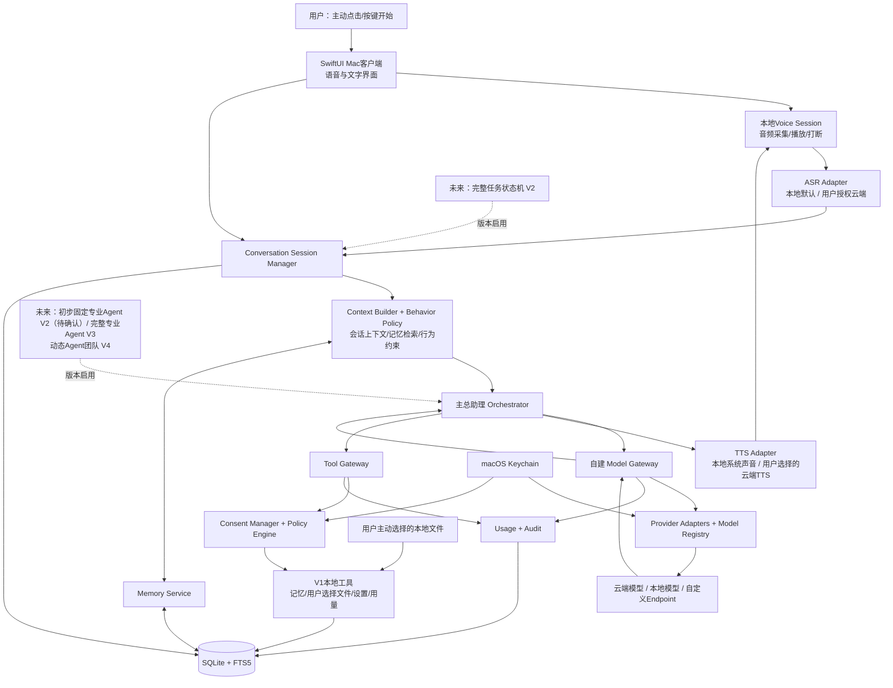
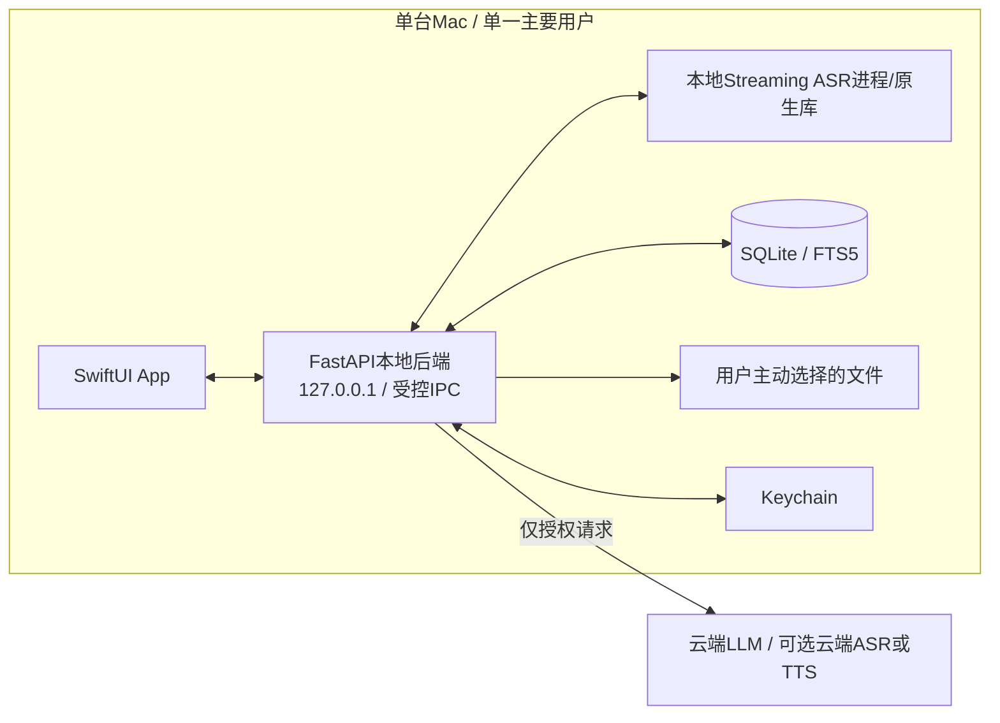
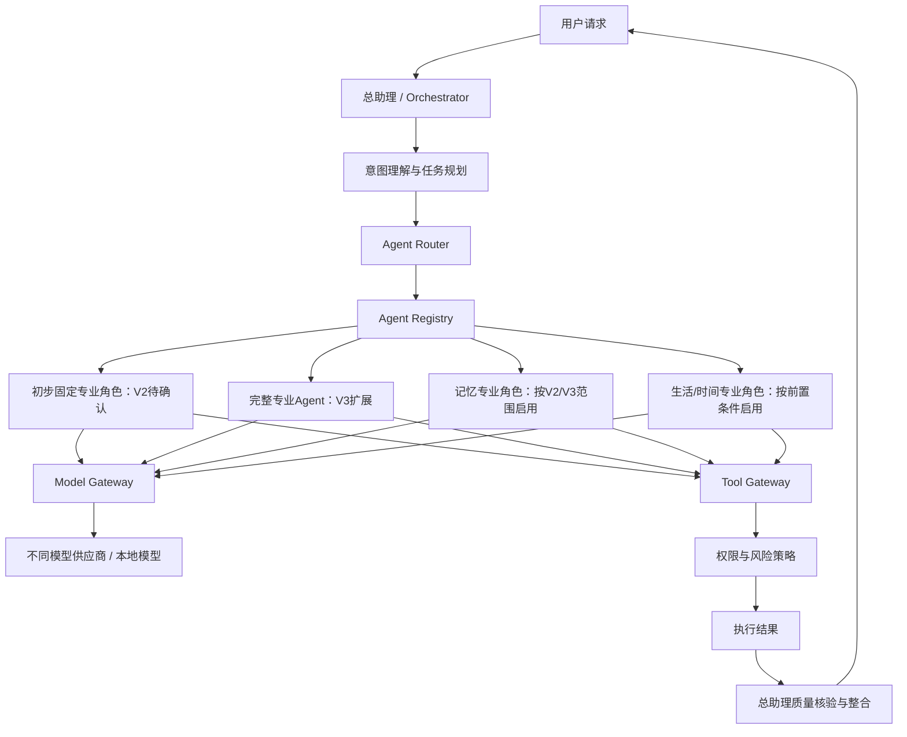

# 个人AI助理技术架构

> **版本：1.1（审核修订版）**  
> **修订日期：2026-11-07**  
> **技术基线：原《个人助理技术架构》V1.0**  
> **产品需求基线：《个人AI 助理产品构想书最终版.md》（2026-11-07）**  
> **参考硬件：Mac M1、统一内存16GB；该设备是初期验证基线，实际主力设备型号、内存、macOS版本和可用磁盘空间仍须在阶段0确认。**  
> **V1部署范围：一个主要用户、一台Mac、本地优先；不提供多用户云账号、外部平台连接、完整任务调度或跨设备任务执行。**

**阅读说明：本版保留V1.0的章节结构和主要技术路线。新增或实质修订的内容均使用粗体标示；未加粗内容原则上为原文保留。粗体标示的是本轮修改，不代表相关技术已经完成POC验证。**

---

## 文档定位与架构结论

本文将产品构想书中的目标转化为可实施的技术架构，说明推荐方案、选择理由、成本构成、优缺点、替代技术、版本安排和验证要求。它是技术设计基线，不等同于已经完成的详细开发规格；涉及硬件性能、模型效果、供应商地区支持和实际费用的部分，必须通过阶段0原型测试和上线前核对确认。

**本版以产品构想书中标记为【已确认】的产品要求及P0/P1/P2优先级为需求依据。产品构想书没有确认的事项，本文只提出技术建议并标为待决策或POC待验证，不将推断写成用户已作出的决定。发生范围冲突时，以产品构想书明确的版本边界为准；技术架构预留不等于该能力已纳入当前版本交付。**

**本文件属于“技术架构设计基线”。数据库字段、完整API Schema、UI交互、错误码、自动化测试用例和逐项验收脚本仍需在详细技术设计/开发任务中展开，不应将本文件视为完整的逐行开发规格。**

### 核心架构结论

**采用“Mac原生客户端 + 本地模块化后端 + 实时可切换语音引擎 + 自建多供应商Model Gateway + 总助理Orchestrator + 可配置多Agent + 本地优先记忆系统”的架构。**

1. **前端：SwiftUI + Swift。** V1先提供macOS原生体验；V1采用用户主动点击/按键开始语音会话并保留文字模式，不把持续环境监听或声纹唤醒作为发布前提。
2. **后端：Python + FastAPI。** 采用模块化单体，不在V1提前拆成微服务；本地辅助服务的启动、健康检查、退出和异常恢复必须定义清楚。
3. **实时语音识别：必须支持流式实时识别和中间结果。** 默认优先验证本地流式ASR；用户可主动切换至经过验证的云端实时ASR。ASR不得仅以整段录音上传后的批量转写作为V1方案。
4. **ASR、TTS与LLM分别配置。** V1至少交付一套稳定可用的识别/合成链路；语音识别、语音合成和对话模型配置相互独立。端到端Speech-to-Speech仅作为经POC验证的可选实验模式，不替代标准解耦链路。
5. **Model Gateway采用可扩展Provider Adapter。** 目标供应商包括DeepSeek、Qwen、Kimi/Moonshot、GLM/Zhipu、Gemini、Grok、OpenAI、Claude及Ollama等本地模型；V1按POC结果分批接入，不承诺每家供应商、每个模型都支持相同功能。支持用户配置兼容OpenAI API的自定义Endpoint，但必须单独验证能力和安全边界。
6. **多Agent是分阶段目标能力。** V1交付一个主要总助理、基础Orchestrator接口和可扩展Agent Registry数据结构；不交付完整专业Agent协作、动态Agent团队、后台委派任务或多Agent并行执行。**产品构想书的V2/V3分配存在一处不一致：13.4节把“固定专业助理”列入V2，而12.5阶段路线和13.4节V3又把固定专业角色/团队能力放在V3。本架构建议V2在任务底座和只读连接器成熟后，有限启用少量固定专业角色（不开放外部写操作和动态团队）；V3再扩展完整专业角色、多Agent协作和受控执行。此处需产品负责人确认。**动态Agent团队安排在V4。Agent未来可以独立绑定模型、工具和数据权限。
7. **数据库：V1 SQLite + FTS5。** V1只持久化对话、记忆、配置、授权、用量、审计和必要的会话恢复状态；完整任务状态机属于V2。PostgreSQL + pgvector留给跨设备、多用户或更高并发阶段。
8. **安全控制由本地系统掌握。** 模型只能提出工具调用请求，不能直接访问文件、数据库、凭据或执行系统命令；所有工具调用均经过Consent Manager、Policy Engine和Tool Gateway。记忆中的权限描述不构成实际授权。
9. **V1本地优先、云端按需调用。** V1仅处理用户与助理的对话及用户主动提供/明确选择的本地资料，不自动扫描整个Mac或连接邮件、聊天、日历等外部账户。活动SQLite数据库默认保存在Mac本地应用数据目录；NAS/云盘/网盘作为活动数据库位置须另行验证，不能直接放置共享SQLite文件。云端模型/语音调用前必须明确数据范围、服务商、区域和费用边界。
10. **V1不提供完整任务调度。** V1只保证当前语音/对话会话、对话上下文和已保存记忆的持久化与恢复；不运行用户委托的后台任务、不提供周期任务或跨设备任务迁移。完整任务状态机安排在V2，外部写操作安排在V3，跨设备任务接续安排在V4。
11. **V1的运行状态必须与任务管理区分。** 可以记录当前对话轮次、模型调用、错误和会话恢复信息，但不得将这些运行日志包装成完整的后台任务管理能力。
12. **本机身份和数据安全属于V1基础能力。** 敏感设置、记忆导出、凭据管理及备份恢复应受本机身份验证保护；应实现基本数据加密、访问隔离、存储空间和应用健康检查。

### 重要范围边界

本架构从一开始支持未来多Agent和多设备的扩展接口，但不因此把完整多Agent团队、自动外部写操作、跨设备任务迁移或云端多用户服务塞进V1。V1严格遵循产品构想书中单用户、单Mac、以语音和记忆为核心的范围。

**版本边界以产品构想书为准：V1不自动读取外部账户、不运行后台委托任务、不提供完整任务状态机、不实现iPhone远程交代Mac任务、不做跨设备同步。V1语音入口为主动点击/按键；本地唤醒词只有在阶段0证明可靠且另行纳入范围后，才可作为可选增强。**

**V1.1可增加产品构想书明确列出的记忆中心体验、导出/恢复优化、语音可靠性、基础快捷指令和简单本地提醒；V2进入完整任务管理、日历/待办只读连接器和受控通知，并可在前置条件满足后有限启用固定专业角色（版本归属待产品确认）；V3扩展完整固定专业Agent协作及受控外部写操作；V4启用跨设备接续和动态Agent团队。**

---

# 1. 目标、约束与设计原则

## 1.1 产品目标

系统需要逐步成为长期理解用户、能够自然交流、保留个人记忆、主动分析问题，并在授权范围内协调Agent和工具执行事务的个人AI助理。技术架构必须兼顾：

- 自然、低延迟、可打断的中文及中英混合实时语音。
- 可演进的长期记忆：事实、推测、事件、来源、有效时间和历史变化分开管理。
- 多模型、多供应商：不同任务及Agent可以使用不同模型。
- 多Agent协作：总助理负责任务路由、授权、质量和最终汇报。
- 本地优先：数据、凭据、记忆、权限和审计由用户设备控制。
- 可恢复、可追溯：进程中断、模型失败、任务失败时不伪造成功状态。
- 易维护：首版尽量减少服务数量、部署组件和需要用户手动管理的技术细节。

## 1.2 已知约束

| 约束    | 当前基线                                        | 对架构的影响                                                         |
| ----- | ------------------------------------------- | -------------------------------------------------------------- |
| 设备    | **Mac M1、16GB为初期参考设备；实际主力设备待确认**            | **阶段0记录准确型号、内存、macOS版本、磁盘空间和外接设备；以真实设备验收**                     |
| 首版产品  | 单用户、单台Mac                                   | 可使用SQLite和本地服务，不需要首版云端账号系统                                     |
| 语音    | 实时识别为硬性要求；用户可选语音模型                          | ASR必须支持流式音频输入和增量结果；ASR/TTS独立配置；**主动开始会话，不要求全天候监听**             |
| 模型    | 多供应商、可替换模型，支持自定义兼容Endpoint                  | 建立Provider Adapter、Model Registry和Model Gateway；**分批接入并逐型号验证** |
| Agent | 总助理是最高层助理；专业助理和动态团队分阶段开放                    | 将Agent路由与模型路由分离；**V1仅主要总助理；V2有限固定角色（待确认）/V3完整专业Agent；V4动态团队**  |
| 数据    | 本地优先，云端补充                                   | 敏感数据默认不出本机；云端调用按数据等级、供应商、区域和用途授权                               |
| 外部数据源 | **V1仅用户主动提供/选择的本地资料；外部连接器V2逐项启用**           | **不自动扫描磁盘，不连接邮件、聊天、通讯录、日历等外部账户**                               |
| 任务    | **V1仅会话恢复；V2完整任务状态机；V3受控写操作；V4跨设备接续**       | **不得将V1会话恢复扩写为后台任务调度**                                         |
| 成本    | 月度预算先测试后决定                                  | V1必须记录真实用量、费用和供应商分布，支持费用提示及用户设置预算/关闭云调用                        |
| 后续    | V1核心、V1.1体验增强、V2任务/只读数据源、V3受控执行、V4跨设备、V5产品化 | 通过稳定接口预留扩展，不提前部署分布式系统                                          |

## 1.3 设计原则

1. **本地优先，不等于完全离线。** 本地处理语音、记忆、文件和权限；经过授权的高复杂度推理可使用云端模型。
2. **实时语音优先于批量转写。** 用户说话时持续送入音频帧，系统返回中间文本或部分结果，结束一个语句后再发出最终文本。
3. **语音模型与语言模型解耦。** 用户更换ASR不应该被迫更换Agent的大模型；更换Agent模型也不应该改变实时语音识别模型。
4. **Agent路由与模型路由解耦。** 先确定由哪个Agent负责，再按该Agent绑定的模型策略选择具体模型。
5. **模型只提出请求，应用负责执行。** function calling不是授权，工具调用必须经过权限、参数、数据等级和风险检查。
6. **能力声明优先于厂商品牌。** 每个模型都登记其流式、工具调用、JSON Schema、视觉、音频、上下文、地域和价格能力。
7. **默认串行，按需并行。** 多Agent并行必须有明确任务收益、预算限制和完成条件。
8. **模块化单体优先。** 先有清楚的模块边界，再按性能、隔离或部署需求拆分独立服务。
9. **重要操作可审计、可恢复。** 写入采用幂等键、状态记录和结果核验；不能撤销的操作须先确认并披露影响。
10. **数据删除不是界面隐藏。** 必须明确处理原文、摘要、索引、向量、缓存、备份和审计元数据。
11. **记忆不等于授权。** 用户偏好、历史对话或记忆条目不能赋予Agent访问数据源、调用工具或向云端发送数据的权限；权限以有效授权记录和Policy Engine判断为准。
12. **V1会话恢复不等于任务管理。** V1可以恢复未完成的对话轮次和上下文，但不得显示或承诺后台业务任务正在运行；完整任务状态机从V2开始。
13. **产品愿景与版本交付分开。** 文档可预留远期接口，但必须标注其状态为POC、预留、后续版本或已交付，避免把长期愿景误写为V1验收项。

---

# 2. 总体系统架构

## 2.1 逻辑架构图

**下图用Mermaid源码替代V1.0中的本机绝对路径图片，确保Markdown文件在其他设备和代码仓库中可以直接显示。V1实际只部署一个Mac客户端和一个本地模块化后端；图中的未来专业Agent及任务服务以版本标签区分，不代表V1已经启用。**



**信任边界：模型供应商只能接收经过本地Policy Engine检查并获得有效授权的数据；供应商凭据不交给模型。模型产生的工具调用只是请求，必须经过Tool Gateway验证。V1不连接外部平台、不开放外部写操作。**

### **V1部署视图**



**V1本地服务即使作为登录辅助进程运行，也不代表执行用户委托的后台业务任务或持续监听环境声音。语音必须由用户主动开始；Mac休眠/关机时不承诺本机继续执行。**

说明：该图是逻辑关系，不代表V1需要部署多个服务器。V1可将API、Agent、记忆、权限、网关和数据库模块放在同一个本地后端进程中；语音推理可使用同进程原生库或受控子进程。

## 2.2 部署形态

**V1：Mac应用 + 本地后端辅助服务。**

- SwiftUI负责界面、麦克风权限、音频播放、系统通知和用户设置。
- FastAPI作为本地后端，默认只监听 `127.0.0.1`。
- 本地数据库、文件资料、记忆索引和审计日志存放在用户指定的本地数据目录。
- API Key保存在Keychain，不放进数据库、日志或前端代码。
- 云端请求仅由本地后端发起，供应商密钥不直接暴露给模型网页、插件或外部内容。

**V2–V4：按需增加任务执行节点和设备同步。**

- 只有当跨设备、Mac休眠时的后台任务或远程接入成为真实需求，才增加私有云节点。
- 节点之间需要设备身份、加密通信、权限继承、状态同步和任务防重复机制。

**V5：多用户云服务。**

- 再评估PostgreSQL、对象存储、任务队列、身份服务、容器编排和多租户隔离。
- 不建议从V1直接上Kubernetes或微服务集群。

## **2.3 关键运行数据流与异常边界**

**语音到回复的标准链路：用户主动开始会话 → 本地采集音频 → VAD/ASR持续产生中间结果 → 语句结束产生最终文本 → Context Builder组合本轮对话、必要记忆和行为规则 → 主总助理调用Model Gateway → 本地Policy Engine检查云端数据范围和模型权限 → 模型返回文本/工具请求 → 如有工具请求则经Tool Gateway校验并执行V1本地工具 → TTS生成语音 → 客户端播放。**

**任何阶段失败都必须返回明确状态。ASR partial不得写入长期记忆或触发高风险行为；模型超时不得伪装成完成；TTS被打断时应停止当前播放、清理待播片段并取消仍可取消的生成请求。V1只恢复会话上下文，不恢复不存在的后台任务。**

---

# 3. 前端技术选型

## 3.1 推荐方案：SwiftUI + Swift

| 项目       | 选型                           | 选择理由                                   |
| -------- | ---------------------------- | -------------------------------------- |
| 桌面界面     | SwiftUI                      | macOS原生体验、系统交互能力好，适合语音优先界面和控制中心        |
| 音频采集/播放  | AVFoundation / AVAudioEngine | 原生音频输入输出、缓冲和播放控制                       |
| 系统语音播放   | AVSpeechSynthesizer          | V1可作为本地TTS候选，支持本机合成和播放控制               |
| 本机生物认证   | LocalAuthentication          | 敏感操作可请求Touch ID或系统认证                   |
| **本地通知** | **UserNotifications**        | **V1仅应用内状态提示；V1.1可用于简单本地提醒，不承诺外部通知渠道** |
| 凭据       | Security / Keychain          | 使用系统凭据存储API Key和本机访问凭据                 |
| 网络       | URLSession                   | REST和WebSocket通信                       |
| 动画       | SwiftUI Animation / Canvas   | 语音状态球、音频波形和运行状态展示                      |
| 测试       | XCTest / Swift Testing       | UI、状态和系统能力测试                           |

### 优点

- 与Mac系统能力集成直接。
- 音频采集、播放中断、设备选择和系统权限管理更自然。
- 对V1单一Apple平台而言，减少跨平台框架桥接问题。
- 后端接口稳定后，未来iPhone可使用Swift/SwiftUI复用部分模型、状态和API客户端代码。

### 缺点

- Windows和Linux不能直接复用SwiftUI界面。
- 需要掌握Swift和Apple应用打包、签名、权限及分发流程。
- 后台辅助服务的打包、启动、崩溃恢复和应用更新需要专门设计。

### 替代方案

| 替代方案             | 优点                         | 缺点                       | 何时选择                    |
| ---------------- | -------------------------- | ------------------------ | ----------------------- |
| Tauri + React    | 跨平台、前端生态大、应用体积通常比Electron轻 | Rust桥接和原生音频集成仍需额外工程      | 若未来很早就必须支持Windows/Linux |
| Electron + React | Web开发生态成熟，桌面UI开发快          | 运行时相对重、内存占用需关注           | 若团队主要是Web开发且可接受额外资源     |
| Flutter          | 多端UI复用较好                   | macOS系统级音频和安全能力需要插件/原生桥接 | 若手机端和桌面端需要高度共用UI        |

**决策：V1采用SwiftUI，不为跨平台过早牺牲Mac原生体验。**

成本：Swift、SwiftUI和系统框架本身没有单独软件许可费；开发者计划、签名和分发费用按Apple当期规则另计。替代框架的许可成本通常也低，但会增加桥接和适配开发时间。

### **3.2 V1交互和后台进程边界**

**V1语音会话采用用户主动点击/按键开始；用户可以切换文字模式、停止会话和打断语音输出。V1不把持续环境监听、声纹身份识别或全天候唤醒作为硬性能力。**

**本地后端/辅助进程可以按安装配置在用户登录时启动，以提供本地API和健康状态，但“进程在后台运行”不等于“后台任务正在执行”。V1不得在无用户会话时自动采集麦克风、执行委托任务或向外部渠道发通知。**

**V1应用在锁屏、切换macOS用户或退出时，应按策略暂停语音输入并保护界面；关闭窗口、退出应用、用户注销、Mac休眠、Mac关机和断网必须作为不同运行状态分别处理。**

---

# 4. 后端技术选型

## 4.1 推荐方案：Python + FastAPI

| 组件      | 建议版本/技术                     | 主要用途                     |
| ------- | --------------------------- | ------------------------ |
| 语言      | Python 3.11起，最终以依赖兼容性测试确定   | Agent、模型、记忆和数据处理         |
| API框架   | FastAPI                     | REST、SSE、WebSocket和API文档 |
| 数据校验    | Pydantic 2                  | 配置、输入、输出和Agent结构化结果      |
| ORM     | SQLAlchemy 2                | 数据访问抽象                   |
| 数据迁移    | Alembic                     | 数据库结构版本管理                |
| HTTP客户端 | HTTPX                       | 供应商API请求                 |
| 日志      | Python标准logging + structlog | 结构化日志                    |
| 依赖管理    | uv                          | Python环境、依赖锁定和项目管理       |
| 测试      | pytest                      | 单元、集成和回归测试               |

### 选择理由

- Python的AI、模型SDK、数据处理、向量检索和Agent生态成熟。
- FastAPI支持异步请求、类型校验、OpenAPI文档和WebSocket。
- Pydantic适合统一不同供应商的请求/响应结构。
- 模块化单体适合V1，开发和部署成本低于微服务。

### 缺点

- Python异步并发、音频流和后台线程需要谨慎管理。
- CPU密集型ASR/Embedding不应阻塞API事件循环。
- 打包成普通Mac应用时，需要管理Python运行环境及原生依赖。

### 关键实现要求

- FastAPI只承担业务协调和API，不把ASR推理直接跑在请求事件循环中。
- 重计算模块通过原生库、受控线程或子进程运行，并设置超时和资源上限。
- V1使用少量进程：主后端、必要时的本地ASR工作进程；不引入Redis/Celery。
- 所有配置集中管理，开发、测试和正式运行配置分离。
- **本地后端需要健康检查、启动超时、优雅关闭、异常退出记录和有限重启策略；不得无限重启造成CPU/内存占用或重复请求。**
- **Python运行时及原生依赖应随应用以可复现方式打包，锁定依赖版本；启动时执行兼容性与数据库迁移检查，失败时保留旧数据并给出可理解的恢复步骤。**
- **本机客户端访问后端使用短期会话凭据或受控IPC；密钥不得放入命令行参数、普通环境变量转储或可读配置文件。**

### 替代方案

- Django：有完整后台和ORM，但V1偏重。
- Flask：简单，但需要自行组合更多基础设施。
- Go：部署和并发性能优秀，但模型生态和开发便利性不如Python。
- Rust：适合高性能语音/安全组件，不建议作为整个AI业务层的首选语言。

成本：Python/FastAPI等开源组件无软件许可费，主要成本是开发、测试、依赖维护和应用打包。

---

# 5. 实时语音架构

## 5.1 硬性要求

**语音识别必须支持实时流式输入和实时增量识别。** 不得以“录制整段音频，结束后才上传并转写”的批处理方式作为V1的唯一语音识别能力。

系统需要支持：

- **V1由用户主动点击/按键开始会话；不默认持续监听环境声音。**
- 音频帧持续采集和发送。
- 实时中间识别结果（partial/intermediate result）。
- 语句结束后的最终识别结果（final result）。
- VAD语音活动检测和端点检测。
- 用户打断、暂停、继续和结束会话。
- 中文及中英混合表达。
- 热词、上下文提示和专有名词增强（取决于所选引擎能力）。
- 识别不确定时允许修订；重要姓名、金额、日期和承诺不能只依据未确认的中间结果写入长期记忆。

## 5.2 语音模型选择必须由用户控制

语音设置独立于大语言模型设置。用户可以按需选择：

1. **ASR（语音识别）提供商和模型**：默认本地流式识别；可切换Qwen实时ASR及未来其他支持实时流式的服务。
2. **VAD/端点检测**：本地VAD或云端服务端VAD，按所选ASR能力配置。
3. **TTS（语音合成）提供商和模型**：默认本地系统声音；可选Qwen等云端实时/流式TTS。
4. **声音和表达参数**：声音、语速、音量、情绪风格等，仅在引擎支持时显示。
5. **语言与热词**：默认中文，可支持中英混合和人物、公司、项目名称词表。

用户切换ASR不应强迫切换TTS或Agent大模型。用户切换某个Agent的大模型，也不应影响当前ASR模型。

**V1交付口径：至少提供一套在目标Mac上稳定可用的实时识别与语音合成链路，保存用户选定的声音/模型配置，并提供文字模式作为备用。云端ASR/TTS必须由用户主动选择并完成相应授权；本地链路失败时不得静默把音频上传云端。**

## 5.3 本地默认ASR：sherpa-onnx Streaming ASR

**首选本地POC：sherpa-onnx的Streaming ASR模型。**

选择理由：

- 项目支持离线语音识别及流式、非流式识别。
- 官方列出macOS arm64（Apple Silicon，包括M1）支持。
- 提供Python、C/C++、Swift等多种语言接口，便于与SwiftUI和FastAPI结合。
- 项目文档包含中文实时/流式ASR示例，并列出Qwen3-ASR 0.6B INT8的本地模型示例。
- 音频无需上传云端，符合本地优先和隐私目标。

潜在问题：

- 不同预训练模型的中文准确率、延迟、内存、模型授权和热词能力不同。
- 有些模型虽然支持流式接口，但仍可能以分块或增量解码形式产出结果；必须实际测试中间结果延迟和修订行为。
- M1 16GB上还要同时运行UI、数据库、Embedding和后端，不能只测试单独ASR进程。

候选模型和POC：

- sherpa-onnx官方支持的中文Streaming模型。
- sherpa-onnx文档中的Qwen3-ASR 0.6B INT8模型示例。
- 其他符合许可、支持中文和Apple Silicon的流式Transducer/Zipformer/Paraformer类模型。

本地ASR的API软件成本为0；需考虑模型下载、磁盘空间、设备内存、电力和开发维护。模型权重文件的许可必须单独核查，不能仅因推理引擎开源就认定所有模型均可任意再分发。

## 5.4 用户可选云端实时ASR：云端模型默认Qwen系列

Qwen作为第一批可选语音供应商，优先验证：

- `qwen3-asr-flash-realtime`
- `qwen-audio-3.1-asr-flash-streaming`
- Qwen后续提供并支持目标地区的实时ASR型号

其官方文档说明实时ASR通过WebSocket接收音频流，并支持VAD或Manual等会话方式；文档列出新加坡（ap-southeast-1）可用的Qwen实时ASR型号。模型、区域和API Key必须匹配，具体以供应商控制台和文档为准。

优点：

- 不占用Mac本地ASR模型的主要计算资源。
- 有实时增量识别、服务端VAD、上下文/热词等能力（以具体型号为准）。
- 适合用户希望更高识别质量或本地模型性能不足时切换。

缺点：

- 音频会离开Mac并由云端供应商处理。
- 产生按音频时长、请求或模型规则计费的费用。
- 依赖网络、服务可用性、区域、并发和限流。
- 不能把服务商的“新加坡API入口”直接理解为其所有处理、日志和备份都只位于新加坡；必须核对合同、数据政策和实际处理范围。

**切换原则：**用户在设置中主动选择Qwen实时ASR后，系统显示音频将发送至哪个供应商/区域及费用方式，并保存用户授权。不得因为本地ASR失败而未经授权自动上传音频。

## 5.5 ASR其他候选方案

| 方案                    | 类型    | 优点                      | 缺点/风险                                 | 建议                    |
| --------------------- | ----- | ----------------------- | ------------------------------------- | --------------------- |
| sherpa-onnx Streaming | 本地    | 离线、Apple Silicon支持、流式接口 | 模型效果和延迟需实测                            | V1默认本地POC首选           |
| Qwen ASR Realtime     | 云端    | WebSocket实时流、中文和多语言支持   | 音频出本机、按用量计费、依赖网络                      | V1用户可选云端引擎            |
| 腾讯云实时ASR              | 云端    | WebSocket实时识别，中文方言覆盖广   | 新供应商凭据、计费和数据策略需单独审查                   | 可作为后续备选               |
| Grok Streaming STT    | 云端    | 提供流式语音识别API             | 区域、价格、语言质量与实时延迟要单独验证                  | 第二批候选                 |
| whisper.cpp           | 本地/离线 | 生态成熟、离线文件转写好            | 常见实时方式是分块/滑窗增量转写，不应未验证就称为严格流式端点       | 辅助文件转写，不作为默认实时ASR唯一实现 |
| 云端端到端Speech-to-Speech | 云端    | 延迟可能更低，音频理解和语气处理更完整     | 语音、推理和TTS绑定同一模型；跨Agent/跨供应商路由和成本控制更复杂 | 可选实验模式，不能替代标准解耦流水线    |

## 5.6 TTS语音合成选择

建议V1默认本地使用AVSpeechSynthesizer，用户可选择云端TTS。

| 方案                    | 优点                  | 缺点                   | 成本方式               |
| --------------------- | ------------------- | -------------------- | ------------------ |
| AVSpeechSynthesizer   | 本地、无第三方API调用费、系统集成好 | 声音自然度、情绪和角色个性受系统声音限制 | 无TTS API费用；系统资源成本  |
| Qwen TTS / CosyVoice等 | 可选音色、自然度和流式能力较丰富    | 网络、费用、数据发送和服务版本依赖    | 按字符、音频Token或服务规则计费 |
| 其他云端TTS               | 可扩展不同语言和音色          | 要维护不同接口和声音配置         | 按供应商价格表计费          |

TTS应独立Adapter化，支持流式音频片段播放、停止、队列清理和被打断后的残余音频取消。

### **5.6.1 语音身份、表达和保留规则**

**产品要求声音身份保持稳定，语气、语速、停顿和情绪表达可按场景调整。V1应保存用户选择的声音配置；若具体TTS引擎不支持情绪或部分表达参数，界面不得显示为可用能力。声音配置切换不得隐式改变ASR或LLM配置。**

**原始音频默认不持久化保存。采集缓冲仅为实时识别所需，语句完成、会话关闭或异常终止后按清理策略删除；崩溃转储和调试日志不得意外包含原始音频。转写文本与原始音频分开保存，作为对话记录的转写文本按用户可见的保留策略管理。具体文本保留期限、临时缓存最长时长和备份清理周期属于V1发布前待决策项。**

## 5.7 实时语音会话状态机

建议至少定义以下状态：

```text
IDLE
  -> CONNECTING
  -> LISTENING
  -> TRANSCRIBING_PARTIAL
  -> UTTERANCE_FINALIZED
  -> THINKING
  -> SPEAKING
  -> INTERRUPTED
  -> LISTENING / IDLE
```

关键事件：

- `audio.frame`：音频帧到达。
- `asr.partial`：中间识别文本，可持续修订。
- `asr.final`：当前语句最终文本。
- `vad.speech_started` / `vad.speech_ended`：语音活动开始/结束。
- `assistant.response_started`：开始回复。
- `assistant.audio_chunk`：TTS音频片段。
- `user.interrupt`：用户打断，立即停止播放并取消未完成生成。
- `session.paused` / `session.resumed` / `session.closed`：会话状态变更。

**注意：中间识别文本不能直接触发高风险工具和长期记忆写入。** 只有最终文本，或经过用户确认的文本，才能进入后续语义判断。

## 5.8 实时语音数据流

本地ASR模式：

1. SwiftUI/AVAudioEngine采集麦克风音频。
2. 音频帧送入本地ASR进程或原生库。
3. ASR持续返回中间文本和最终文本。
4. 语音会话管理器把最终文本交给主要总助理Orchestrator。
5. **V1由主要总助理按自身模型绑定调用Model Gateway；V2/V3专业Agent启用后，才按Agent Router规则选择对应Agent及其模型。**
6. TTS Adapter生成本地或云端语音片段。
7. 客户端播放，并允许用户随时打断。

云端Qwen ASR模式：

1. 客户端音频帧进入本机后端。
2. 本地后端使用Keychain中的Qwen凭据建立供应商WebSocket连接。
3. 按供应商协议发送实时音频帧，接收中间结果和最终结果。
4. 后端将标准化ASR事件返回客户端。
5. 用户最终文本进入总助理流程。

云端API Key不得写入SwiftUI代码或传给模型；客户端不应直接持有长期供应商凭据。

## **5.9 实时音频协议与设备处理要求**

**正式实现前应形成独立的音频协议Schema，至少明确：采样率（`sample_rate_hz`）、声道数（`channels`）、编码格式（如PCM或供应商要求的压缩格式）、位深（如适用）、帧时长（`frame_duration_ms`）、帧序号、采集时间戳、音频会话ID、utterance ID、结束原因和错误码。不同ASR供应商的采样格式要求应由Adapter转换，不得让UI依赖单一厂商格式。**

**帧时长和采样率先以候选配置进入POC，最终值按本地模型和云端供应商协议分别确定，不在架构稿中假定所有服务完全一致。音频队列必须有上限和背压策略；处理速度落后时应告知用户或安全终止当前识别，不得静默丢弃关键音频后继续声称转写完整。**

**产品要求支持用户插话和打断。POC需验证TTS播放期间的麦克风采集、回声消除（AEC）、噪声抑制、VAD和插话检测；如无法可靠区分扬声器回声与用户声音，应保留按键/点击打断作为可靠备用入口。是否实现真正的全双工体验以POC结果为准，不将其作为未经验证的性能承诺。**

**用户打断时应通过同一`response_id`或等效关联标识取消当前模型生成、TTS生成和待播音频队列；无法取消的供应商请求需标记为已忽略/仍在服务端运行，不能把停止本地播放等同于已取消供应商计费。**

---

# 6. 多模型接入与自建Model Gateway

## 6.1 总体原则

**Model Gateway由本项目自行建设和掌控，不依赖单一第三方聚合平台作为唯一入口。可以参考借鉴 github上非常成熟的其他model gateway。**

它负责统一接入、模型能力注册、请求转换、流式输出、成本统计、权限约束、故障处理和Agent模型绑定。

Model Gateway不负责决定整个用户任务应该交给哪个Agent；这由总助理的Agent Router负责。两者必须分离。

## 6.2 V1供应商接入范围

从架构上支持并计划接入以下供应商：

**供应商清单代表架构目标和候选接入范围，不代表V1发布时必须完成所有厂商、所有型号和所有模态的接入。V1需先有稳定的统一契约，并完成一组经过测试的主流供应商；其余适配器按真实使用价值、地区可用性、费用和维护能力分批加入。用户配置自定义OpenAI兼容Endpoint时，也必须经过连通性、能力和数据策略校验。**

| 供应商                | 主要用途候选                 | 接入方式                           | 优点                     | 注意事项/缺点                    |
| ------------------ | ---------------------- | ------------------------------ | ---------------------- | -------------------------- |
| OpenAI             | 通用推理、结构化输出、工具调用、多模态    | 官方SDK / API                    | 工具调用、流式和生态能力完整         | 模型能力和价格随型号不同；需管理API费用      |
| DeepSeek           | 通用推理、代码、成本敏感型任务、工具调用   | 官方API；部分接口兼容OpenAI/Anthropic格式 | 接口迁移方便，提供工具调用和流式输出     | 不同推理模式的工具调用限制、模型升级和价格规则需登记 |
| Qwen               | 中文、通用推理、视觉、工具调用和语音相关模型 | 官方Model Studio/DashScope API   | 中文生态丰富；新加坡区域有模型与实时语音入口 | 模型和能力按地区不同，需选择正确区域和API Key |
| Kimi / Moonshot    | 长文本、文件理解、研究和Agent任务    | 官方Kimi API                     | 提供OpenAI格式兼容接口，便于集成    | 具体型号的上下文、工具和地区能力需核实        |
| GLM / Zhipu        | 中文推理、工具调用、Agent任务      | 智谱官方API/SDK                    | 国内模型生态及工具能力            | 不同版本对tool调用参数和流式事件可能存在差异   |
| Gemini             | 多模态、长上下文、低成本任务和工具调用    | Google官方GenAI SDK/API          | 文本、图像、音频等能力覆盖较广        | 地区可用性、免费/付费数据政策和模型预览状态需核对  |
| Grok / xAI         | 通用推理、工具调用、联网/X相关能力     | xAI官方API                       | 支持自定义工具及部分服务端工具        | 区域、模型版本、工具调用事件和费用变化需跟踪     |
| Claude / Anthropic | 复杂分析、长文档、代码和Agent任务    | Anthropic官方SDK/API             | 工具使用和复杂知识工作能力          | 独立API格式和部分工具协议需适配          |
| Ollama / 本地模型      | 本地轻量任务、隐私敏感任务、离线辅助     | 本地HTTP API或原生适配器               | 无云端Token账单，资料可留在设备     | M1 16GB计算和内存有限，模型速度/效果需筛选  |

架构应允许用户后续添加兼容OpenAI API的自定义Endpoint，但不得只因接口兼容就默认支持完整工具调用、视觉、音频或严格JSON Schema。

## 6.3 Provider Adapter设计

每个供应商有独立适配器，统一暴露：

```python
class ModelProviderAdapter:
    async def generate(self, request): ...
    async def stream(self, request): ...
    async def call_with_tools(self, request): ...
    async def validate_connection(self): ...
    async def list_or_validate_models(self): ...
    async def estimate_cost(self, request): ...
    async def normalize_error(self, error): ...
```

供应商适配器负责：

- Base URL、区域、认证和请求格式。
- 不同消息角色、工具定义和工具结果转换。
- 流式事件解析。
- Function Calling参数累积和JSON校验。
- 供应商错误码归一化。
- Token、缓存Token、音频时长和费用信息解析。
- 超时、限流、重试和熔断策略。

不允许业务层直接拼接某一家厂商的专用字段。厂商特有参数通过Adapter能力声明和显式配置传递。

## 6.4 Model Registry（模型注册表）

每个可用模型至少登记：

| 字段                             | 说明                        |
| ------------------------------ | ------------------------- |
| `provider_id`                  | 供应商标识                     |
| `model_id`                     | 供应商模型ID，保持原样              |
| `display_name`                 | 用户界面显示名称                  |
| `model_family`                 | 通用、推理、代码、视觉、音频、Embedding等 |
| `context_limit`                | 上下文长度（未知时不得猜测）            |
| `supports_streaming`           | 是否支持流式文本输出                |
| `supports_tools`               | 是否支持工具调用                  |
| `supports_parallel_tools`      | 是否支持并行工具调用                |
| `supports_json_schema`         | 结构化输出能力及严格程度              |
| `supports_vision`              | 是否支持图像输入                  |
| `supports_audio_input`         | 是否支持音频输入                  |
| `supports_audio_output`        | 是否支持音频输出                  |
| **`supports_embeddings`**      | **是否支持Embedding生成**       |
| **`supports_rerank`**          | **是否支持重排序**               |
| **`supports_realtime_audio`**  | **是否支持实时音频/双向流式会话**       |
| **`supports_batch`**           | **是否支持批处理接口**             |
| **`supports_cancellation`**    | **是否支持请求取消/中止**           |
| `region`                       | 可用区域或端点                   |
| `data_policy_ref`              | 数据使用与保留政策来源               |
| `input_price` / `output_price` | 当前价格表快照及单位                |
| `capability_verified_at`       | 最近一次能力验证日期                |
| `status`                       | 推荐、有限使用、停用或待验证            |

价格和模型能力会变化，不能把静态价格硬编码进业务规则。管理员/用户应能够刷新或更新模型清单，升级前运行能力回归测试。

## 6.5 统一模型能力层

不能把供应商统一成一个最低共同能力后就丢失高级特性。建议支持两层：

- **标准能力层：** 普通文本生成、流式输出、工具调用、JSON结构化输出。
- **扩展能力层：** 视觉、音频、多模态、联网搜索、缓存、推理模式、供应商特有参数。

Orchestrator和Agent通过能力声明选择模型。模型不具备某能力时，应明确降级、换模型或要求用户选择，不能静默假装支持。

## 6.6 成本模型

供应商常见计费维度：

- 输入Token、输出Token、推理Token。
- 缓存读写Token。
- **订阅计划、预付费额度和其他套餐型计费方式。**
- 音频输入/输出Token或会话分钟数。
- 语音识别分钟数、语音合成字符数。
- 搜索、代码执行、文件解析等工具调用次数。
- 专用部署或数据地域附加费用。

Model Gateway要记录供应商返回的usage，无法取得真实费用时，标记为估算，不得标记为实际账单。

每次调用记录：供应商、模型、所属Agent（V1为主要总助理）、**会话/轮次ID（V1）或任务ID（V2以后）**、调用用途、数据等级、Token、音频时长、重试次数、延迟、返回状态、估算/实际费用和用户授权依据。

**月度API预算暂不定值。** V1先测量真实对话、语音、记忆检索和长文本分析等代表性样本，再由用户决定预算。由于V1不交付完整多Agent团队，不能将“多Agent调用”作为V1实际用量的前提；多Agent预算在V3/V4启用前另行测量。

**用户可设置费用提醒、软预算和硬停止阈值；达到硬停止阈值时保存会话上下文并暂停收费请求，不自动充值、不自动升级到更贵模型。账单币种应保留供应商原币种，并可按带时间戳的汇率展示用户选择的本地参考币种；估算费用与供应商实际usage/账单必须区分。**

## 6.7 故障与切换策略

- Key无效：停止当前供应商请求，提示用户更新Key；不循环尝试。
- 额度不足：暂停或按用户授权切换；不能自动充值。
- Rate Limit：按供应商要求退避，有限次数重试。
- 网络超时：保存上下文并有限重试。
- 服务异常：检查模型注册表中的备用模型。
- 备用模型切换前：重新检查数据等级、数据区域、工具兼容性和价格。
- 高风险任务：不得只因主模型失败就自动改用未经验证的低能力模型。
- 工具调用格式不兼容：Adapter校验并返回可解释错误，不执行不完整参数。

**模型故障切换不得扩大数据授权或费用权限。**

### **6.8 开源Model Gateway参考项目与自建边界**

**本节用于借鉴成熟项目的接口、路由和治理设计，不代表必须把第三方Gateway作为V1运行依赖。以下对比依据项目公开文档/GitHub仓库在2026-11-07可见的信息；项目能力、许可、维护状态和商业功能边界可能变化，正式采用前应固定版本并复核LICENSE、Release、Security Policy和依赖清单。**

| 项目                                                       | 主要形态与优势                                                                                              | 对本项目的参考价值                                                               | 主要考虑/建议                                                                                   |
| -------------------------------------------------------- | ---------------------------------------------------------------------------------------------------- | ----------------------------------------------------------------------- | ----------------------------------------------------------------------------------------- |
| [LiteLLM](https://github.com/BerriAI/litellm)            | **Python SDK与可自托管Proxy/Gateway；提供多供应商统一调用、流式、Router、Fallback和用量/费用能力；官方资料说明其开源核心采用MIT许可。**           | **与本项目Python技术栈接近，适合研究Provider Adapter、统一请求/响应、模型命名、重试、Fallback和成本归属。** | **若直接运行Proxy，会引入另一层服务、配置和安全维护；需确认当前版本依赖、数据库/缓存需求和日志脱敏。优先作为POC对照或可选SDK，而非默认取代本项目的权限与审计层。** |
| [Bifrost](https://github.com/maximhq/bifrost)            | **Go实现的自托管AI Gateway，公开资料列出多Provider统一接口、模型路由、Fallback、负载均衡、Virtual Keys、预算和可观测性；仓库标示Apache-2.0许可。** | **适合参考高性能代理、Provider Catalog、路由/熔断、指标与治理模块的边界。**                        | **作为独立Gateway会增加进程和部署复杂度；其企业能力与开源核心的边界需要按版本核实。对于V1单用户Mac，不应仅为追求吞吐引入额外服务。**                |
| [Portkey Gateway](https://github.com/Portkey-AI/gateway) | **TypeScript开源Gateway，公开README列出多模型接入、重试、Fallback、负载均衡和Guardrail集成。仓库README同时标注Gateway 2.0为预发布方向。**  | **可参考配置驱动的Retry/Fallback、Guardrail Hook和Provider集成方式。**                 | **应关注预发布分支与稳定版本的功能差异、开源版和托管/企业版边界、版本维护情况；不建议未经版本审查就作为V1核心依赖。**                            |

**V1推荐决策：继续自建项目级Model Gateway，保留Provider Adapter和Model Registry的自主控制权；先通过官方SDK/HTTP适配器接入经选定的主流供应商。LiteLLM与Bifrost作为POC比较对象，Portkey作为参考对象。若POC证明直接采用某项目可以显著降低维护成本且不会绕过本地Consent/Policy/Audit控制，再单独提交ADR决定是否集成。**

**无论是否采用开源Gateway，以下能力必须由本项目掌握：用户授权、数据等级、Agent/工具权限、供应商白名单、区域限制、预算硬停止、敏感数据脱敏、审计最小化和删除策略。不得把这些安全职责完全外包给Model Gateway。**

### **6.9 供应商接入分层与能力验收**

**供应商接入分为三个层次：①建立统一接口和能力注册规范；②对V1首批实际使用的2～3家代表性服务完成端到端深度测试；③其余供应商按需增加。这个数量是推荐的POC节奏，不是对用户最终选择供应商数量的限制。**

**每个具体模型必须分别验证普通生成、流式、工具调用、严格JSON Schema、视觉、音频、取消、费用返回、区域和数据政策。兼容OpenAI API格式仅代表部分请求/响应协议相似，不自动证明工具调用、多模态、错误语义或严格结构化输出兼容。**

---

# 7. 多Agent系统架构

## 7.1 目标结构



**版本说明：上图展示目标架构，不代表V1即有多个独立Agent并发执行。V1以一个主要总助理为产品入口；Orchestrator/Agent接口和Registry结构可以先行建立。**产品构想书对固定专业角色的V2/V3归属存在表述差异；本架构建议V2在任务底座成熟后有限启用少量固定角色，V3扩展为完整专业Agent和受控协作，须由产品负责人确认。**动态创建/多层委派/团队并行在V4启用。阶段0可用模拟任务验证设计，不得把模拟POC能力计入V1产品功能。**

## 7.2 职责划分

**总助理（Orchestrator）**：

- 识别用户真正目标和上下文。
- 将复杂请求拆解为子任务。
- 从Agent Registry选择最合适的Agent。
- 决定串行或并行执行。
- 限制Agent数量、层级、调用次数、时间和预算。
- 检查权限和数据等级。
- 对Agent结果进行交叉验证、冲突处理和最终汇总。
- 负责向用户解释结果和未完成事项。

**专业Agent**：

- 有独立角色说明、任务边界和领域能力。
- 可以绑定不同的大模型。
- 只能使用授权的工具和数据源。
- 可保存工作上下文，但不得复制或扩大总助理权限。
- 返回结构化结果，包括依据、限制、成本、状态和不确定性。

## 7.3 Agent Registry（Agent注册表）

每个Agent配置至少包含：

| 字段                        | 说明             |
| ------------------------- | -------------- |
| `agent_id`                | 唯一ID           |
| `name`                    | Agent名称        |
| `description`             | 负责什么任务、不负责什么任务 |
| `capabilities`            | 专业能力标签         |
| `task_types`              | 可接受任务类型        |
| `primary_model_binding`   | 首选供应商/模型       |
| `fallback_model_bindings` | 经授权的备用模型列表     |
| `model_selection_mode`    | 固定模型、用户选择或自动选择 |
| `tool_allowlist`          | 允许使用的工具        |
| `data_access_policy`      | 可以访问的数据等级和数据源  |
| `budget_policy`           | 单任务/单日/单月预算    |
| `max_steps`               | 最大推理/工具步骤      |
| `timeout_seconds`         | 超时边界           |
| `max_delegation_depth`    | 最大下级委派深度       |
| `status`                  | 启用、暂停、归档       |
| `prompt_version`          | 系统指令版本         |
| `evaluation_profile`      | 验收和质量评估标准      |

## 7.4 每个Agent绑定不同大模型

这是本项目的正式需求，不应把所有Agent强制绑定同一个模型。

每个Agent支持：

- 固定供应商和模型。
- 自动选择（从该Agent允许的模型集合中选择）。
- 首选模型与备用模型。
- 单Agent模型参数（温度、最大输出、推理模式等，按供应商支持情况）。
- 独立供应商凭据引用（凭据本身存Keychain，不存Agent表）。
- 单Agent预算、数据区域和模型白名单。

例如，以下只是初始配置示意，不代表已经完成模型效果评测：

| Agent      | 任务特征           | 可配置模型候选                             | 注意事项                                         |
| ---------- | -------------- | ----------------------------------- | -------------------------------------------- |
| Agent角色    | 规划用途/任务特征      | 模型候选                                | 版本边界与注意事项                                    |
| ---        | ---            | ---                                 | ---                                          |
| 总助理        | 需求理解、上下文、最终汇总  | OpenAI、Qwen、Claude、Gemini、DeepSeek等 | **V1实际交付；V1只需配置主要总助理模型**                     |
| 研究Agent    | 资料分析、来源整理、综合研究 | Gemini、Claude、Kimi、Grok、Qwen等       | **初始角色V2有限启用待确认；完整能力V3扩展；外部搜索/连接器另按授权开放**    |
| 编程Agent    | 代码理解、修改和测试     | Claude、OpenAI、DeepSeek、Qwen、Grok等   | **V3/V4评估；只能在明确授权的项目目录操作**                   |
| 记忆专业角色     | 记忆候选提取、冲突检查、归档 | 本地轻量模型、Qwen等                        | **V1由Memory Service承担确定性规则；不要依赖模型自行授予或执行权限** |
| 工作/项目Agent | 项目进展、会议准备、文件归纳 | Qwen、Kimi、Claude、OpenAI等            | **固定角色V3；外部工作资料连接器按V2/V3范围开放**               |
| 生活/时间Agent | 生活事务、计划和日程建议   | Qwen、Gemini、DeepSeek等               | **V1不接入外部日历/任务平台；V2只读连接器后再开放**               |

模型分配应基于测试数据和可用能力动态调整，不要将某品牌永久绑定某个专业领域。

## 7.5 Agent Router：任务分发流程

**本节描述未来Agent Router的目标流程。V1只实现总助理的意图理解、上下文构建和必要的单模型调用，不开放完整子任务拆解、后台委派、Agent之间互相委派或多Agent并行任务管理。**

1. 总助理接收用户请求。
2. 解析意图、目标、交付物、约束和数据等级。
3. 判断是否需要拆分任务。
4. 对候选Agent计算匹配度：任务类型、技能、工具、模型能力、数据权限、成本、延迟和可用状态。
5. 选择一个Agent或多个Agent；独立子任务可并行，存在依赖的任务按顺序执行。
6. Agent使用自身绑定的模型策略和允许工具工作。
7. Agent返回结构化结果和证据。
8. 总助理核验完整性、相互矛盾之处和任务约束。
9. 必要时返工或进行第二个Agent复核。
10. 汇总结果并向用户报告。

推荐路由评分（可调参，不是固定事实）：

`score = task_fit + capability_fit + tool_fit + quality_history - privacy_penalty - cost_penalty - latency_penalty - load_penalty`

权限是硬性过滤条件，不得只作为可被其他分数抵消的扣分项。

## 7.6 多Agent并行策略

适合并行：

- 不同来源资料的独立检索。
- 独立的代码测试和文档检查。
- 多个模型对同一结论进行限定范围的复核（经用户授权且数据政策允许）。

不适合并行：

- 多个Agent同时修改同一文件或同一数据库对象。
- 任务存在前置依赖。
- 需要单一事实来源且并行只增加成本。
- 数据等级不允许发送给部分Agent所绑定的云端模型。

防止Agent失控：

- 最大委派深度。
- 单任务最大Agent数量。
- 最大工具调用次数。
- 最大Token/费用预算。
- 单步骤和总任务超时。
- 任务取消传播。
- 防止Agent之间循环委派。
- Agent不可自行创建权限或访问新的数据源。

## 7.7 Agent框架选型

建议V1采用轻量自建Orchestrator，不强制绑定大型Agent框架；用Pydantic定义任务、Agent输入输出和工具Schema。

后续选项：

| 框架                | 优点                            | 缺点                     | 建议阶段       |
| ----------------- | ----------------------------- | ---------------------- | ---------- |
| 自建轻量Runtime       | 控制力强，易嵌入权限、Model Gateway和成本规则 | 需要自己维护状态和调度逻辑          | V1         |
| Pydantic AI       | 类型化Agent和工具接口，Python体验好       | 长时间状态工作流仍需额外设计         | V1可选       |
| LangGraph         | 有状态图、检查点、人工确认和恢复能力            | 学习和调试复杂度更高             | V2/V3评估    |
| OpenAI Agents SDK | 有工具和Agent交接、追踪等集成能力           | 若把核心运行时绑定其生态，供应商独立性会下降 | 可作为独立适配器评估 |

**原则：Agent框架不能替代本项目的权限网关、模型网关、审计和记忆治理。**

### **7.8 总助理行为策略与上下文管理**

**产品构想书要求总助理根据工作、生活、情绪、学习、轻松聊天和紧急场景调整表达方式，同时保持稳定身份和声音。因此建议在Orchestrator之外设置Behavior Policy/Prompt Assembly模块，统一管理：角色定位、场景表达策略、用户确认的偏好、当前会话目标、隐私规则、工具限制和模型能力约束。行为策略不是Agent的额外权限。**

**上下文组装分为：①系统级安全/角色指令；②产品行为规则和当前版本能力边界；③当前会话消息；④按需检索的记忆及其来源/有效时间；⑤用户本轮明确指令；⑥外部资料和工具输出（始终标记为不可信数据）。不得将外部文档、网页、文件或邮件内容拼接成具有系统指令优先级的文本。**

**长对话不应无限累积原始消息。建议按任务/会话阶段生成有来源的摘要，保留最近上下文及可追溯消息引用；摘要只用于上下文压缩，不自动等同于长期记忆。重要事实仍需经Memory Validator判断后才写入记忆。**

**应对System Prompt、行为规则、Agent Prompt和模型配置进行版本管理；每次模型调用记录`prompt_version`、模型版本、上下文构建版本和数据等级，便于复现问题。模型上下文超限时应压缩/删减低优先级内容或提示用户，不得静默丢弃关键约束。**

### **7.9 Agent统一结果协议（预留给POC及后续版本）**

**未来专业Agent应返回结构化结果，而不是只返回一段自由文本。建议统一包含：`run_id`、`agent_id`、`status`、`summary`、`evidence[]`、`artifacts[]`、`warnings[]`、`limitations[]`、`model_usage`、`cost_estimate`、`trace_id`和`next_action`。`status`至少区分`success`、`partial`、`needs_clarification`、`blocked`和`failed`。证据需带来源标识/时间；部分成功必须清楚标示。**

**该结果协议可在阶段0用模拟Agent验证，但V1不因此启用完整`agent_runs`后台工作流。**

---

# 8. 记忆系统架构

## 8.1 四层记忆

1. **核心记忆（Core Memory）：** 当前有效偏好、目标、稳定事实、关系和行为规则；**实际数据访问权限与授权状态由Consent Manager管理，不存放在记忆中作为授权依据。**
2. **事件记忆（Episodic Memory）：** 按时间保存经历、事件、决策、承诺、结果和复盘。
3. **原始资料库（Raw Data）：** 用户主动提供或明确选中的文件、对话资料、转写文本和相关原件。
4. **历史/冷存储（Archive）：** 低频历史资料和归档内容，后续可迁移到NAS或云存储。

## 8.2 记忆子系统

| 子模块               | 职责                 |
| ----------------- | ------------------ |
| Extractor         | 提取记忆候选             |
| Classifier        | 分类事实、偏好、事件、推测和敏感级别 |
| Validator         | 可信度、冲突、重复和时间有效性检查  |
| Store             | 持久化记忆、版本和来源        |
| Retriever         | SQL、全文和向量混合检索      |
| Relation Manager  | 人物、项目、事件关系管理       |
| Lifecycle Manager | 更新、合并、归档、删除、备份清理   |
| Memory UI API     | 供用户查看、纠错、导出和删除     |

## 8.3 记忆写入规则

- 明确、低风险、来源清晰的事实可自动写入。
- 含糊、冲突或影响较大的信息先进入候选状态。
- 健康、财务、亲密关系、身份凭据及第三方敏感信息，默认不自动写入长期画像；必须有具体授权和用途。
- 每条记忆必须记录来源、时间、事实/推测类型、敏感级别、置信状态和当前状态。
- **置信度数值不能单独作为事实依据；应结合来源类型、用户是否明确确认、证据是否可复核、时间有效性及冲突状态判断。来源不明或仅由模型推断的内容不得升级为用户确认事实。**
- **记忆中的“用户允许/不允许”等自然语言描述只能作为偏好或历史说明；实际权限必须查询当前有效的`consents`记录和Policy Engine。**
- 用户纠正后，当前有效状态立即更新；必要历史保留为历史版本，不得继续把过期版本当当前事实。
- 中间ASR文本不得直接写入长期记忆；必须等最终转写和语义确认。

## 8.4 检索架构

V1采用混合检索：

- SQL：精确查人物、金额、日期、项目状态和结构化字段。
- SQLite FTS5：精确关键词和原文片段。
- 本地Embedding：语义相似度。
- 时间过滤：区分当前和历史信息。
- 来源权重：用户明确确认优先于AI推测。

检索结果应带来源引用和有效时间，不只把向量相似度最高的文本直接交给模型。

## 8.5 本地向量方案

V1：SQLite主库 + FTS5 + 独立的Embedding接口。向量可在SQLite中保存为独立记录或轻量索引文件，检索组件可替换。Embedding优先使用本地多语言模型，具体模型通过真实中文记忆数据集测试。

不建议V1另外部署Qdrant、Milvus、Elasticsearch等服务。

后续：PostgreSQL + pgvector；只有向量规模、过滤和检索吞吐达到明确瓶颈时，才考虑独立向量数据库。

## 8.6 记忆数据结构示例

```json
{
  "memory_id": "mem_xxx",
  "category": "preference",
  "subject": "communication_style",
  "content": "用户偏好简洁、直接的工作交流方式",
  "claim_type": "user_confirmed_fact",
  "confidence": 0.95,
  "source_type": "conversation",
  "source_id": "message_xxx",
  "sensitivity": "low",
  "valid_from": "2026-11-07T00:00:00+08:00",
  "valid_to": null,
  "status": "active",
  "created_at": "2026-11-07T00:00:00+08:00",
  "updated_at": "2026-11-07T00:00:00+08:00"
}
```

上例为字段示意，具体字段、时间语义和置信度标定需在数据库设计阶段确定。

**正式Schema建议补充`observed_at`（观察时间）、`source_refs[]`（可关联多个证据来源）、`evidence_level`（证据等级）、`supersedes_memory_id`（替代的旧记忆）、`reviewed_at`（最近复核时间）、`deletion_state`（删除处理状态）和`extractor_version`（提取规则版本）。如果保留`confidence`，必须通过标注集校准，不可把0.95等模型自报值当作客观概率。**

## 8.7 删除与数据生命周期

用户删除记忆时，需要识别并区分：

- 记忆条目。
- 摘要和派生文本。
- 全文索引和向量索引。
- 缓存和临时文件。
- 原始来源文件。
- 备份副本。
- 审计元数据。

删除工作流要显示处理范围和完成状态。不得仅从UI隐藏后继续把内容用于个人化检索。审计日志尽量只保留执行删除所需的最小元数据，不复制被删除的敏感内容。备份中的清除策略、保留期和法规留存要求需在隐私政策中明确。

### **8.8 数据生命周期与保留策略**

**V1发布前应为不同数据对象明确默认保存行为、用户可调节范围、清理触发条件和备份策略。当前产品构想书没有给出具体保留天数，因此本文不擅自设置天数；以下保留周期均为V1发布前待决策项。**

| 数据对象               | V1默认处理建议                                     | 保存/清理规则需明确的内容                       |
| ------------------ | -------------------------------------------- | ----------------------------------- |
| 原始麦克风音频            | **仅在实时处理缓冲区短暂存在；默认不持久化**                     | **语句完成、会话结束、应用崩溃后的清理方式和最大缓冲时长**     |
| ASR中间结果            | **仅用于当前语音会话展示/修订，不直接写入长期记忆**                 | **是否保存少量诊断元数据；不得默认长期留存完整partial文本** |
| ASR最终转写/对话文本       | **作为用户对话记录保存，用户可查看、删除和按设置清理**                | **默认保留周期、是否包含在备份、导出范围**             |
| 长期记忆及版本            | **按记忆生命周期管理，记录来源、状态和纠错历史**                   | **停用/归档与彻底删除的区别；被替代旧记忆是否保留**        |
| 用户主动导入的原始文件        | **V1仅处理用户明确选择的文件；是否复制进资料库由导入选项决定**           | **原文件引用失效、导入副本删除、文件哈希和关联记忆清理**      |
| 摘要、Embedding、FTS索引 | **属于派生数据，必须与来源关联**                           | **来源删除/纠正时重新生成或删除；索引版本迁移**          |
| 临时文件和解析缓存          | **任务/导入结束后按规则清理**                            | **最长保留时间、磁盘空间阈值和崩溃后的残留清理**          |
| 日志与审计              | **只保留诊断所需最小元数据，默认不记录原始音频、完整提示词、密钥或完整私人文件内容** | **轮转上限、保留期限、脱敏和用户导出/删除规则**          |
| 加密备份               | **仅由用户主动触发；加密保存**                            | **备份频率、保留份数、到期清理和彻底删除的延迟说明**        |

**删除状态建议区分`REQUESTED`、`HIDDEN_FROM_RETRIEVAL`、`DERIVED_DATA_CLEANUP_PENDING`、`SOURCE_CLEANUP_PENDING`、`BACKUP_EXPIRY_PENDING`和`COMPLETED`。只有所有适用范围都完成后才能显示“彻底清除”；如果备份尚未到期或无法在线改写，应明确显示剩余副本和预计清理规则。**

---

# 9. 数据库与文件存储

## 9.1 V1数据库：SQLite

选择理由：

- 无需独立数据库服务，易安装、易备份、适合单用户Mac。
- 支持事务和索引，可承载会话、记忆、设置和用量记录。
- 配合FTS5可以实现本地全文检索。

缺点：

- 单写入者模型，不适合高写入并发的多用户云服务。
- 多设备同时访问一个数据库文件不安全，不应把SQLite文件放在网络共享盘供多台设备同时写入。
- 复杂全文/向量检索能力不如专门数据库生态。

建议配置：WAL模式、合理事务边界、忙等待和有限重试、定期一致性检查、SQLite Backup API或一致性备份方式。

## 9.2 V1核心表

| 表                        | 用途                                                   | 版本         |
| ------------------------ | ---------------------------------------------------- | ---------- |
| `conversations`          | 会话                                                   | V1         |
| **`conversation_turns`** | **单轮对话的接收、生成、完成、失败/中断状态，用于会话恢复；不是后台任务表**             | **V1**     |
| `messages`               | 消息与最终转写文本                                            | V1         |
| `memory_items`           | 当前记忆                                                 | V1         |
| `memory_versions`        | 记忆历史                                                 | V1         |
| `memory_sources`         | 来源和引用                                                | V1         |
| `memory_embeddings`      | 向量记录或索引元数据                                           | V1按POC决定   |
| `memory_relations`       | 人物、事件和项目关系                                           | V1基础版      |
| `user_profile`           | 用户基础认知                                               | V1         |
| `provider_configs`       | 供应商及Endpoint配置（不存明文Key）                              | V1         |
| `model_registry`         | 模型能力、地区和价格快照                                         | V1         |
| `agent_definitions`      | **Agent定义/版本/模型绑定结构；V1仅主要总助理启用，专业Agent记录可预留但不对用户开放** | **V1基础结构** |
| `model_usage`            | Token、时长、费用和延迟                                       | V1         |
| `consents`               | **用户授权的目的、数据范围、供应商、区域、有效期、撤销和版本**                    | V1         |
| **`retention_policies`** | **各类数据的保留/清理设置及策略版本**                                | **V1**     |
| **`deletion_jobs`**      | **记忆/派生索引/导入副本删除任务及逐项完成状态**                          | **V1**     |
| `audit_logs`             | 关键操作审计                                               | V1         |
| `imports`                | 用户主动选择资料的导入记录                                        | V1         |
| **`tasks`**              | **完整任务状态机**                                          | **V2**     |
| `connectors`             | 外部数据源连接状态                                            | V2         |
| `tool_runs`              | 外部工具执行记录                                             | V2/V3      |
| `skills`                 | Skill及版本                                             | V3/V4      |
| `devices`                | 多设备身份                                                | V4         |

## 9.3 PostgreSQL迁移路线

V1不使用PostgreSQL服务器。V2/V3根据实际任务并发和外部连接需要评估；V4跨设备和V5多用户云端服务优先采用PostgreSQL。向量检索可用pgvector。

数据库访问全部通过Repository/Service抽象，不允许业务逻辑依赖SQLite文件格式或直接读取数据库文件路径。迁移必须经过备份、数据映射、完整性校验和回滚演练。

## 9.4 文件存储

原始文件不应全部存为数据库BLOB。数据库保存文件ID、路径、哈希、来源、大小、MIME、权限和关联对象；文件本身单独存储。

V1只读取用户主动选择的资料，不自动扫描整个Mac。需要实现内容哈希、去重、导入进度、取消导入、文件缺失检查和删除影响评估。

**产品构想书提出用户未来可在本机、NAS、私有云、公有云或网盘之间选择数据存储位置，但V1采用SQLite单写入者本地架构，不能默认把活动数据库文件放在网络共享盘、多设备共享目录或同步盘中。建议V1先支持Mac本地应用数据目录；外接本地磁盘是否支持作为活动数据目录需POC验证；NAS/云盘/网盘优先作为经加密的备份目标或后续版本存储选项。若产品要求V1就支持远程/网络存储作为活动数据目录，必须单独验证锁、原子写入、断网恢复、加密和数据一致性，并形成产品决策。**

**原始文件若仅以用户选择的路径引用，应用不应擅自移动/加密用户原件；应用自己复制或托管的文件副本必须纳入本应用静态加密、访问控制和删除策略。用户可选择将资料复制进应用管理的加密资料库，但应在导入前说明。**

**如应用启用macOS沙盒，应采用系统文件选择器和Security-Scoped Bookmark等受支持机制维护用户明确授予的文件访问范围；书签失效、文件移动或目录权限变化时需重新授权，不得通过扩大目录权限或扫描其他路径绕过限制。V1导入器只处理明确列入白名单的有限文件类型。**

## **9.5 SQLite静态加密兼容性验证**

**SQLite主库、FTS5索引和Embedding索引的静态加密要求统一遵循第12.7节。阶段0必须验证选定的数据库/文件加密方案是否与FTS5检索、SQLAlchemy与Alembic迁移、SQLite一致性备份、恢复、macOS ARM64打包及性能兼容。SQLCipher只是候选方案，不得在兼容性测试前视为既定选型。任何V1实现都必须满足第12.7节所述可验证的静态加密要求；FileVault仅作为额外整盘保护。**

---

# 10. 用户认证、权限与工具执行

## 10.1 V1认证

- 使用macOS用户身份作为本机主要身份边界。
- 需要保护敏感设置、记忆导出、备份恢复等入口时，使用LocalAuthentication（Touch ID/设备密码）。
- API Key、云模型令牌和内部凭据保存至macOS Keychain。
- FastAPI只绑定`127.0.0.1`，不监听公网/局域网。
- 本机客户端与后端使用随机生成的本机访问凭据或受控IPC认证，防止同机其他进程随意调用。
- 应用锁屏、系统用户切换和设备撤销策略需在V1测试中明确。
- **V1限定一个主要用户；敏感设置、Key管理、记忆导出、备份恢复和存储位置修改等入口应请求Touch ID或设备密码。锁屏/未认证状态不得通过界面、通知预览或语音播放泄露私人内容。**
- **应用私有数据目录需限制当前macOS账户以外的系统账户访问；不能只依赖Loopback地址保护本机API。**

V1不部署Auth0、Keycloak或互联网账号体系。V4多设备时引入设备注册与撤销；V5多用户时再评估OIDC/Passkey和外部身份提供商。

## 10.2 权限分层

| 层级      | 权限对象             | 示例                         |
| ------- | ---------------- | -------------------------- |
| 用户授权    | 用户明确允许的能力范围      | 是否允许云端模型、是否允许连接日历          |
| 数据源权限   | 某个平台/文件夹的读取范围    | 只读某个目录，不扫描全盘               |
| Agent权限 | Agent可见的数据与工具白名单 | 研究Agent不能使用文件删除工具          |
| 工具权限    | 单个工具可执行的动作       | `file.read`与`file.write`分离 |
| 单次确认    | 高风险具体操作          | 发送消息、外部修改、支付等              |

读取授权不等于写入授权；模型返回tool call不等于用户授权。

### **10.2.1 Consent Manager与授权数据结构**

**授权必须由独立Consent Manager管理，记忆条目、对话文本、Agent提示词和模型判断均不能替代授权记录。建议`consents`至少包含：`consent_id`、`purpose`、`provider_id`、`model_id`、`region`、`data_scope`、`action_scope`、`source_scope`、`granted_at`、`expires_at`、`revoked_at`、`consent_version`、`consent_type`（一次性/持续）和`status`。**

**授权记录需支持按用途、数据类别、供应商/模型、处理区域、文件/数据源范围和操作类型细分。默认最小授权、明确期限、可查看、可撤销；不得以“用户曾经授权过相似任务”推定当前任务已授权。**

**云端请求授权至少绑定目标供应商、模型/服务、区域、数据范围和用途。Fallback切换到另一供应商、另一地区或更高成本模型前，应重新检查授权；若新目标不在原授权范围内，必须暂停并向用户请求确认。用户撤销后，立即阻止新的相关请求，并在可行时取消当前请求；已发送给供应商的数据及供应商自身保留记录的处理边界须如实说明。**

## 10.3 Tool Gateway

所有工具统一注册，不允许Agent自行导入Python模块或执行任意系统命令。

**V1本地工具范围严格限定为：会话/记忆读取与写入、用户主动选择资料的只读访问、应用设置查询、模型连接状态和费用查询、备份状态查询等。V1不启用邮件/消息发送、日历或任务平台写入、支付、订阅取消、外部文件删除、任意Shell或其他外部副作用工具。**

工具定义至少包含：

- 工具名称、功能说明和版本。
- 输入/输出JSON Schema。
- 所需权限。
- 数据等级。
- 风险等级。
- 是否需要用户确认。
- 是否支持幂等。
- 超时、重试和可撤销性。
- 审计策略。

调用流程：模型提出工具调用 → Adapter标准化 → Schema校验 → 权限校验 → 数据等级检查 → 风险确认 → 执行 → 结果核验 → 记录审计。

V1只开放记忆读取/写入、用户选定资料读取、设置查询和成本查询等本地工具；V1不开放邮件发送、外部消息回复、支付、删除外部资料和任意Shell执行。

## **10.4 外部连接器生命周期（V2及以后）**

**外部连接器不属于V1功能。自V2逐项启用时，每个连接器至少应使用以下状态：`DISCONNECTED`、`AUTHORIZING`、`CONNECTED`、`SYNCING`、`EXPIRING`、`EXPIRED`、`ERROR`、`PAUSED`、`REVOKED`。状态迁移必须记录发生时间、最后成功同步时间、错误原因和用户可执行的下一步。**

**连接器令牌存入Keychain或相应平台的安全凭据存储；只在平台支持且用户授权时自动刷新。刷新失败、权限范围变化或平台撤销访问时，立即暂停该数据源后续读取/写入并提示重新授权。用户主动断开后，必须停止相关访问、撤销/删除本地令牌，并让用户选择已缓存资料的保留、导出或删除方式。连接器读取权限与写入权限分开配置；V2只读连接器不得因接口升级而意外开放写操作。**

**连接器必须显示授权范围、同步频率、最后成功时间、数据完整性状态及撤销入口。同步数据应保存来源ID、来源更新时间和本地导入时间，便于去重、冲突处理和按来源删除。不得通过其他连接器或工具绕过用户的撤销决定。**

## **10.5 多Agent权限继承**

- 子Agent的权限是总助理权限的子集，不得超过总助理。
- Agent的模型绑定不改变工具权限。
- 模型切换不改变数据授权。
- 一个Agent不得把其他Agent的凭据或未授权资料传给第三方模型。
- **权限判断必须由Policy Engine根据有效授权、数据等级、目标模型/区域和工具动作实时执行；Agent Registry中的`data_access_policy`只是配置约束，不是绕开Consent Manager的独立授权。**
- 每个Agent必须明确可用工具白名单和数据等级。

---

# 11. API与通信协议

## 11.1 API分层

| 协议             | 用途                        | 说明            |
| -------------- | ------------------------- | ------------- |
| REST/HTTP JSON | 会话、记忆、设置、模型、Agent配置、用量    | 普通请求和资源管理     |
| WebSocket      | 实时音频帧、ASR事件、语音会话和实时状态     | 双向实时通信        |
| SSE            | 文字回复流、长文本生成、进度更新          | 单向服务器事件流      |
| 本地原生桥接         | AVFoundation、sherpa-onnx等 | 仅用于本机能力，需控制边界 |

## 11.2 API路径建议

路径按资源组织；仅重大不兼容变更才升级主版本，不因增加一个模块就机械升级路径。

V1：

```text
POST   /api/v1/conversations
GET    /api/v1/conversations
GET    /api/v1/conversations/{id}
POST   /api/v1/conversations/{id}/messages
POST   /api/v1/conversations/{id}/turns/{turn_id}/cancel  # V1：停止当前生成/播放，不创建后台任务
GET    /api/v1/conversations/{id}/events
DELETE /api/v1/conversations/{id}  # 按保留策略删除对话记录及关联派生数据
WS     /api/v1/voice/sessions/{id}
GET    /api/v1/voice/providers
GET    /api/v1/voice/models
PUT    /api/v1/voice/settings
GET    /api/v1/agents                         # V1仅返回主要总助理配置
PUT    /api/v1/agents/{agent_id}/model-binding # V1仅配置主要总助理；专业Agent按后续版本启用
GET    /api/v1/providers
POST   /api/v1/providers
PATCH  /api/v1/providers/{provider_id}
DELETE /api/v1/providers/{provider_id}
POST   /api/v1/providers/{provider_id}/validate
GET    /api/v1/providers/{provider_id}/credential-status
PUT    /api/v1/providers/{provider_id}/credentials  # 仅写入到Keychain，不回显明文
DELETE /api/v1/providers/{provider_id}/credentials
GET    /api/v1/models
GET    /api/v1/voice/asr/settings
PUT    /api/v1/voice/asr/settings
GET    /api/v1/voice/tts/settings
PUT    /api/v1/voice/tts/settings
GET    /api/v1/memories
POST   /api/v1/memories/search
PATCH  /api/v1/memories/{memory_id}
DELETE /api/v1/memories/{memory_id}
POST   /api/v1/memories/export
POST   /api/v1/memories/deletion-preview
POST   /api/v1/memories/deletion-jobs
GET    /api/v1/memories/deletion-jobs/{job_id}
POST   /api/v1/imports
GET    /api/v1/imports/{import_id}
POST   /api/v1/imports/{import_id}/cancel
GET    /api/v1/consents
POST   /api/v1/consents
DELETE /api/v1/consents/{consent_id}
POST   /api/v1/backups
GET    /api/v1/backups
POST   /api/v1/backups/{backup_id}/restore  # 本机敏感操作：须重新认证
GET    /api/v1/health
GET    /api/v1/diagnostics/summary
```

**V2及以后按版本开放以下接口；这些接口不是V1可用功能。主API前缀可继续使用`/api/v1`，除非未来出现真正不兼容的API契约变化。**

```text
/api/v1/tasks                 # V2：完整任务状态机
/api/v1/connectors             # V2：外部数据源连接器
/api/v1/notifications          # V2：受控通知与本地/外部渠道
/api/v1/tools                  # V2/V3：工具目录及授权动作
/api/v1/agent-runs             # V3：固定专业Agent运行记录
/api/v1/skills                 # V3/V4：Skill定义、版本与共享
/api/v1/devices                # V4：设备身份与撤销
/api/v1/sync                   # V4：跨设备同步
```

**备份恢复属于应用级敏感操作：V1可以提供本地UI工作流和内部接口，但恢复前必须重新认证、先备份当前数据，并在恢复后重新核验授权/设备/凭据。恢复普通数据不得自动恢复已撤销的授权。**

## 11.3 实时ASR事件规范

后端对不同ASR供应商的返回事件进行标准化：

```json
{
  "event": "asr.partial",
  "session_id": "voice_xxx",
  "utterance_id": "utt_xxx",
  "revision_id": "rev_12",
  "sequence": 12,
  "text": "我想安排明天上午的",
  "is_final": false,
  "provider": "local_sherpa",
  "model": "configured_model_id",
  "audio": {"sample_rate_hz": 16000, "channels": 1, "encoding": "pcm_s16le"},
  "timestamp": "2026-11-07T10:00:00+08:00"
}
```

最终结果示例：

```json
{
  "event": "asr.final",
  "session_id": "voice_xxx",
  "sequence": 15,
  "text": "我想安排明天上午的项目会议。",
  "is_final": true,
  "provider": "qwen",
  "model": "qwen3-asr-flash-realtime",
  "timestamp": "2026-11-07T10:00:03+08:00"
}
```

**示例中的`sample_rate_hz: 16000`、单声道和`pcm_s16le`仅用于展示字段结构，不代表所有本地模型或云端供应商都要求该格式；实际采样参数必须按当前选定模型/服务的官方协议配置，并由Adapter转换。**

这两个JSON仅示意事件结构。实际接口需补充错误码、音频采样参数、结束原因、修订ID和会话状态。

**标准语音事件建议统一包含`session_id`、`utterance_id`、`sequence`、`revision_id`、`event`、`timestamp`及必要的provider/model元数据。客户端必须能识别final是否替代partial、重复事件是否去重、序号缺口是否触发恢复。**

## 11.4 API通用规范

- Pydantic定义请求和响应Schema。
- 时间统一采用带时区的ISO 8601。
- 所有错误具有稳定错误码和用户可理解的说明。
- 请求带`trace_id`或`request_id`。
- 写操作支持幂等键或去重策略。
- 流式事件有顺序号，支持断线后的有限恢复或明确要求重开会话。
- API Key和敏感内容不出现在URL、普通日志或错误信息中。
- OpenAPI文档作为SwiftUI客户端的接口契约来源。
- **所有修改型API必须定义幂等键、状态码、错误码和并发更新策略；敏感凭据设置接口只允许写入/删除及返回“已配置/未配置”状态，绝不提供明文Key读取接口。V1的语音会话创建、打断和关闭只管理当前交互，不表示创建或调度后台任务。**
- **本机API应默认关闭跨域访问，严格校验Host/Origin和本机短期令牌；不允许普通网页凭据或Cookie隐式取得本地服务权限。**
- **流式请求需定义客户端取消、服务端取消传播、断线恢复窗口、序号缺口处理和会话过期规则。无法恢复的流应返回明确错误并要求重开会话。**

---

# 12. 安全、隐私与数据保护

## 12.1 数据等级

| 等级       | 定义示例               | 默认处理原则                |
| -------- | ------------------ | --------------------- |
| L0公开     | 公开信息、公开知识          | 可本地或发送给获批云端模型         |
| L1普通个人   | 普通偏好、非敏感个人信息       | 本地优先；云端需在用户设定范围内授权    |
| L2敏感     | 财务、家庭关系、工作机密、私人文件  | 默认本地；发送云端前进行具体授权和必要脱敏 |
| L3凭据/极敏感 | 密码、API Key、私钥、恢复密钥 | 不发送给普通模型API；仅由凭据服务处理  |

分类由数据本身、来源和用户规则共同决定，不能完全交由模型自由判定。

**数据等级、数据源访问权限和操作授权是三种不同概念：L0-L3表示数据敏感程度；数据源权限限制可读取的对象；Consent/Policy决定当前请求是否可将特定数据发送给某个服务或执行某种动作。不得仅凭“模型支持该能力”就允许处理数据。**

## 12.2 云端请求前置检查

1. 识别即将发送的数据范围和数据等级。
2. 检查目标供应商、模型、区域和用户授权。
3. 必要时在本地脱敏或仅提取任务所需片段。
4. 检查供应商数据政策和保留规则。
5. 记录授权依据、数据等级、供应商和模型。
6. 不符合规则时拒绝云端发送，提供本地处理或暂停选项。

## 12.3 Prompt Injection与不可信输入

邮件、文档、网页和聊天导出资料均视为不可信内容；其内部文字不是系统指令。系统提示、用户指令、外部资料和工具输出应分层存放和标记。

工具参数必须经过Schema校验和权限网关。不得让文档中的指令直接触发Shell、文件写入、外部消息或凭据访问。

## 12.4 凭据和本地API安全

- Keychain存储所有供应商API Key。
- 日志进行密钥和个人数据脱敏。
- 本地服务仅监听Loopback，不开放公网。
- 本地服务启动时生成短期会话凭据。
- 不允许任意网页直接访问本地服务；需要校验Origin、Host和请求来源。
- 子进程使用最小环境变量，不继承不必要的凭据。
- 供应商Key按最小权限创建，并支持撤销和轮换。

## 12.5 备份与恢复

- V1提供手动备份和恢复基础能力。
- 备份采用加密容器或加密备份文件，密钥恢复流程必须可操作。
- 恢复前先备份当前状态。
- 恢复后核验数据库完整性、文件哈希和记忆数量。
- 已撤销的数据源、设备和令牌不得因恢复备份而重新生效。
- 数据迁移和备份必须支持版本迁移及回滚。

## 12.6 隐私和区域

供应商支持某个API区域，不等于该供应商所有数据处理、监控、滥用检测、备份和支持访问均发生在该区域。每家供应商应分别核对：推理区域、日志保留、训练使用、删除政策、数据处理协议和可用地区。未核实的供应商不得用于L2/L3数据。

## **12.7 本地静态加密、日志和密钥恢复**

**V1必须落实数据传输加密和静态数据保护。云端传输使用TLS；API Key/令牌保存在Keychain；备份必须使用应用层加密；本地数据库、FTS索引、Embedding索引、会话记录和用户导入的资料应有可验证的静态加密保护。阶段0必须比较并验证SQLCipher（包括与SQLite FTS5、SQLAlchemy、备份/迁移的兼容性）或其他成熟的应用层/文件级加密方案，选定后写入ADR并进行恢复演练。FileVault作为额外的整盘保护建议，不能替代应用对用户指定外接盘/NAS等存储位置的加密核验。**

**若某种存储位置无法提供已验证的静态加密，应用必须明确告知用户并限制敏感数据写入该位置；不得把“仅有macOS账户权限隔离”描述成已满足静态加密要求。任何密码学算法和密钥派生都应使用成熟、受审查的实现，不自行发明加密方案。**

**加密密钥与备份副本分离。恢复密钥应由用户单独保存或通过明确的恢复口令派生；不得仅依靠原Mac的Keychain。密钥丢失时不得声称可以恢复加密备份。恢复流程必须验证备份完整性，并在恢复后重新核对设备身份、授权与凭据状态。**

**日志分级建议为ERROR/WARN/INFO/DEBUG；正式版本默认不记录完整Prompt、私人文件正文、ASR原始音频、API Key、访问令牌或可直接还原敏感内容的调试数据。日志应支持大小上限、轮转、保留期限和一键导出诊断包；诊断包生成前进行脱敏预览。具体保留天数和最大容量属于V1发布前待决策项。**

**本地数据库、文件目录、日志和备份应分别管理访问权限。用户更换存储位置或选择外接盘/NAS时，应重新检查目标位置是否受设备加密和账户访问控制保护，并提示不安全位置的风险。**

---

# 13. 云端与本地部署

## 13.1 V1：Local First

```text
Mac
├── SwiftUI App
├── Local FastAPI Backend
├── Streaming ASR (local by default)
├── Local TTS (default)
├── Agent Runtime / Orchestrator
├── Model Gateway
├── SQLite + FTS5
├── Local Files / Memory
├── Keychain
└── Logs / Backups
       │
       ├── Optional: Qwen Realtime ASR/TTS (user-selected)
       ├── Optional: cloud LLM providers (per Agent binding)
       └── Optional: cloud embedding/reranking only when authorized
```

本地服务负责记忆、权限、路由和操作审计；云端只接收当前任务明确允许的数据。V1不部署公有云应用服务器，不提供多用户账号系统。

**V1不提供外部平台连接器，也不在Mac休眠/关机时执行任务。可选的登录辅助进程只负责本地服务可用性；不监听麦克风、不自主启动用户委托工作、不连接日历/邮件/消息账户。**

## 13.2 V2–V4：私有节点与跨设备

**V2首先实现本机完整任务状态机及只读连接器，并可在前置条件满足后有限启用初始固定专业角色（版本归属待产品负责人确认）；V3扩展完整专业Agent协作并实现受控外部写操作；V4才实现iPhone入口、跨设备会话/记忆/任务同步及授权节点迁移。不能将“增加私有节点”误写成V2就默认完成跨设备。**

当需要iPhone远程访问、后台任务在Mac休眠期间持续执行或多设备接续时，再增加可选私有节点。必须解决：

- 设备注册、撤销和身份认证。
- 端到端或传输/静态加密。
- 记忆和任务增量同步。
- 离线冲突解决。
- 节点任务租约、防重复和执行状态一致性。
- 跨设备数据等级和云端授权。

## 13.3 V5：多用户云服务

候选架构：FastAPI服务、PostgreSQL/pgvector、对象存储、任务队列、OIDC身份服务、容器部署和监控。按用户/租户隔离数据库记录、对象存储路径、密钥、向量索引和Agent执行环境。

替代云部署：

- 自建VPS：控制权高，需自行运维安全、升级和备份。
- 托管PostgreSQL/对象存储：维护少，持续费用更高。
- Kubernetes：适合规模化多服务，不是个人V1或早期小规模部署的必要条件。
- Docker Compose：适合V2/V5初期单机或单节点组合部署。

---

# 14. 其他基础设施选型

## 14.1 任务队列和工作流

V1不引入Redis、Celery或分布式工作流。V1只保存会话、记忆和必要恢复状态。

V2完整任务管理可先在数据库中实现持久化任务状态机；长任务、审批、等待、恢复和并行流程确实复杂时，再评估LangGraph、ARQ、Dramatiq或Celery。

| 技术          | 优点              | 缺点         | 建议        |
| ----------- | --------------- | ---------- | --------- |
| 数据库持久化状态机   | 依赖少、可追溯、符合单机架构  | 复杂流程需要自行实现 | V2起步      |
| LangGraph   | 检查点、人工审批和流程状态管理 | 抽象和调试复杂度较高 | V2/V3 POC |
| ARQ + Redis | 轻量异步任务          | 增加Redis部署  | 有并发后台任务时  |
| Celery      | 生态成熟、队列能力丰富     | 对早期个人应用偏重  | 规模增长后     |

## 14.2 监控与日志

V1采用本地结构化日志、模型Trace、ASR延迟、内存占用、Agent调用记录和费用记录。V5可引入OpenTelemetry、Prometheus、Grafana等。

默认不把完整对话、原始音频、文件内容和API Key上传第三方监控平台。日志保留期、脱敏规则和导出方式需要用户可见。

**V1还应提供本地健康状态页，至少显示应用/后端版本与运行状态、当前语音引擎状态、模型连接状态、最近错误、最近备份时间、数据库/资料库占用、可用磁盘空间和需要用户处理的事项。健康检查应区分“本地应用故障”“本地模型故障”“云端服务不可用”和“用户凭据/额度问题”。**

**应用需监控可用磁盘空间、缓存增长、记忆库/索引大小、后台CPU/内存占用和长时间运行状态。达到POC确定的阈值时提示用户；空间不足时优先暂停非必要索引/导入，不得自动删除原始文件或有效记忆来释放空间。**

**日志应设轮转、容量上限、最小化字段和保留策略；DEBUG日志仅在用户明确启用诊断时短时使用，导出前展示脱敏结果。不得把第三方监控平台作为V1默认依赖。**

## 14.3 文件解析

V1只支持用户主动选择的有限文件类型。文件解析器应在沙盒/受控目录运行，限制文件大小、压缩包展开深度、解析时间和内存。文件内部提示内容始终按不可信资料处理。

**导入流程应先展示将读取的文件/目录范围、文件类型、数量/大小估计、去重方式、是否复制原件、处理数据是否可能被用于云端模型以及相应授权选项。用户可以暂停/取消并查看进度；V1不得在用户未选择时自动扫描磁盘或连接外部账户。**

后续增加PDF、Office、邮件等格式时，应保留原始文件哈希和页码/段落来源，确保记忆引用可追踪。

## 14.4 安装、更新和打包

V1建议SwiftUI主程序 + 内部Python辅助服务 + 原生ASR依赖。正式安装包负责：

- 检查macOS版本和Apple Silicon架构。
- 初始化用户数据目录。
- 创建/迁移SQLite数据库。
- 配置本地后端并启动健康检查。
- 处理模型文件下载和校验。
- 更新前备份，更新失败可回滚。
- 卸载时明确区分删除应用与删除用户资料。

Python依赖用锁文件固定版本；原生组件需要固定可复现的构建版本。正式分发时评估代码签名、公证和更新机制。

**V1还应定义本地辅助服务的登录启动/停止策略、崩溃后是否允许有限重启、重启前是否存在未完成对话轮次，以及卸载时“删除应用”和“删除用户数据”两个不同选择。安装/更新应显示所需磁盘空间；空间不足时中止迁移而非删除用户资料。**

---

# 15. 技术成本框架

## 15.1 固定成本与变量成本

| 成本类别      | 主要项目                                             | V1成本特点                           |
| --------- | ------------------------------------------------ | -------------------------------- |
| 软件许可      | SwiftUI、Python、FastAPI、SQLite、sherpa-onnx等       | 大部分基础组件无许可费；第三方模型权重许可需逐项核对       |
| 硬件        | Mac M1 16GB                                      | 已有设备则无新增购置成本；注意内存和SSD空间          |
| 本地运算      | ASR、Embedding、本地模型                               | 无Token API账单，但消耗内存、CPU/GPU、磁盘和电力 |
| 云端LLM     | DeepSeek、Qwen、Kimi、GLM、Gemini、Grok、OpenAI、Claude | 按模型Token、缓存、推理等维度计费              |
| 云端ASR/TTS | Qwen及其他可选实时服务                                    | 按音频时长、音频Token、字符或服务规则计费          |
| 云基础设施     | 服务器、对象存储、托管数据库                                   | V1不部署；后续按规模增加                    |
| 备份        | 本地外置盘/NAS/云存储                                    | 按容量、保留周期和加密方案计费                  |
| Apple分发   | 开发者会员、签名/公证流程                                    | 正式分发时按Apple当期政策核实                |

## 15.2 费用计算口径

月度成本至少分为：

`月成本 = 云端LLM + 云端ASR + 云端TTS + 搜索/工具API + 云存储/服务器 + 其他订阅`

本地运算另行记录资源占用和电力机会成本，不伪装成零成本。

**费用界面应保留各供应商原始计费单位和币种；如转换为用户选择的展示币种，必须记录汇率来源和换算时间，并标记为参考值。产品构想书中的“1000元”财务提醒阈值币种尚未明确，这不属于本技术文档可自行确定的模型预算，应在对应产品决策中确认。**

Model Gateway按供应商返回的usage记录实际Token和音频时长；若供应商不返回实际费用，系统以当前价格表计算估算值并清晰标记。每条费用关联Agent、任务、模型、供应商和时间。

## 15.3 预算策略

月度预算先测试后决定。V1应先具备：

- 总用量统计。
- 按供应商、模型、Agent和任务分类统计。
- 单次调用费用预估。
- 每日/月度趋势。
- 用户自定义软提醒和硬停止阈值。
- 预算不足时保存上下文并暂停，不自动充值。

多Agent会增加调用数量和上下文重复成本。必须设置单任务Agent数量、并行度、每个Agent预算和总任务预算。

## 15.4 多供应商成本比较注意事项

模型价格随版本、区域、上下文长度、缓存、推理模式、优先级、工具和音频计费而变动。技术文档不应固定写死某一模型单价作为长期成本承诺。建立供应商价格来源链接和“最近核验日期”，每次升级模型前重新核价。

---

# 16. 阶段路线图与版本范围

## 阶段0：技术验证（POC）

目标是在已确认的主力Mac上验证架构关键假设，而不是先完成完整产品。**如阶段0仍以Mac M1 16GB作为参考设备，应记录具体机型、macOS版本、可用磁盘和外接音频设备；后续验收应以产品负责人确认的实际主力设备为准。**

### POC-01：实时语音识别与语音链路

- sherpa-onnx Streaming ASR本地实时输入。
- 选择至少一个适合中文的模型；包括可行时的Qwen3-ASR INT8本地示例。
- Qwen Realtime ASR云端切换。
- AVSpeechSynthesizer本地TTS。
- 可选Qwen TTS流式输出。
- VAD、部分结果、最终结果、打断和恢复。
- 与Agent推理同时运行时的延迟、内存和CPU/GPU测试。

**验收：用户说话时能够实时获得中间识别文本；语句结束得到最终文本；打断能立刻停止播放；ASR模型可由用户自主切换；本地模式不上传音频。**

### POC-02：多供应商Model Gateway

- **先定义Provider Adapter、统一请求/响应、流式事件和Capability Registry契约。**
- **首批选取2～3家代表性供应商，覆盖不同API风格/协议模式，完成文本生成、流式、工具调用、结构化输出、费用和错误映射的端到端测试。**
- **将LiteLLM、Bifrost作为开源方案对照对象，Portkey作为参考对象；验证其与本项目Policy/Consent/Audit边界的集成成本，不预设必须采用。**
- **其余供应商按需求逐家接入；兼容OpenAI格式的自定义Endpoint必须单独进行能力和安全验证。**
- 比较中文、中英混合、长文本、工具调用和总助理指令遵循。
- 验证主模型失败后的有限Fallback和授权检查；**Fallback不得扩张数据范围或费用权限。**

**验收：同一应用可选择多家已验证供应商/模型；切换模型不需要修改Orchestrator业务代码；不支持的能力明确报错或降级；费用记录可区分实际和估算；所有云端请求均经过本地数据等级和授权检查。**

### POC-03：Orchestrator/Agent扩展接口验证（非V1交付承诺）

- **验证Agent Registry和AgentResult Schema，明确主要总助理与未来专业Agent的接口。**
- **可使用模拟Agent测试路由、串行/并行、取消传播、预算中止和权限继承；不接外部平台、不执行外部写操作。**
- **验证不同Agent绑定不同模型的配置结构，但不要求V1开放完整Agent团队和多Agent管理UI。**
- **将真实的后台任务持久化状态机留给V2详细设计；V1仅记录当前对话轮次的必要状态和模型调用审计。**

**验收：模拟任务能按能力和权限约束路由；Agent无权扩展自身数据或工具权限；POC结果明确区分“已验证的接口能力”和“尚未进入产品版本的功能”。**

### POC-04：长期记忆

- SQLite + FTS5。
- 本地Embedding候选。
- 结构化记忆、来源、事实/推测、时间和版本。
- 记忆冲突、纠错、删除和恢复测试。

**验收：可以通过来源找回记忆；纠错后旧信息不再作为当前事实；删除会检查相关派生索引。**

### POC-05：安全与客户端集成

- SwiftUI与FastAPI通信。
- Keychain凭据保存。
- Touch ID敏感入口。
- 本地API认证和Loopback绑定。
- 云端数据分类和出站控制。
- 异常退出、重启、备份和恢复。

**验收：API Key不出现在日志或数据库；未经批准的敏感数据不能发到云端；后端重启后会话和记忆可恢复。**

## V1：个人AI助理核心

V1必须实现：

- Mac原生应用和首次配置向导；单用户本机访问保护及敏感操作身份验证。
- 实时流式语音识别（本地默认；用户主动选择并授权后可切换云端实时ASR）。
- 至少一套稳定可用的语音合成链路，保存声音配置；提供文字模式。
- 中文/中英混合自然对话、主动开始会话、连续对话、停止/打断及会话上下文恢复。
- 多供应商Model Gateway基础能力；**首批实际接入范围按POC和成本/区域核验结果确定，支持用户配置经过验证的兼容Endpoint。**
- **一个主要总助理Orchestrator；Agent Registry和独立模型绑定作为可扩展基础结构，不代表V1交付完整专业Agent团队或并行Agent执行。**
- 基础长期记忆、事实/推测区分、来源和时间、冲突处理、检索、查看、纠错、删除和导出。
- 本地认证、Keychain、基础加密和访问控制、安全日志及有效云端授权检查。
- 成本统计、单次额外费用提示、错误处理、手动加密备份/恢复。
- **V1仅读取用户主动提供或明确选择的本地资料，不自动扫描整个Mac或连接外部账户。**
- **基础磁盘空间与应用健康检查；原始音频默认不持久化，转写文本按用户可见的保留策略管理。**
- **只持久化对话、记忆、配置、授权和必要的本地会话恢复信息；不提供完整任务状态机、周期任务或后台任务调度。**

**V1不开放自动外部写操作、完整外部数据源读取、日历/任务连接器、动态Agent团队、专业Agent并行、跨设备任务迁移或多用户云服务。Mac休眠/关机期间不承诺任务继续运行。**

## V1.1

- **记忆中心体验完善、记忆查看/纠错/导出/恢复流程优化。**
- **语音可靠性优化、语音与模型预设管理。**
- **基础快捷指令和简单本地提醒；不等同于V2完整任务状态机或外部通知渠道。**
- **成本、延迟和模型能力面板优化；进一步完善本地模型调度和记忆检索。**

## V2：任务与只读数据源

- 完整任务状态机、任务创建/修改/取消、部分完成和恢复。
- 日历/待办等只读连接器及连接器令牌刷新、过期、撤销和重授权。
- 主动简报、受控通知和简单任务提醒。
- **建议V2在任务状态机、授权/审计和只读连接器通过验收后，先启用少量固定专业角色；此项与产品构想书12.5节/13.4节的版本表述冲突，须产品确认。V2不开放外部写操作。**

## **V3：受控自主执行与专业Agent增强**

- 外部写操作、消息草稿/发送确认、工具权限和补救机制。
- **扩展完整的工作/项目/研究/生活等固定专业Agent角色；若V2已启用初始角色，在V3完善其能力、工具边界和质量评估。**
- 多Agent受控协作、串并行治理和质量复核。
- Skill定义、版本、测试和审计。

## V4：跨设备与动态Agent团队

- iPhone入口和跨设备会话接续。
- 记忆与任务同步、设备撤销、授权节点迁移。
- 动态创建和归档专业Agent。
- 多Agent并行、冲突解决和共享Skill。

## V5：产品化

- 多用户隔离。
- PostgreSQL/pgvector及对象存储。
- 云端部署与自部署双模式。
- 完整身份体系、运维、监控和商业成本中心。

---

# 17. 性能、质量与验收指标

具体数字应由POC基线确定。本节定义指标类别，不在缺少实测时承诺未经验证的毫秒数或准确率。

**所有性能验收必须记录硬件型号/内存、macOS版本、应用版本、模型ID/版本、供应商区域、网络条件、输入测试集版本和测试时间。延迟类指标至少报告P50/P95及失败率；不能只提供最好一次的演示结果。语音和记忆质量应使用固定且可重复的中文/中英混合测试集。**

**阶段0先建立基线；产品负责人确认目标值后，将目标值、不可接受阈值和测试步骤写入V1验收清单。没有经过测试的数据不得写成产品性能承诺。**

## 17.1 实时语音指标

- 音频采集到第一个ASR partial的延迟。
- 语句结束到ASR final的延迟。
- 中间结果修订正确性。
- 中文普通话、中英混合和专有名词识别率。
- VAD误触发、漏触发和端点等待时间。
- 用户打断到TTS停止的时间。
- TTS首个音频片段延迟。
- 长时间语音会话稳定性和断线重连能力。

## 17.2 **参考Mac设备资源指标（初期参考：M1 16GB）**

- 应用空闲内存。
- ASR单独运行内存峰值。
- ASR + FastAPI + SQLite + TTS同时运行峰值。
- Embedding执行期间内存与CPU/GPU占用。
- 本地LLM开启后与实时ASR共存的内存压力。
- 交换内存增长和持续运行温度/降频表现。

测试至少包括：冷启动、热启动、持续语音、长对话、同时记忆检索、连续模型推理和后台空闲。

**V1实际验收以单总助理对话、ASR、TTS、记忆检索、文件导入和费用统计并发场景为主。多Agent并行压力测试仅属于阶段0模拟或后续版本测试，不得作为V1日常使用的硬性资源条件。**

## 17.3 多模型与多Agent指标

- Provider连通成功率。
- 首Token延迟和总响应时长。
- 流式事件解析成功率。
- 工具调用名称/参数正确率。
- JSON Schema合规率。
- Agent路由准确率。
- Agent任务完成率和返工率。
- 每个任务的模型费用、Agent费用和总费用。
- Fallback成功率与授权策略遵循率。
- Agent并行冲突和重复调用率。

## 17.4 记忆指标

- 候选记忆提取准确性。
- 事实/推测分类准确性。
- 记忆冲突识别率。
- 检索Recall/Precision。
- 来源引用完整率。
- 纠错后旧信息停用成功率。
- 删除后派生索引清理率。

## 17.5 安全指标

- API Key或敏感资料出现在日志中的次数应为0。
- 未授权工具执行应为0。
- L2/L3数据未经授权发出站请求应为0。
- 用户撤销授权后仍继续访问的情况应为0。
- 任务重试导致重复外部副作用的情况应通过幂等设计避免。

## **17.6 V1产品范围与运行恢复验收**

- **应用重启后能恢复用户配置、会话上下文和已保存记忆；未完成的对话轮次显示为中断/未完成，不得伪装为成功。**
- **V1没有后台任务执行器；界面/API不得显示虚构的后台任务进度或跨设备任务状态。**
- **应用不会自动扫描整个Mac，不会未经用户选择读取本地资料，不会自动连接邮件/聊天/通讯录/日历等外部账户。**
- **用户主动撤销云端服务授权后，不得发起新的相关请求；备用模型切换不能绕过原授权范围。**
- **备份恢复不会重新激活已撤销的API Key、设备信任或数据源授权。**
- **原始音频按既定策略不持久化；临时音频缓存和解析临时文件能够清理；转写文本能按用户设置查看/删除。**
- **磁盘不足和本地服务故障能被健康状态页识别；空间不足不会自动删除原始资料或重要记忆。**
- **敏感设置、凭据管理、记忆导出和备份恢复受本机身份验证保护；锁屏状态不泄露私人内容。**

---

# 18. 风险清单与待决策事项

| 事项                    | 当前建议                               | 后续处理                                     |
| --------------------- | ---------------------------------- | ---------------------------------------- |
| M1 16GB本地模型能力         | 不让大型LLM和实时ASR无约束并行                 | POC测内存峰值和交互延迟                            |
| 本地实时ASR准确率            | sherpa-onnx Streaming作为首选候选        | 用中文/中英混合测试集比较模型                          |
| Qwen实时ASR地区与价格        | 可选云端引擎，文档列出新加坡模型入口                 | 注册前核对实际模型、区域、价格和数据政策                     |
| 语音模型切换                | ASR、TTS独立于LLM选择                    | UI和配置模型在POC中验证                           |
| 端到端语音模型               | 保留为可选模式，不作为Agent主线路唯一方案            | 评估其function calling与多Agent兼容性            |
| 多供应商能力差异              | 通过Capability Matrix登记              | 每次型号升级做回归测试                              |
| 供应商地区/隐私政策            | 逐家核验，不作统一假设                        | L2数据供应商白名单和区域决策                          |
| 多Agent成本              | 限制并行度、Agent数量和费用                   | 用真实任务集测量后定限额                             |
| Agent路由质量             | 先规则/能力过滤，再模型辅助排序                   | 建立评测集和人工纠错机制                             |
| 月度API预算               | 先测后定                               | V1收集代表性用量再决定                             |
| 数据库迁移                 | V1 SQLite，后续评估PostgreSQL           | 迁移前做可逆迁移演练                               |
| 实时语音保存策略              | 原始音频默认不长期保存                        | 明确缓冲、转写、缓存和备份周期                          |
| 本地服务安全                | Loopback + 短期本机凭据                  | 渗透/越权测试                                  |
| 模型与SDK生命周期            | 锁定依赖版本和模型ID                        | 版本更新需评测和回滚                               |
| 模型输出不可信               | 工具参数和输出严格校验                        | 建立Prompt Injection和工具滥用测试                |
| **固定专业Agent的V2/V3归属** | **产品构想书12.5阶段路线与13.4版本表存在差异**      | **本架构建议V2有限启用少量固定角色、V3扩展完整团队；须产品负责人确认**  |
| **会话恢复/任务状态**         | **V1只恢复会话轮次；完整任务状态机V2**            | **用中断/崩溃注入测试验证，避免假后台任务状态**               |
| **数据保留周期**            | **音频默认不持久化；文本/日志/缓存期限待决策**         | **V1发布前确定默认保留、用户设置和备份清理规则**              |
| **本地静态加密**            | **文件级/数据库级加密方案需POC和ADR**           | **验证FileVault、SQLCipher候选、FTS5、备份恢复和性能** |
| **用户授权撤销**            | **Consent Manager独立管理授权与撤销**       | **测试正在请求、备用模型和恢复备份等边界**                  |
| **本地服务与健康状态**         | **辅助进程、磁盘监控、健康页和日志轮转**             | **V1验收启动/退出/崩溃/空间不足/诊断导出**               |
| **开源Gateway采用**       | **LiteLLM/Bifrost/Portkey仅作为比较对象** | **POC评估依赖、许可、维护、安全和集成成本后再决策**            |
| **主力设备和macOS版本**      | **M1 16GB为初期参考而非已确认唯一设备**          | **阶段0记录真实设备与最低支持系统版本**                   |

---

# 19. 推荐代码目录

```text
PersonalAI/
├── app-macos/
│   ├── App/
│   ├── Views/
│   ├── ViewModels/
│   ├── Audio/
│   │   ├── Capture/
│   │   ├── Playback/
│   │   └── Session/
│   ├── Security/
│   ├── API/
│   └── Resources/
│
├── backend/
│   ├── app/
│   │   ├── main.py
│   │   ├── api/
│   │   │   ├── routes/
│   │   │   ├── schemas/
│   │   │   └── middleware/
│   │   ├── core/
│   │   │   ├── config/
│   │   │   ├── auth/
│   │   │   ├── consents/
│   │   │   ├── policy_engine/
│   │   │   ├── permissions/
│   │   │   ├── events/
│   │   │   └── security/
│   │   ├── voice/
│   │   │   ├── asr/
│   │   │   ├── tts/
│   │   │   ├── vad/
│   │   │   ├── session_manager/
│   │   │   ├── protocol/
│   │   │   └── retention/
│   │   ├── ai/
│   │   │   ├── model_gateway/
│   │   │   ├── providers/
│   │   │   ├── model_registry/
│   │   │   ├── agent_runtime/
│   │   │   ├── orchestrator/
│   │   │   ├── agent_registry/
│   │   │   ├── context_builder/
│   │   │   └── behavior_policy/
│   │   ├── memory/
│   │   │   ├── extractor/
│   │   │   ├── classifier/
│   │   │   ├── validator/
│   │   │   ├── retriever/
│   │   │   ├── store/
│   │   │   └── lifecycle/
│   │   ├── tools/
│   │   ├── database/
│   │   ├── imports/
│   │   ├── backups/
│   │   ├── retention/
│   │   ├── usage/
│   │   ├── audit/
│   │   ├── diagnostics/
│   │   └── monitoring/
│   ├── tests/
│   ├── pyproject.toml
│   └── uv.lock
│
├── models/
│   ├── asr/
│   ├── tts/
│   └── embedding/
├── data/
├── backups/
├── docs/
│   ├── architecture/
│   ├── adr/
│   └── poc/
├── scripts/
└── README.md
```

该目录是逻辑建议，不要求第一天创建所有空目录。应按实际交付模块逐步建立。

---

# 20. 架构决策记录（ADR）

**ADR状态统一采用：Proposed（提议中）、Accepted（已正式决定）、Validated（已通过POC/测试验证）、Deferred（暂缓决定）、Rejected（已否决）。Accepted表示架构/产品决策已确定，不代表具体实现已经测试通过；只有Validated才表示有可复核测试证据。**

| ADR         | 决策                                             | 状态                                        | 说明                                            |
| ----------- | ---------------------------------------------- | ----------------------------------------- | --------------------------------------------- |
| ADR-001     | V1前端采用SwiftUI + Swift                          | **Accepted**                              | Mac原生体验和系统集成                                  |
| ADR-002     | V1后端采用Python + FastAPI                         | **Accepted**                              | AI生态和开发效率；打包与进程管理待验证                          |
| ADR-003     | V1采用SQLite + FTS5                              | **Accepted**                              | 单用户本地部署；并发与备份通过POC验证                          |
| ADR-004     | V1采用macOS本机身份保护 + Keychain                     | **Accepted**                              | 单一主要用户，不引入云端账号体系                              |
| ADR-005     | 自建项目级Model Gateway                             | **Accepted**                              | 保留权限、数据流和审计控制权；外部Gateway非强制依赖                 |
| ADR-006     | Provider Adapter + Model Capability Registry   | **Accepted**                              | 供应商差异显式化，逐型号验证                                |
| ADR-007     | 实时流式ASR为硬性要求，本地ASR优先验证                         | **Accepted / POC待验证**                     | 具体模型性能需在目标设备验证                                |
| ADR-008     | ASR/TTS/LLM分开配置                                | **Accepted**                              | 用户自主切换语音模型                                    |
| ADR-009     | V1只交付主要总助理；固定专业角色分阶段启用                         | **Accepted（V1边界）；Deferred（V2/V3边界待产品确认）** | POC模拟多Agent不代表V1产品交付；V2建议有限角色，V3扩展完整协作，V4动态团队 |
| ADR-010     | V1轻量自建Orchestrator/Runtime                     | **Accepted**                              | 不过早绑定大型工作流框架                                  |
| ADR-011     | 四层记忆 + 混合检索                                    | **Accepted**                              | 权限从记忆中分离，由Consent/Policy管理                    |
| ADR-012     | V1本地优先，云端按授权调用                                 | **Accepted**                              | 仅处理用户主动选择的数据源                                 |
| ADR-013     | V1不部署Redis/Celery/独立向量服务器                      | **Accepted**                              | 降低维护负担；V1无完整任务调度                              |
| ADR-014     | PostgreSQL/pgvector留给跨设备和多用户阶段                 | **Deferred**                              | 根据并发、同步和容量需求评估                                |
| ADR-015     | 月度模型预算由真实POC数据及用户决定                            | **Deferred**                              | 不擅自设定金额或自动充值                                  |
| ADR-016     | 本地ASR模型、Embedding和云端型号                         | **POC待验证**                                | 不凭参数规模或宣传选型                                   |
| **ADR-017** | **V1不实现完整任务状态机；只做对话轮次恢复**                      | **Accepted**                              | **任务状态机V2、外部写操作V3、跨设备任务V4**                   |
| **ADR-018** | **记忆系统不授予权限；Consent Manager与Policy Engine为权威** | **Accepted**                              | **防止历史记忆/模型推断形成越权**                           |
| **ADR-019** | **本地数据库静态加密方案**                                | **Deferred / POC待验证**                     | **验证SQLCipher/FTS5/ORM/备份/性能后冻结**             |
| **ADR-020** | **开源Gateway作为参考还是运行依赖**                        | **Deferred**                              | **POC比较LiteLLM/Bifrost/Portkey后再决定**          |
| **ADR-021** | **语音音频协议、AEC与插话能力**                            | **POC待验证**                                | **定义采样/帧/取消/回声处理和性能阈值**                       |
| **ADR-022** | **主力Mac型号、macOS最低版本及发布支持矩阵**                   | **Deferred**                              | **阶段0确认真实设备和兼容范围**                            |

---

# 21. 官方技术参考

以下为本架构形成时参考的官方文档或项目文档。供应商模型名称、可用地区、接口、价格和服务政策变化较快，正式接入时必须重新核验。核验日期：2026-11-07。

## macOS与前端

- [Apple SwiftUI Documentation](https://developer.apple.com/documentation/swiftui)
- [Apple AVFAudio / AVAudioEngine](https://developer.apple.com/documentation/avfaudio/avaudioengine)
- [Apple AVSpeechSynthesizer](https://developer.apple.com/documentation/avfaudio/avspeechsynthesizer)
- [Apple LocalAuthentication](https://developer.apple.com/documentation/localauthentication)
- [Apple Keychain Services](https://developer.apple.com/documentation/security/keychain_services)

## 后端与数据

- [FastAPI Documentation](https://fastapi.tiangolo.com/)
- [Pydantic Documentation](https://docs.pydantic.dev/)
- [SQLAlchemy Documentation](https://docs.sqlalchemy.org/)
- [SQLite Documentation](https://www.sqlite.org/docs.html)
- [SQLite FTS5](https://www.sqlite.org/fts5.html)
- [PostgreSQL Documentation](https://www.postgresql.org/docs/)
- [pgvector](https://github.com/pgvector/pgvector)

## 实时语音

- [sherpa-onnx GitHub](https://github.com/k2-fsa/sherpa-onnx)
- [sherpa-onnx macOS build guide](https://k2-fsa.github.io/sherpa/onnx/install/macos)
- [sherpa-onnx documentation](https://k2-fsa.github.io/sherpa/onnx/)
- [Qwen Real-time Speech Recognition](https://docs.qwencloud.com/developer-guides/speech/asr-realtime)
- [Qwen Speech-to-Text Models](https://docs.qwencloud.com/developer-guides/speech/speech-to-text-models)
- [Qwen Realtime WebSocket Overview](https://docs.qwencloud.com/api-reference/realtime-api/websocket-overview)
- [Qwen Regions and Endpoints](https://docs.qwencloud.com/developer-guides/getting-started/regions)
- [Tencent Cloud Real-time ASR](https://cloud.tencent.com/document/product/1093/48982)

## 大模型供应商与工具调用

- [OpenAI API Documentation](https://developers.openai.com/api/docs/)
- [OpenAI Function Calling](https://developers.openai.com/api/docs/guides/function-calling)
- [OpenAI API Pricing](https://developers.openai.com/api/docs/pricing)
- [DeepSeek API Documentation](https://api-docs.deepseek.com/)
- [DeepSeek Tool Calls](https://api-docs.deepseek.com/guides/tool_calls/)
- [DeepSeek Pricing](https://api-docs.deepseek.com/quick_start/pricing/)
- [Qwen Function Calling](https://docs.qwencloud.com/developer-guides/tool-calling/function-calling)
- [Qwen Model Prices](https://docs.qwencloud.com/developer-guides/getting-started/model-prices)
- [Moonshot/Kimi API Overview](https://www.kimi.ai/help/kimi-api/api-overview)
- [Zhipu BigModel API Documentation](https://docs.bigmodel.cn/)
- [Gemini Function Calling](https://ai.google.dev/gemini-api/docs/function-calling)
- [Gemini API Pricing](https://ai.google.dev/gemini-api/docs/pricing)
- [xAI/Grok API Documentation](https://docs.x.ai/overview)
- [xAI Function Calling](https://docs.x.ai/developers/tools/function-calling)
- [xAI Pricing](https://docs.x.ai/developers/pricing)
- [Anthropic Tool Use](https://platform.claude.com/docs/en/agents-and-tools/tool-use/overview)
- [Anthropic API Pricing](https://platform.claude.com/docs/en/about-claude/pricing)
- [Ollama Documentation](https://docs.ollama.com/)
- [Apple MLX](https://github.com/ml-explore/mlx)

## **Model Gateway参考项目**

- [LiteLLM GitHub](https://github.com/BerriAI/litellm)
- [LiteLLM Documentation](https://docs.litellm.ai/docs/)
- [Bifrost GitHub](https://github.com/maximhq/bifrost)
- [Bifrost Documentation](https://docs.getbifrost.ai/)
- [Portkey Gateway GitHub](https://github.com/Portkey-AI/gateway)

**上述开源项目仅作为2026-11-07的方案比较来源；接入前应重新核查仓库活跃度、稳定版本、许可证全文、开源/企业功能边界、依赖漏洞和数据日志默认设置。**

## Agent与工作流

- [Pydantic AI](https://ai.pydantic.dev/)
- [LangGraph Documentation](https://docs.langchain.com/oss/python/langgraph/overview)
- [OpenAI Agents SDK](https://openai.github.io/openai-agents-python/)

---

# **22. 产品需求追踪与版本边界矩阵**

**本章将产品构想书中已确认的交付顺序映射到技术模块。产品构想书是产品需求基线；本表用于追踪，不代表产品文档中的所有长远愿景均已进入V1。**

| 产品需求/场景                            | 技术模块                                                         | 版本           | 主要验收证据                                    |
| ---------------------------------- | ------------------------------------------------------------ | ------------ | ----------------------------------------- |
| **中文/中英混合实时语音、主动开始、打断**            | **Voice Session、ASR Adapter、TTS Adapter、Audio Protocol**     | **V1**       | **实时partial/final、打断/取消、文字备用模式和语音数据保留测试** |
| **自然对话和连续上下文**                     | **Conversation Manager、Context Builder、Behavior Policy**     | **V1**       | **短暂中断/应用重启后上下文恢复，未完成轮次状态明确**             |
| **基础长期记忆、纠错、删除、导出**                | **Memory Service、SQLite/FTS5、Lifecycle Manager**             | **V1**       | **来源/时间可见、错误纠正、派生索引删除、导出恢复**              |
| **本机身份保护、Keychain、基础加密**           | **Auth、Keychain Bridge、Storage Security、Backup**             | **V1**       | **敏感入口认证、凭据不落普通文件、加密备份恢复**                |
| **模型服务配置、费用记录、故障处理**               | **Model Gateway、Model Registry、Usage/Audit**                 | **V1**       | **多供应商基础接入、费用估算标记、无授权不切换**                |
| **用户主动选择的本地资料导入**                  | **Import Service、File Access Scope、Parser Sandbox**          | **V1**       | **范围预览、进度、取消、哈希去重、文件类型限制**                |
| **记忆中心、导出/恢复优化、快捷指令、简单本地提醒**       | **Memory UI、Backup UX、Shortcuts、Local Notifications**        | **V1.1**     | **记忆可管理、恢复演练、提醒本地生效且不扩展为完整任务管理**          |
| **任务创建/修改/取消、部分完成和恢复**             | **Task State Machine、Task Store、Scheduler**                  | **V2**       | **任务状态迁移、失败恢复、部分成功、防重复**                  |
| **日历/待办只读连接器及主动简报**                | **Connector Framework、Token Lifecycle、Read-only Tools**      | **V2**       | **授权/撤销/刷新/过期、最后同步时间、只读范围测试**             |
| **初步固定专业角色（待产品确认）**                | **Agent Registry、Agent Runtime、只读工具**                        | **V2建议有限启用** | **任务状态机、数据权限和只读工具验收后启用；不含外部写操作**          |
| **完整固定专业Agent协作和受控外部写操作**          | **Agent Runtime、Tool Gateway、Approval UI、Audit**             | **V3**       | **逐次授权、预览、执行核验、补救和越权测试**                  |
| **iPhone与Mac跨设备接续、节点迁移、动态Agent团队** | **Device Identity、Sync Engine、Node Runtime、Agent Lifecycle** | **V4**       | **设备撤销、同步冲突、防重复执行、任务迁移演练**                |
| **多用户/自部署与云服务产品化**                 | **Tenant Isolation、PostgreSQL/pgvector、Object Storage、Ops**  | **V5**       | **租户隔离、安全审计、运维、备份和成本验证**                  |

**任何新功能进入版本规划前，应在产品需求矩阵中关联需求ID、技术模块、数据等级、授权类型、版本和验收用例。若需求尚未在产品构想书中确认，应标为待决策，而不是由技术架构自行补全。**

---

# **23. 术语表与状态定义**

| 术语                     | 本项目中的定义                                                        |
| ---------------------- | -------------------------------------------------------------- |
| **Orchestrator / 总助理** | **唯一面向用户的最高层助理；理解请求、组织上下文、调用模型并负责向用户汇报。**                      |
| **Agent / 专业助理**       | **受总助理委派、具有限定角色和工具范围的执行单元；V1只有主要总助理；初步固定角色V2/V3边界待确认，动态团队V4。** |
| **Model Gateway**      | **统一模型请求、Provider Adapter、能力注册、用量与错误处理的项目级网关。**                |
| **Provider Adapter**   | **把特定供应商API转换成项目统一契约的适配器。**                                    |
| **Model Registry**     | **记录模型ID、能力、地区、价格快照、数据政策和验证状态的注册表。**                           |
| **Consent Manager**    | **保存用户对具体用途、数据范围、供应商/模型/区域和操作的授权及撤销状态。**                       |
| **Policy Engine**      | **根据数据等级、当前授权、目标服务和工具动作作出允许/拒绝判断的强制策略层。**                      |
| **Tool Gateway**       | **对模型提出的工具调用请求进行Schema、权限、风险、幂等和审计检查，再调用本地/外部工具。**             |
| **长期记忆**               | **经Memory Validator批准并按来源、时间、敏感级别及生命周期管理的信息；不是全部对话原文。**        |
| **会话轮次恢复**             | **恢复V1中断的当前对话上下文和可见状态；不代表后台任务继续执行。**                           |
| **完整任务状态机**            | **具有待执行、等待、执行、部分完成、失败、取消、修改和恢复等生命周期的持久化业务任务，属于V2。**            |
| **本地优先**               | **默认由Mac保存和管理数据；必要的云端处理必须先通过明确授权，不等于完全离线。**                    |

### **文档中状态词的统一含义**

- **已确认/Accepted：产品或架构方向已确定，但具体实现仍可能需要测试。**
- **POC待验证：已有候选方案，但尚无足够目标设备/真实数据测试证据。**
- **预留/Deferred：只保留接口或未来设计位置，不进入当前版本验收。**
- **Validated：已通过可复核的POC或自动化测试；必须记录版本、设备和测试结果。**
- **不支持/Rejected：当前版本或当前方案明确不提供，不应由开发人员自行绕过。**

### **产品基线校对说明**

**本版已将产品构想书下列要求映射到技术设计：V1主动点击/按键开始语音；V1仅处理用户主动提供或选择的本地资料；V1不连接外部账户；V1只持久化会话、记忆和必要恢复信息；V1不提供完整任务状态机或后台任务；V1不提供外部系统写操作；V1不实现跨设备任务迁移；V1.1增加产品书列明的记忆/语音体验、快捷指令和简单本地提醒；V2进入任务管理和只读连接器。**固定专业Agent的版本归属在产品构想书12.5阶段路线和13.4版本表之间存在差异：本架构建议V2有限启用少量角色、V3扩展完整专业团队，须产品负责人确认。**V4跨设备与动态Agent团队。**

**产品构想书中尚待确认的事项（例如实际主力设备、macOS最低版本、具体数据保留天数、备份RPO/RTO、币种/预算、风险阈值、加密实现、活动数据目录是否支持NAS/云盘，以及特定供应商政策）仍保持待决策，不由本技术文档代替用户决策。**

**另有一处源文档内部版本表述需产品确认：产品构想书12.5节阶段路线将“固定专业角色”放在阶段3/V3，而13.4节版本规划又在V2行列出“固定专业助理”，V3行则列出具体项目/客户/会议等助理。本V1.1暂按“V2有限启用少量固定专业角色，V3扩展完整专业Agent协作”的渐进方案编写；这是一项明确标记的修订建议，不是替用户作出的最终产品决定。**

---

# 结语

本项目的技术核心不是某一个模型或某一个Agent框架，而是由本机掌控的语音、记忆、权限、数据和执行基础设施，以及能够连接不同供应商、为不同Agent灵活绑定模型的统一调度体系。

V1应先建立稳定的Mac原生应用、本地实时语音识别、可切换语音引擎、多供应商Model Gateway、一个主要总助理、基础长期记忆和安全底座。Agent Registry及扩展接口可以从一开始设计；**固定专业角色建议V2有限启用（待产品负责人确认），V3扩展完整专业Agent协作；动态团队及跨设备协作按V4路线开放。**

**本版与产品构想书对齐的核心原则是：V1先证明自然交流、上下文连续、基础长期记忆和可信数据控制；不提前承诺外部平台连接、完整任务管理、后台自主执行或跨设备任务迁移。**

**最重要的架构原则：语音模型可选、供应商可替换、总助理行为和记忆可持续演进、用户授权不可被模型或Agent绕过；本地优先但不牺牲必要的智能体验；先用POC证明真实Mac设备上的能力，再确定模型规格、性能门槛、存储加密方案和月度预算。**
